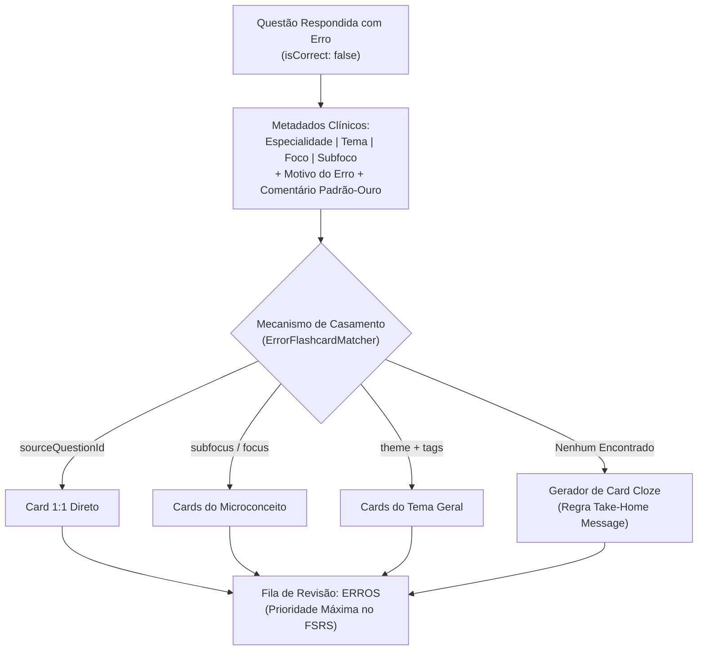

# Error-Flashcard Remediation — Motor de Remediação Ativa de Erros Médicos

> **Missão Primária:** Transformar cada erro do estudante em uma oportunidade cirúrgica de consolidação de memória de longo prazo. Vincular semanticamente as questões erradas no Banco de Questões aos flashcards atômicos (FSRS/Cloze) e materiais teóricos oficiais que tratam exatamente do conceito clínico, critério diagnóstico, posologia ou conduta cujo desconhecimento ou confusão causou o erro.

---

## 1. Princípios Fundamentais do Vínculo Erro-a-Card

1. **Ancoragem no Conceito, Não no Enunciado (Zero Spoiler):**
   - O flashcard de remediação **nunca** deve reproduzir o enunciado da prova ou perguntar *"Qual foi o gabarito da questão do ENARE 2024?"*.
   - O flashcard deve isolar a **regra de ouro clínica**, a **armadilha do distrator** ou o **ponto de corte decisório** (ex: *"Na Injúria Renal Aguda pré-renal, a fração de excreção de sódio (FeNa) típica é {{c1::< 1%}}"*).

2. **Granularidade Multinível Flexível:**
   - O estudante tem total liberdade para estudar seus erros na granularidade desejada:
     - **Subfoco:** Microconceito atômico (ex: *Classificação de KDIGO para IRA*).
     - **Foco:** Assunto clínico delimitado (ex: *Injúria Renal Aguda*).
     - **Tema (Padrão Oficial):** Domínio de estudo (ex: *Nefrologia*).
     - **Especialidade:** Grande área médica (ex: *Clínica Médica*).
   - O agrupamento padrão é sempre por **Tema**, com ordenação primária pela **menor taxa de acertos** (maior taxa de erros).

3. **Resolução de Fallback em Cascata:**
   Ao buscar flashcards para remediar os erros de um estudante, o motor deve executar a seguinte ordem de resolução:
   - **Nível 1 (Vínculo Direto):** Flashcards cujo campo `sourceQuestionId` corresponda exatamente ao ID da questão errada.
   - **Nível 2 (Subfoco Exato):** Flashcards com o mesmo `specialty`, `theme`, `focus` e `subfocus` da questão errada.
   - **Nível 3 (Foco Clínico):** Flashcards do mesmo `focus` com tags conceituais coincidentes com o Take-Home Message ou justificativa da banca.
   - **Nível 4 (Tema Macro - Fallback):** Flashcards marcados como `priority: 'essential'` dentro do `theme` correspondente.
   - **Nível 5 (Geração On-Demand):** Quando não houver card pré-existente no acervo cobrindo a lacuna, a IA deve gerar um card Cloze padrão-ouro em tempo de execução com a tag `#erro_remediado`.

---

## 2. Taxonomia e Modelo de Dados do Vínculo



### Contrato de Dados do Card de Remediação (`FlashcardItem`):
```typescript
interface RemediationFlashcardItem extends FlashcardItem {
  remediationMeta?: {
    sourceQuestionId: string;
    errorReason?: ErrorReasonType; // lacuna_teorica, desatencao, pegadinha...
    failedAttemptLetter?: string;
    correctAnswerLetter?: string;
    clinicalTrapExplanation?: string;
    matchedLevel: 'direct' | 'subfocus' | 'focus' | 'theme';
  };
}
```

---

## 3. Padrão-Ouro para Flashcards Gerados a Partir de Erros

Quando for necessário derivar novos flashcards a partir de questões erradas, deve-se obedecer rigorosamente às seguintes diretrizes:

1. **Formato Exclusivo: Cloze Deletion Atômico (`{{c1::...}}`):**
   - Omissão de apenas 1 fato clínico decisivo por cartão.
   - Evitar omissões longas que exijam parágrafos de memória.
   - Exemplo Correto:
     - Frente: *"Na cetoacidose diabética, o critério laboratorial de resolução requer glicemia < 200 mg/dL associada a bicarbonato sérico {{c1::≥ 18 mEq/L}} e pH venoso {{c1::> 7,30}}."*
     - Justificativa/Back: *"Diretriz SBD 2024. A infusão de insulina só deve ser transicionada para SC após atingir ambos os critérios de resolução."*
   - Exemplo Incorreto:
     - *"Explique a conduta completa na CAD."* (Amplo demais, anti-estudo espaçado).

2. **Neutralização de Vícios de Banca:**
   - O card deve focar na evidência médica oficial (SBC, CBC, SBP, Febrasgo, MS/PCDT), corrigindo a distorção cognitiva que levou o estudante a cair no distrator.
   - O campo `comment` deve destacar explicitamente:
     - **Conceito Chave:** O que sustenta o gabarito.
     - **Pegadinha da Banca:** Por que a alternativa marcada pelo aluno é clinicamente incorreta.

---

## 4. Integração Operacional com o Caderno de Erros

1. **Ao Clicar em "Flashcards Direcionados" na Linha do Tema:**
   - O sistema filtra instantaneamente todos os flashcards mapeados para as questões erradas daquele agrupamento.
   - Dispara a sessão de estudo com algoritmo FSRS priorizando estabilidade baixa (cards novos de remediação entram com intervalo curto).

2. **No Botão "Erros" na Aba de Flashcards (`/flashcards`):**
   - Localizado obrigatoriamente à **esquerda do botão "Essenciais"**.
   - Exibe a contagem ativa de cartões derivados de falhas não recuperadas.
   - Ao ativar o botão, isola visualmente apenas os baralhos que possuem questões erradas pendentes.

3. **Ciclo de Superação:**
   - Quando o estudante acerta repetidamente um flashcard de remediação (Estabilidade FSRS $> 21$ dias) ou acerta a questão no reteste do banco, o card transiciona de *Pendente de Remediação* para *Conceito Consolidado*.
