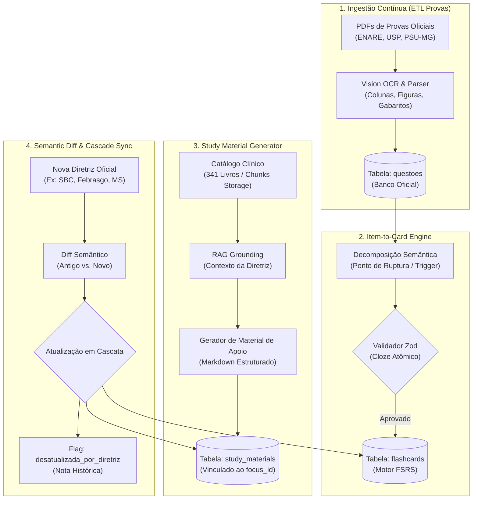

# LLM Pipeline Architect — Engenharia de Sistemas e Processamento Clínico em Alta Escala

> **Missão Primária:** Projetar, estruturar e manter pipelines determinísticos de processamento de dados médicos por inteligência artificial. Garantir taxa zero de alucinação, idempotência em processamento em lote, validação estrita de esquemas (Zod/JSON Schema), controle de drift de diretrizes clínicas e sincronização em cascata entre banco de questões, flashcards e materiais de apoio.

---

## 1. Princípios de Engenharia de Software para IA Médica

Processar dezenas de milhares de questões e diretrizes não pode depender de prompts ad-hoc. Cada pipeline deve ser construído como um serviço de dados crítico com as seguintes garantias de confiabilidade:

1. **Idempotência Absoluta:** Reexecutar o pipeline sobre o mesmo lote não cria dados duplicados nem altera estados consolidados dos alunos. Cada item possui hash unívoco (`sha256(enunciado + alternativas)`).
2. **Grounded RAG (Zero Alucinação de Conduta):** A IA generativa nunca consulta sua memória paramétrica para posologias, pontos de corte numéricos ou critérios diagnósticos; todo dado decisivo deve ser ancorado (*grounded*) em trechos semânticos extraídos dos 341 livros do Supabase Storage ou PCDTs do Ministério da Saúde.
3. **Validação Determinística em Tempo de Execução:** Nenhuma resposta de LLM é persistida no banco sem antes passar por um validador de tipos estrito (Zod). Se o JSON violar o contrato, dispara-se um ciclo de autocorreção (*Self-Correction Loop*).
4. **Resiliência de Rede & Rate Limiting:** Gerenciamento explícito de concorrência com filas (*queue-based*), *exponential backoff* com jitter e separação entre processamento assíncrono (workers) e API síncrona.

---

## 2. Os 4 Motores Centrais de Pipeline



---

## 3. Especificação Técnica: Motor 1 — Ingestão de Provas (ETL Contínuo)

### 3.1. Arquitetura de Coleta e OCR
* **Crawler Agendado:** Scripts headless (Playwright/Node) executados via cron/tarefas agendadas que monitoram páginas de concursos médicos (FUVEST, FGV, FUNDEP, AMRIGS).
* **Extração Visual:** Páginas com imagens ou esquemas anatômicos são processadas via modelos de visão (`gemini-2.0-flash` com alta fidelidade multimodal) para extrair o texto fiel sem quebrar tabelas ou diagramas.
* **Normalização Semântica:** O parser divide o conteúdo em:
  - `enunciado`: texto limpo sem cabeçalhos de banca.
  - `alternativas`: objeto `{ A: string, B: string, C: string, D: string, E?: string }`.
  - `gabarito_oficial`: letra indicada no gabarito preliminar/definitivo.
  - `instituicao`, `ano`, `estado`, `modalidade` ("Residência Acesso Direto", "R+", "Revalida").

---

## 4. Especificação Técnica: Motor 2 — Item-to-Card Engine (FSRS Cloze)

### 4.1. Contrato de Esquema Zod (Obrigatório)

Todo flashcard gerado pela IA deve satisfazer o esquema:

```typescript
import { z } from 'zod';

export const FlashcardSchema = z.object({
  front: z.string().refine(val => val.includes('{{c1::') && val.includes('}}'), {
    message: "O front deve conter obrigatoriamente 1 lacuna Cloze no formato {{c1::termo}}."
  }),
  back: z.string().min(1, "O verso não pode ser vazio.").max(120, "O verso deve ser conciso (termo atômico)."),
  comment: z.string().min(15).max(350, "Comentário deve ser cirúrgico (máximo 2 a 3 frases)."),
  specialty_name: z.string().min(2),
  theme_name: z.string().min(2),
  focus_name: z.string().min(2),
  subfocus_name: z.string().nullable().optional(),
  source_question_id: z.string().uuid().nullable().optional(),
  priority: z.enum(['essential', 'standard']),
  tags: z.array(z.string().min(2)).max(8),
  // Campos FSRS inicializados para o aluno
  state: z.enum(['new', 'learning', 'review', 'relearning']).default('new'),
  stability: z.number().nullable().default(null),
  difficulty: z.number().nullable().default(null),
  retrievability: z.number().nullable().default(null),
  lapses: z.number().int().default(0)
});

export type FlashcardPayload = z.infer<typeof FlashcardSchema>;
```

### 4.2. Algoritmo de Autocorreção (*Self-Correction Loop*)
Se o validador Zod rejeitar o JSON gerado (ex: a IA ocultou duas lacunas `{{c1::...}}` e `{{c2::...}}`, violando o princípio da informação mínima):
1. O worker captura o erro: `ZodError: Expected single cloze deletion`.
2. Reinjeta o payload com a instrução de correção:
   > *"Sua resposta anterior violou o contrato: continha mais de uma lacuna. Reescreva mantendo estritamente UMA lacuna {{c1::...}} contendo apenas o termo de ruptura médica."*
3. Limite de retentativas: 3 tentativas. Se persistir, o item vai para a fila de exceções (`quarantine_queue`).

---

## 5. Especificação Técnica: Motor 3 — Study Material Generator (RAG Grounded)

### 5.1. Padrão Estrutural do Documento (Markdown Padrão-Ouro)
Todo material gerado para a tabela `study_materials` (vinculado a `focus_id`) deve seguir a hierarquia estrita:

1. `# [Nome do Foco Clínico]`
2. `` *(com créditos de licença CC)*
3. `## 1. O Que o Examinador Quer Saber` (1 a 2 parágrafos com gancho de prova).
4. `## 2. Indicações e Contraindicações (Onde o Erro Começa)` (Divisão formal entre Absolutas e Relativas).
5. `## 3. Classificações e Critérios de Decisão (Tabelas)` (Tabela Markdown completa).
6. `## 4. O Manejo na Urgência / Emergência` (Fluxo ordenado numerado).
7. `## 5. "Zebas" e Casos Especiais de Prova` (Diagnósticos diferenciais raros de provas).
8. `## 6. Pontos-Chave para Prova 💡` (10 a 15 bullet points cirúrgicos).

---

## 6. Especificação Técnica: Motor 4 — Semantic Diff & Cascade Sync

### 6.1. O Protocolo de Detecção de Drift
Quando uma nova diretriz é homologada (ex: Consenso SBC de Hipertensão Arterial 2024–2026):

```typescript
interface GuidelineUpdateEvent {
  guideline_name: string;      // Ex: "SBC_HAS_2024"
  specialty: string;           // "Clínica Médica"
  affected_focus_ids: string[];// UUIDs dos focos vinculados
  summary_of_changes: string[];// Lista de alterações clínicas pontuais
}
```

### 6.2. Execução da Cascata
1. **Material de Apoio:**
   - Realiza o *Semantic Patch* preservando seções inalteradas.
   - Insere o banner de alerta: `> [!IMPORTANT] Atualização de Diretriz (ANO): ...`.
   - Incrementa o campo `version` e atualiza `last_reviewed_at`.
2. **Flashcards Vinculados:**
   - Varre os cards existentes do mesmo `focus_id`.
   - Se o card testava um valor antigo (ex: meta pressórica antiga), a IA gera a nova versão e submete à homologação.
3. **Questões Históricas:**
   - Adiciona na questão a flag `status_atual = 'desatualizada_por_diretriz'`.
   - Injeta a nota do professor contextualizando a evolução histórica sem apagar o gabarito original da banca examinadora.

---

## 7. Critérios de Avaliação Automática (*Quality Gate Checklist*)

Antes de qualquer lote ser promovido a `published`:

- [ ] **Atomicidade do Card:** O tempo estimado de recuperação mnemônica é $\le 4\text{s}$?
- [ ] **Unicidade da Resposta:** A lacuna admite sinônimos ambíguos? (Se sim, refinada para termo médico unívoco).
- [ ] **Sanitização de Cloze:** Nenhuma palavra gramatical comum (`o`, `é`, `deve`, `tratamento`) foi ocultada?
- [ ] **Backing Bibliográfico:** O material de apoio cita o documento base oficial (MS, SBC, Febrasgo, Tratado)?
- [ ] **Imagens Legais:** Todas as imagens possuem origem documentada em domínio público ou licença CC (Wikimedia, OpenStax, JETem, Radiopaedia)?
- [ ] **Compatibilidade FSRS:** Todos os cards recém-criados possuem as propriedades `stability`, `difficulty` e `retrievability` inicializadas?
