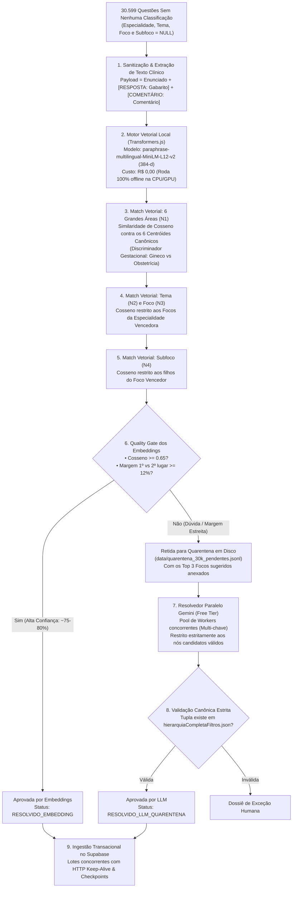

# 📘 Guia Mestre Operacional: Pipeline de Categorização Taxonômica (Novas Questões)
## Plataforma Banco Residência Médica — Engenharia de Dados & Inteligência Artificial
### Manual de Execução para Desenvolvedores: Embeddings Locais + Quarentena LLM Multi-Worker

---

## 📌 1. Visão Geral & Escopo do Projeto

Este documento consolida a arquitetura completa, especificações clínicas, modelos matemáticos e comandos operacionais para a **categorização taxonômica integral** das questões sem nenhuma classificação prévia no acervo do **Banco Residência**.

### O Desafio
Na base de produção do Supabase, existem exatamente **30.599 questões ativas** que foram ingeridas sem metadados taxonômicos (com `especialidade`, `tema`, `foco` e `subfoco` iguais a `NULL`):

| Tabela no Supabase | Total de Questões | Questões sem Classificação | Percentual do Lote |
| :--- | :---: | :---: | :---: |
| **`questions_direto`** | 206.599 | **28.945** | 94,6% |
| **`questions_rplus`** | 45.413 | **1.604** | 5,2% |
| **`questions_revalida`** | 4.411 | **50** | 0,2% |
| **`questions_titulo`** | 688 | **0** | 0,0% |
| **TOTAL CONSOLIDADO** | **257.111** | **30.599** | **100,0%** |

O objetivo deste pipeline é classificar **100% dessas 30.599 questões** na árvore taxonômica canônica, sem alucinações, sem criar nós inexistentes e com auditoria ponta a ponta.

---

## 🌲 2. A Árvore Canônica Oficial (Fonte Única da Verdade)

A taxonomia oficial da plataforma é governada pelo arquivo versionado no Git:
👉 [`src/data/hierarquiaCompletaFiltros.json`](file:///c:/bancoresidencia/bancoresidencia/src/data/hierarquiaCompletaFiltros.json)

A estrutura é fechada em **4 a 5 níveis hierárquicos**:
$$\text{Especialidade (N1)} \longrightarrow \text{Tema (N2)} \longrightarrow \text{Foco (N3)} \longrightarrow \text{Subfoco (N4)} \longrightarrow \text{Sub-subfoco (N5)}$$

### As 6 Grandes Áreas Canônicas ($N_1$):
Na plataforma, **Ginecologia** e **Obstetrícia** são rigorosamente separadas em duas especialidades independentes:

1. **Clínica Médica** (16 Temas, 95 Focos, 193 Subfocos)
2. **Cirurgia Geral** (14 Temas, 91 Focos, 190 Subfocos)
3. **Ginecologia** (13 Temas, 55 Focos, 110 Subfocos) — *Afecções ginecológicas, SUA, DIP, mastologia, oncologia pélvica, etc.*
4. **Obstetrícia** (11 Temas, 53 Focos, 106 Subfocos) — *Ciclo gravídico-puerperal, pré-natal, partograma, DHEG, DPP, etc.*
5. **Pediatria** (14 Temas, 88 Focos, 176 Subfocos)
6. **Medicina Preventiva e Social** (11 Temas, 53 Focos, 106 Subfocos)

> **Total da Árvore:** Rigorosamente **6 Especialidades**, **79 Temas**, **435 Focos** e **881 Subfocos**.

---

## ⚙️ 3. Arquitetura da Solução em 2 Fases



---

## 🚀 4. Guia de Configuração e Execução para o Desenvolvedor

### Passo 1: Pré-requisitos
* **Node.js** v20 ou superior.
* Acesso à internet na 1ª execução para baixar as dependências e o modelo local do HuggingFace (~120 MB).

### Passo 2: Instalação das Dependências
Na raiz do projeto clonado:
```bash
npm install
```

### Passo 3: Configurar o Arquivo `.env.local`
Crie ou edite o arquivo `.env.local` na raiz do projeto com as chaves necessárias:

```ini
# Conexão com o Supabase de Produção/Staging
NEXT_PUBLIC_SUPABASE_URL=https://xxxxxxxxxxxxxxxx.supabase.co
SUPABASE_SERVICE_ROLE_KEY=eyJh...sua_service_role_key...

# Pool de Chaves Gemini (Free Tier do Google AI Studio - Custo R$ 0,00)
# Você pode colocar de 1 a N chaves para rodar com paralelismo proporcional:
GEMINI_API_KEY_1=AIzaSy...
GEMINI_API_KEY_2=AIzaSy...
GEMINI_API_KEY_3=AIzaSy...
```

---

## 🛠️ 5. Roteiro de Execução Passo a Passo

### Etapa 1: Auditoria Inicial (Modo Leitura)
Antes de processar qualquer questão, rode a auditoria para confirmar os números no Supabase:
```bash
node scripts/auditoria_taxonomia_supabase.mjs
```
*O console exibirá exatamente os 30.599 registros nulos.*

---

### Etapa 2: Simulação da Fase 1 — Embeddings (`--dry-run`)
Teste a classificação vetorial em um lote de amostra sem alterar nada no banco:
```bash
node scripts/pipeline_classify_expansion_supabase.mjs --table questions_direto --limit 100
```
*Valide se as questões foram alocadas corretamente nas 6 grandes áreas.*

---

### Etapa 3: Executar a Fase 1 Completa (Embeddings no Supabase)
Para classificar o lote principal com gravação ativa e streaming automático dos casos ambíguos para quarentena:

```bash
# 1. Processar Acesso Direto (28.945 questões)
node scripts/pipeline_classify_expansion_supabase.mjs --table questions_direto

# 2. Processar R+ Especialidades (1.604 questões)
node scripts/pipeline_classify_expansion_supabase.mjs --table questions_rplus

# 3. Processar Revalida (50 questões)
node scripts/pipeline_classify_expansion_supabase.mjs --table questions_revalida
```

* **Comportamento Automático:**
  * O script processa cerca de **1.000 a 1.500 questões por minuto**.
  * Cria checkpoints automáticos (`data/checkpoint_<tabela>.json`). Se a internet cair, basta reexecutar o mesmo comando que ele retoma do ponto exato onde parou.
  * As questões com margem estreita são salvas em `data/quarentena_<tabela>.jsonl`.

---

### Etapa 4: Executar a Fase 2 (Resolução da Quarentena com Gemini LLM)
Para resolver as questões que foram retidas na quarentena por dúvida médica entre focos vizinhos:

```bash
# Executa os workers Gemini paralelos (0 Custo no Free Tier)
node scripts/resolver_quarentena_llm_free.mjs --execute
```

* **Destaques:**
  * Com 5 chaves a 14 RPM em lotes de 5, o resolvedor atinge até **350 questões por minuto**.
  * Cada resposta é validada contra o catálogo antes de ser aceita.

---

### Etapa 5: Auditoria Final de Homologação
Após finalizar as duas fases, rode novamente a auditoria de conferência:
```bash
node scripts/auditoria_taxonomia_supabase.mjs
```

**Critério de Sucesso (Definition of Done):**
- [x] Total de Nulos em `especialidade`, `tema`, `foco` e `subfoco` = **0**.
- [x] Nenhuma questão com tema ou foco genérico "Geral".
- [x] 100% dos nós pertencentes estritamente à árvore oficial.

---

## 🔒 6. Invariantes de Segurança Médica & Qualidade

1. **Blindagem de Distratores:** As alternativas incorretas têm peso zero na pontuação para evitar viés de pegadinha.
2. **Proibição de Nós Fantasmas:** O motor nunca cria sufixos como `: Diagnóstico e Conduta`.
3. **Anti-Duplicação:** Subfoco $\neq$ Foco.
4. **Isolamento de Erros:** Caso ocorra falha de rede em um registro, a transação daquele registro sofre rollback sem interromper o lote.

---

## 📞 Contato & Suporte
Dúvidas técnicas ou necessidade de regeneração de chaves do pool: consulte a documentação técnica em `docs/` ou abra uma issue interna no repositório.
