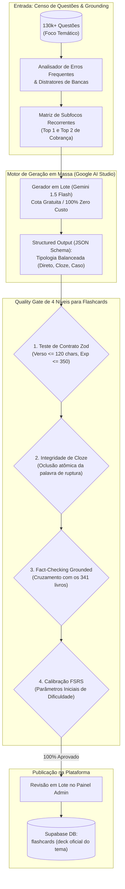

# Plano Mestre Canônico: Engenharia, Produção em Massa e Calibração de Flashcards Multimodais (FSRS)

> **Documento Estratégico & Arquitetura de Produção em Escala**  
> **Plataforma:** Banco Residência  
> **Versão:** 2.7.0 — Padrão-Ouro Canônico de Design & UX Médica  
> **Módulo:** Acervo Multimodal de Flashcards & Algoritmo de Repetição Espaçada FSRS  
> **Escopo:** Produção em escala de 15.000 a 24.000 flashcards médicos de alto rendimento cobrindo 300+ temas da residência médica, dimensionamento dinâmico (25 a 100 cards por foco), tipologia multimodal balanceada, limites estritos de caracteres (Zod contract), geração em lote a custo zero via Google AI Studio Free Tier (Gemini 1.5 Flash), validação psicométrica FSRS e curadoria administrativa antes da publicação.

---

## 1. Diretriz Estratégica: Acervo Oficial Curado vs. Cartões de Alunos

Os flashcards da plataforma Banco Residência formam um **acervo canônico de referência nacional**. Eles não dependem da digitação ou formulação dos estudantes:

### Vantagens do Acervo Oficial Canônico:
1. **Engenharia Reversa de Provas:** Cada cartão é derivado diretamente dos distratores mais assinalados e das pegadinhas reais observadas no banco de 130k+ questões.
2. **Qualidade Atômica Garantida:** Nenhuma pergunta ambígua, nenhum verso prolixo com parágrafos densos e zero alucinação em dosagens de emergência.
3. **Economia Absoluta com o Motor Híbrido:** A geração em massa de milhares de flashcards é roteada para o **Google AI Studio (Gemini 1.5 Flash na cota gratuita)**. Isso significa que **zero centavos dos \$300 de crédito do Google Cloud são consumidos por cartões**, reservando o saldo do GCP para tarefas nobres de raciocínio clínico.

---

## 2. Visão Geral da Arquitetura do Pipeline de Flashcards



---

## 3. Matriz de Dimensionamento por Porte de Foco

O número de cartões por tema é calculado automaticamente a partir do censo de questões daquele foco no banco Supabase:

| Porte do Foco | Volume de Questões no Banco | Quantidade de Cards Canônicos | Estratégia Pedagógica |
| :--- | :--- | :--- | :--- |
| **Pequeno / Específico** | $< 150$ questões | **25 a 35 flashcards** | Foco em critérios diagnósticos e condutas imediatas de primeira escolha. |
| **Médio / Recorrente** | $150$ a $400$ questões | **40 a 60 flashcards** | Cobertura de diagnóstico diferencial, doses de ataque/manutenção e critérios de gravidade. |
| **Grande / Macro-Tema** | $> 400$ questões (ex: HPP, Apendicite, HAS, DM) | **70 a 100 flashcards** | Cobertura integral: epidemiologia de prova, estadiamentos, manejo clínico escalonado, controle cirúrgico de danos e profilaxias. |

---

## 4. Tipologia Multimodal Balanceada

Os decks de flashcards não utilizam um único formato monótono. Cada deck de 50 cartões segue a seguinte distribuição obrigatória:

### 1. Perguntas Diretas de Resposta Rápida (40%)
* **Foco:** Drogas de primeira linha, doses clássicas de prova e contraindicações absolutas.
* **Exemplo Frente:** *Qual é a droga de primeira escolha para profilaxia de atonia uterina no 3º período e sua via de administração?*
* **Exemplo Verso (máx. 120 chars):** *Ocitocina 10 UI Intramuscular (IM) logo após o desprendimento do ombro anterior ou saída do feto.*

### 2. Cloze Deletion Atômico Sanitizado (40%)
* **Regra Canônica de Oclusão:** Apenas a **palavra ou valor de ruptura clínica** deve ser ocultada com `{{c1::termo}}`. Proibido ocultar frases inteiras ou termos contextuais neutros.
* **Exemplo Frente:** *No choque hemorrágico obstétrico, um Índice de Choque (FC/PAS) maior ou igual a {{c1::0,9 a 1,0}} indica sangramento oculto grave e acionamento imediato do banco de sangue.*
* **Exemplo Verso:** *$\ge 0,9 \text{ a } 1,0$ (prediz instabilidade hemodinâmica incipiente).*

### 3. Mini-Casos de Pronto-Socorro / Beira do Leito (10%)
* **Foco:** Decisão rápida sob pressão (cenários típicos das bancas ENARE, USP e PSU-MG).
* **Exemplo Frente:** *Puérpera há 40 min de parto normal evolui com sangramento vaginal profuso e útero amolecido acima da cicatriz umbilical. Após massagem e ocitocina sem resposta, qual a próxima intervenção mecânica conservadora?*
* **Exemplo Verso:** *Tamponamento intrauterino com Balão de Bakri (manter por 12-24h se teste positivo).*

### 4. Exames Reais com Oclusão de Imagem (10%)
* **Diretriz Estrita Anti-SVG Artificial:** **Zero retângulos gerados por código ou diagramas sintéticos.**
* As imagens de exames devem ser exclusivamente **exames médicos reais autênticos** (radiografias, tomografias, ECGs com arritmias, dermatoscopias, exames de sedimento urinário) licenciados sob Creative Commons (Wikimedia Commons, Radiopaedia, OpenStax, JETem).

---

## 5. Contrato de Dados Estrito (Zod Schema)

Todos os cartões gerados pelo pipeline são submetidos à validação estrita de contrato:

```typescript
import { z } from 'zod';

export const FlashcardContractSchema = z.object({
  type: z.enum(['direct', 'cloze', 'clinical_case', 'image_occlusion']),
  front: z.string().min(10).max(400),
  // Limite rígido canônico: verso cirúrgico e sem parágrafos
  back: z.string().min(2).max(120),
  // Comentário explicativo com a justificativa da diretriz oficial
  explanation: z.string().min(10).max(350),
  difficulty: z.enum(['facil', 'medio', 'dificil']),
  subtopic: z.string().min(3).max(60),
  sourceGuideline: z.string().max(100).optional(),
  imageUrl: z.string().url().optional()
});
```

---

## 6. Integração Psicométrica com o Algoritmo FSRS

O Banco Residência utiliza o algoritmo de repetição espaçada moderno **FSRS (Free Spaced Repetition Scheduler)** em substituição ao clássico SM-2 (Anki antigo):

1. **Retenção Alvo (Request Retention):** Configurada para **$R = 0.90$** (90% de probabilidade de acerto na prova).
2. **Classificação Inicial de Dificuldade ($D_0$):**
   * *Cartões Fáceis:* Dificuldade inicial calibrada em $D = 3.0$.
   * *Cartões Médios:* Dificuldade inicial calibrada em $D = 5.0$.
   * *Cartões Difíceis / Pegadinhas:* Dificuldade inicial calibrada em $D = 7.5$.
3. **Evolução de Estabilidade ($S$):** O intervalo entre as revisões expande exponencialmente à medida que o estudante acerta sem hesitação, reduzindo revisões desnecessárias e concentrando o tempo nos pontos fracos.

---

## 7. Roteiro de Produção em Escala (15.000 a 24.000 Cards)

Com o pipeline integrado na rota `/api/ai/study-generator`:

* **Custo de IA para 20.000 flashcards:** **\$0,00 (Zero)** através das cotas diárias do Google AI Studio.
* **Tempo de Máquina:** ~3 segundos por lote de 50 cards.
* **Volume por Especialidade:**
  * Ginecologia & Obstetrícia (60 temas): ~3.600 flashcards.
  * Cirurgia Geral & Trauma (65 temas): ~4.000 flashcards.
  * Pediatria & Neonatologia (55 temas): ~3.300 flashcards.
  * Clínica Médica & Preventiva (100 temas): ~6.500 flashcards.
* **Resultado:** O maior e mais qualificado deck nacional de flashcards de residência médica, 100% auditado por diretrizes oficiais e calibrado por FSRS.

---
*Plano Mestre de Flashcards Multimodais (FSRS) homologado para o Banco Residência.*
