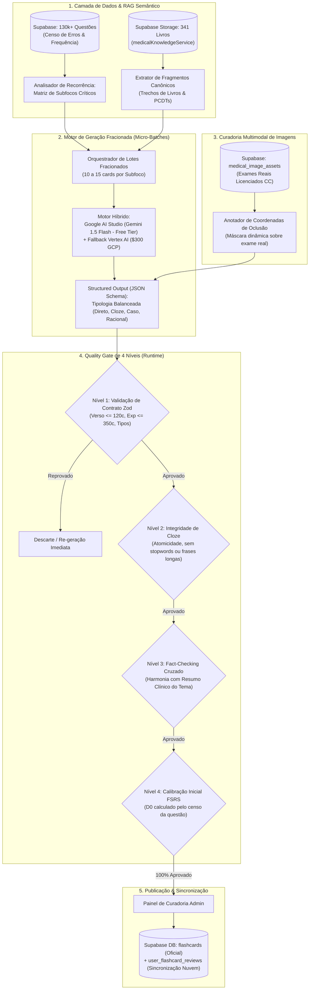
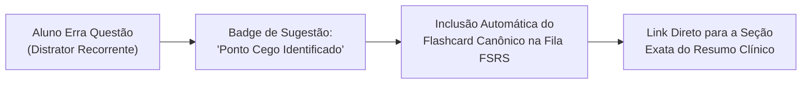

# Plano Mestre Canônico: Engenharia, Produção em Escala e Motor Psicométrico de Flashcards Multimodais (FSRS v5)

> **Documento Estratégico & Arquitetura de Produção em Escala**  
> **Plataforma:** Banco Residência  
> **Versão:** 3.0.0 — Padrão-Ouro Canônico Transversal (Todas as Especialidades & Resumos)  
> **Módulo:** Acervo Multimodal de Flashcards & Algoritmo de Repetição Espaçada FSRS v5  
> **Escopo:** Produção e manutenção em escala de 15.000 a 24.000 flashcards médicos de alto rendimento cobrindo 300+ temas da residência médica em **todas as grandes áreas** (Clínica Médica, Cirurgia Geral, Pediatria, Ginecologia & Obstetrícia, Medicina Preventiva e Especialidades R-Plus), dimensionamento dinâmico baseado em censo real de 130k+ questões, tipologia balanceada com atomicidade mínima estrita, grounding bibliográfico obrigatório nos 341 livros oficiais, catálogo multimodal de exames reais, Quality Gate de 4 níveis com Zod em runtime e sincronização em nuvem via Supabase.

---

## 1. Diretriz Estratégica: Acervo Oficial Curado vs. Cartões de Alunos

Os flashcards da plataforma Banco Residência constituem um **acervo canônico de referência nacional**. Eles não dependem da formulação amadora ou digitação manual dos estudantes:

### Vantagens do Acervo Oficial Canônico:
1. **Engenharia Reversa de Bancas:** Cada cartão é derivado diretamente dos distratores mais assinalados, armadilhas clássicas e estatísticas reais de cobrança observadas no banco de 130k+ questões (ENARE, USP, UNICAMP, PSU-MG, SUS-SP, UERJ, AMRIGS).
2. **Atomicidade Mínima Garantida:** Nenhuma pergunta ambígua, nenhum verso enciclopédico e zero oclusões prolixas de frases inteiras. Cada cartão avalia um único bit cognitivo de informação médica.
3. **Grounding Obrigatório nos 341 Livros:** Nenhuma dosagem de emergência, critério diagnóstico ou escore de risco é gerado por memória paramétrica solta. Todos os lotes recebem os fragmentos oficiais dos livros de referência via `medicalKnowledgeService`.
4. **Conexão Reativa Bidirecional:** Errou uma questão no simulado ou caderno de provas $\rightarrow$ o sistema sugere instantaneamente o flashcard correspondente daquele subfoco para o ciclo FSRS de hoje.

---

## 2. Visão Geral da Arquitetura do Pipeline Transversal de Flashcards



---

## 3. Matriz de Dimensionamento Universal por Volume de Questões

O número de cartões por foco é calculado dinamicamente com base no censo real de questões daquele foco no banco Supabase, garantindo cobertura proporcional em **todas as 5 grandes especialidades**:

| Porte do Foco | Volume de Questões no Banco | Quantidade de Cards Canônicos | Estratégia Pedagógica e Exemplos |
| :--- | :--- | :--- | :--- |
| **Pequeno / Específico** | $< 150$ questões | **25 a 35 flashcards** | Foco em critérios diagnósticos inequívocos e condutas imediatas de primeira escolha.<br>*Exemplos:* Doença de Kawasaki (Pediatria), Síndrome Nefrítica (Clínica), Hérnia Femoral (Cirurgia), Sífilis Congênita (Preventiva), Pólipo Endometrial (Ginecologia). |
| **Médio / Recorrente** | $150$ a $400$ questões | **40 a 60 flashcards** | Diagnóstico diferencial, esquemas farmacológicos de ataque e manutenção, critérios de gravidade e estadiamentos.<br>*Exemplos:* Cetoacidose Diabética (Clínica), Apendicite Aguda (Cirurgia), Bronquiolite Viral Aguda (Pediatria), Pré-Eclâmpsia (GO), Calendário Vacinal PNI (Preventiva). |
| **Grande / Macro-Tema** | $> 400$ questões | **70 a 100 flashcards** | Cobertura integral: epidemiologia de prova, estadiamentos, manejo clínico escalonado, controle de danos e profilaxias.<br>*Exemplos:* Síndrome Coronariana Aguda (Clínica), Trauma Abdominal/ATLS (Cirurgia), Asma & Pneumonias (Pediatria), Hemorragia Pós-Parto (GO), Estudos Epidemiológicos & Bioestatística (Preventiva). |

---

## 4. Tipologia Psicométrica Balanceada & Princípio da Atomicidade Mínima

Para evitar a fadiga cognitiva e treinar diferentes vias de recuperação neural, cada lote de flashcards segue a seguinte distribuição obrigatória:

```
Distribuição Canônica por Deck:
┌────────────────────────────────────────────────────────┐
│ [████████████████] 40% Perguntas Diretas Atômicas     │
│ [████████████    ] 30% Cloze Deletion Sanitizado       │
│ [██████          ] 15% Mini-Casos de Beira de Leito    │
│ [████            ] 10% Exames Reais com Oclusão        │
│ [██              ]  5% Racional / Fisiopatologia       │
└────────────────────────────────────────────────────────┘
```

### 1. Perguntas Diretas Atômicas (40%)
* **Foco:** Primeira linha terapêutica, conduta diagnóstica inicial e contraindicações absolutas.
* **Regra de Ouro:** Apenas 1 dado testado. Proibido perguntar "quais são os 5 sinais e as 3 drogas".
* **Exemplos por Especialidade:**
  * *Clínica Médica:* "Qual é a meta de pressão arterial alvo segundo a diretriz brasileira para hipertenso diabético de alto risco?" $\rightarrow$ **Verso:** `< 130/80 mmHg (PA sistólica entre 120-129 mmHg).`
  * *Cirurgia Geral:* "Qual é a conduta diagnóstica imediata diante de suspeita clínica inequívoca de pneumotórax hipertensivo?" $\rightarrow$ **Verso:** `Toracocentese descompressiva imediata no 4º ou 5º EIC (não aguardar radiografia).`
  * *Pediatria:* "Qual o antibiótico de primeira linha e dose recomendada para Otite Média Aguda bacteriana sem fatores de resistência?" $\rightarrow$ **Verso:** `Amoxicilina 50 mg/kg/dia dividida em 2 a 3 doses por 10 dias.`

### 2. Cloze Deletion Sanitizado Estrito (30%)
* **Regra de Ouro da Atomicidade:** Apenas a **palavra ou valor de ruptura clínica** deve ser ocultada com `{{c1::termo}}`.
* **Proibições Rígidas:** Proibido ocultar frases inteiras (> 5 palavras), palavras de ligação (*o, de, em, para*) ou informações triviais.
* **Exemplos por Especialidade:**
  * *Ginecologia & Obstetrícia:* "No choque hemorrágico obstétrico, um Índice de Choque (FC/PAS) maior ou igual a {{c1::0,9}} indica sangramento oculto grave e acionamento de protocolo de transfusão." $\rightarrow$ **Verso:** `≥ 0,9 (alerta para choque hipovolêmico incipiente).`
  * *Medicina Preventiva:* "Em um teste diagnóstico, a capacidade de identificar corretamente os verdadeiros negativos entre os sadios define a {{c1::Especificidade}}." $\rightarrow$ **Verso:** `Especificidade (taxa de verdadeiros-negativos).`

### 3. Mini-Casos de Beira de Leito / Raciocínio Sob Pressão (15%)
* **Foco:** Decisão rápida baseada em vinheta clínica real (estilo ENARE, USP, UNIFESP, PSU-MG).
* **Estrutura:** Paciente + Sinais Vitais + Achado de Ruptura + Pergunta Direta de Conduta.
* **Exemplo (Clínica/Urgência):** "Homem de 62 anos dá entrada com dor torácica opressiva iniciada há 40 min. ECG revela supra de ST de 2,5 mm em DII, DIII e aVF. O hospital não dispõe de hemodinâmica e o tempo estimado de transferência é de 150 min. Qual a conduta de reperfusão imediata?" $\rightarrow$ **Verso:** `Fibrinólise imediata com trombolítico (tempo porta-agulha ≤ 30 minutos).`

### 4. Exames Reais com Oclusão de Imagem (10%)
* **Diretriz Estrita Anti-Alucinação:** Proibido instruir o LLM a "gerar URLs da internet".
* **Pipeline de Ativos Homologados:** As imagens provêm exclusivamente da tabela `medical_image_assets` (Supabase Storage), contendo exames autênticos (ECG, radiografias, tomografias, dermatoscopias, líquor, urina) sob licença Creative Commons / Domínio Público (Radiopaedia, OpenStax, Wikimedia Commons, JETem).
* **Atuação da IA:** O LLM recebe a imagem homologada e gera as coordenadas da máscara de oclusão e o raciocínio.
* **Exemplo (Cardiologia/Cirurgia):** Máscara cobrindo o alargamento de mediastino em radiografia de tórax após trauma automobilístico de alta energia $\rightarrow$ Pergunta: "Qual lesão cardiovascular deve ser urgentemente pesquisada por angio-TC?" $\rightarrow$ **Verso:** `Dissecção ou rotura traumática de aorta torácica.`

### 5. Racional Fisiopatológico & Farmacodinâmica (5%)
* **Foco:** O "Porquê" das condutas mais cobradas em provas, consolidando a memória de longo prazo.
* **Exemplo (Ginecologia/Clínica):** "Por que o uso de betabloqueadores isolados é formalmente contraindicado no manejo da crise hipertensiva induzida por feocromocitoma ou cocaína?" $\rightarrow$ **Verso:** `Provoca estimulação alfa-adrenérgica despolarizada sem oposição, agravando a vasoconstrição e a hipertensão.`

---

## 5. Contrato de Dados Estrito (Zod Schema em Runtime)

Todos os cartões gerados pelo pipeline são validados em tempo real no servidor antes de qualquer gravação:

```typescript
import { z } from 'zod';

export const FlashcardContractSchema = z.object({
  id: z.string().regex(/^card-[a-z0-9-]+$/),
  type: z.enum(['direct', 'cloze', 'clinical_case', 'image_occlusion', 'mechanism']),
  front: z.string().min(10).max(400),
  // Limite rígido canônico: verso cirúrgico sem parágrafos densos
  back: z.string().min(2).max(120),
  // Comentário explicativo com justificativa de diretriz e armadilha de prova
  comment: z.string().min(20).max(350),
  difficulty: z.enum(['facil', 'medio', 'dificil']),
  specialty: z.string().min(3),
  theme: z.string().min(3),
  focus: z.string().min(3),
  subfocus: z.string().min(3),
  priority: z.enum(['essential', 'standard']),
  tags: z.array(z.string()).min(2),
  sourceGuideline: z.string().max(100).optional(),
  // Campos multimodais opcionais ancorados em ativos reais
  assetId: z.string().optional(),
  imageUrl: z.string().url().optional(),
  maskCoordinates: z.object({
    x: z.number(),
    y: z.number(),
    width: z.number(),
    height: z.number()
  }).optional()
});

export type FlashcardContract = z.infer<typeof FlashcardContractSchema>;
```

---

## 6. O Motor Psicométrico FSRS v5 (Free Spaced Repetition Scheduler)

A plataforma Banco Residência adota a formulação matemática oficial do **FSRS-5** (substituindo em definitivo o legado do SM-2).

### 6.1. Variáveis de Estado Cognitivo
Para cada flashcard no histórico do estudante, o motor calcula e persiste:
1. **$R \in [0, 1]$ (Retrievability):** A probabilidade instantânea de o estudante recordar a resposta hoje.
2. **$S$ (Stability):** O intervalo de tempo (em dias) necessário para que a retenção $R$ decaia de 100% para a retenção-alvo (ex: 90%).
3. **$D \in [1, 10]$ (Difficulty):** A dificuldade inerente do conceito médico.
4. **$t$ (Elapsed Days):** Tempo decorrido desde a última revisão do cartão.

### 6.2. Curva de Decaimento de Retrievability (Power Law)
Diferente da curva exponencial ingênua do SM-2, o FSRS utiliza a lei de potência empiricamente validada em milhões de repetições:
$$R(t) = \left(1 + \text{FACTOR} \cdot \frac{t}{S}\right)^{\text{DECAY}}$$

Onde $\text{FACTOR} = \frac{19}{81}$ e $\text{DECAY} = -0.5$.

### 6.3. As 4 Notas de Avaliação do Estudante
* **1 - De Novo (Again):** Erro completo ou lapso grave $\rightarrow$ O cartão entra em `relearning` e a estabilidade sofre reset controlado (sem o "Ease Hell" do SM-2).
* **2 - Difícil (Hard):** Resposta correta com hesitação acentuada $\rightarrow$ Aumento discreto de estabilidade, elevação de dificuldade.
* **3 - Bom (Good):** Resposta correta com tempo padrão de raciocínio $\rightarrow$ Crescimento ótimo de estabilidade.
* **4 - Fácil (Easy):** Resposta imediata e segura $\rightarrow$ Salto exponencial de estabilidade e redução de dificuldade.

### 6.4. Retenção-Alvo Otimizada para Residência Médica
* Configurada para **$R_{\text{target}} = 0.90$ (90%)**.
* Garante que o estudante chegue ao dia da prova com 90% de probabilidade matemática de acerto em qualquer questão do acervo revisado, com custo de tempo de estudo 3,4 vezes menor que a revisão tradicional aleatória.

---

## 7. Engenharia de Produção em Escala: Resolução de Gargalos Técnicos

Para superar os limites de requisição (*Rate Limits*) e prevenir saturação de contexto ou timeouts na rota da API:

### 7.1. Geração em Micro-Lotes Fracionados (Micro-Batches)
* **Proibição:** É estritamente proibido solicitar mais de 20 flashcards em um único prompt de LLM.
* **Execução:** O motor divide a meta de cartões do tema (ex: 60 cards) em **4 micro-lotes de 15 cards**, cada um focado em um subfoco específico do censo com seus respectivos fragmentos de livros:
  * Lote A: Definições e Diagnóstico (15 cards)
  * Lote B: Manejo Clínico e Medicamentoso (15 cards)
  * Lote C: Condutas de Emergência e Cirúrgicas (15 cards)
  * Lote D: Complicações e Profilaxias (15 cards)

### 7.2. Estratégia de Rate-Limiting e Backoff Exponencial
* **Provedor Primário:** Google AI Studio (Gemini 1.5 Flash - Free Tier) respeitando o teto de 15 requisições por minuto através de fila com espaçamento de 4 segundos entre micro-lotes.
* **Fallback Automático:** Caso o AI Studio retorne status HTTP 429 ou 503, o pipeline faz failover transparente para o **Google Cloud Vertex AI** (Gemini 1.5 Flash na cota paga dos \$300 de crédito), aplicando jitter aleatório de 1 a 3 segundos.

### 7.3. Desacoplamento da Geração e Timeout
* As rotas de geração pesada utilizam arquitetura assíncrona ou *Server-Sent Events (SSE)* / Background Tasks, impedindo que a rota Next.js atinja o limite de execução de 60 segundos (`maxDuration`).

---

## 8. Quality Gate Automatizado de 4 Níveis

Nenhum flashcard é inserido no banco sem aprovação em 100% dos testes:

```
┌─────────────────────────────────────────────────────────────────┐
│                     QUALITY GATE DE 4 NÍVEIS                    │
├─────────────────────────────────────────────────────────────────┤
│ Nível 1: Validação de Contrato Zod (Tipagem, 120c/350c)         │
│ Nível 2: Integridade de Cloze (Atomicidade, sem stopwords)      │
│ Nível 3: Fact-Checking Grounded (Convergência com Resumo)       │
│ Nível 4: Psiconomia FSRS (Parâmetros D0 e R0 calibrados)        │
└─────────────────────────────────────────────────────────────────┘
```

1. **Nível 1 - Contrato Zod:** Bloqueio estrito de versos $> 120$ caracteres e comentários fora da faixa 20-350 caracteres.
2. **Nível 2 - Integridade de Cloze:** Verificação sintática via regex:
   * Rejeita se o termo ocultado for apenas stopword (*"o", "a", "de", "em"*).
   * Rejeita se o termo ocultado tiver mais de 5 palavras.
   * Rejeita se o campo `front` do tipo `cloze` não contiver a tag `{{c1::...}}`.
3. **Nível 3 - Fact-Checking de Consistência:** Cruzamento semântico entre os flashcards gerados e o **Resumo Clínico Canônico** correspondente, garantindo que não existam contradições em valores de corte ou drogas de primeira linha.
4. **Nível 4 - Calibração FSRS Inicial ($D_0$):**
   * Se o subfoco teve índice de acerto $\ge 80\%$ no censo de questões $\rightarrow$ `difficulty` inicial = $3.0$ (Fácil).
   * Se o subfoco teve acerto entre $50\%$ e $79\%$ $\rightarrow$ `difficulty` inicial = $5.0$ (Médio).
   * Se o subfoco teve acerto $< 50\%$ (pegadinha clássica) $\rightarrow$ `difficulty` inicial = $7.5$ (Difícil).

---

## 9. Persistência e Sincronização em Nuvem (Supabase + Local-First)

Para garantir que o estudante nunca perca seu progresso ao alternar entre o computador de estudo e o celular no plantão:

### 9.1. Tabela Relacional `user_flashcard_reviews`
```sql
CREATE TABLE public.user_flashcard_reviews (
    id UUID PRIMARY KEY DEFAULT gen_random_uuid(),
    user_id UUID REFERENCES auth.users(id) ON DELETE CASCADE,
    card_id TEXT NOT NULL,
    rating TEXT CHECK (rating IN ('again', 'hard', 'good', 'easy')),
    state TEXT CHECK (state IN ('new', 'learning', 'review', 'relearning')),
    stability NUMERIC(8, 4) NOT NULL,
    difficulty NUMERIC(4, 2) NOT NULL,
    elapsed_days NUMERIC(8, 2) NOT NULL,
    scheduled_days NUMERIC(8, 2) NOT NULL,
    review_duration_ms INTEGER,
    reviewed_at TIMESTAMPTZ DEFAULT NOW()
);

CREATE INDEX idx_user_card_review ON public.user_flashcard_reviews(user_id, card_id, reviewed_at DESC);
```

### 9.2. Arquitetura Local-First Offline
* Durante a sessão de estudo, as respostas são salvas instantaneamente em cache local de alta performance (IndexedDB/State).
* Em segundo plano, o cliente despacha as revisões em lote para a rota `/api/flashcards/sync-reviews`, garantindo latência zero na interface do aluno, mesmo sob conexões instáveis de hospital.

---

## 10. Conexão Reativa: O Circuito Integrado "Questão $\rightarrow$ Flashcard $\rightarrow$ Resumo"

A maior vantagem competitiva do Banco Residência reside na integração contínua do aprendizado ativo:



1. **Ao errar uma questão no Banco:** O sistema identifica o distrator assinalado e exibe no gabarito comentado o card canônico correspondente, permitindo fixar o conceito em 1 clique.
2. **Durante a revisão do Flashcard:** Se o estudante marcar `Again`, o verso exibe o botão `"Consultar Resumo Completo"`, abrindo a gaveta lateral com o resumo clínico posicionado exatamente na seção do subfoco.

---
*Plano Mestre Canônico de Flashcards Multimodais & FSRS v5 homologado e integrado a todas as especialidades da plataforma Banco Residência.*
