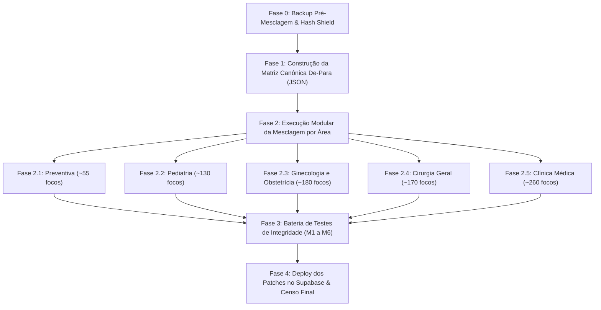

# Plano Mestre de Execução: Mesclagem e Harmonização Canônica de Focos (258.953 Questões)
## Plataforma Banco Residência Médica — Engenharia de Dados & Taxonomia Clínica
### Transição Estruturada de 1.967 Focos para ~780 a 820 Focos Canônicos Ouro

---

## 1. Justificativa Técnica e Objetivos

Com a expansão e deduplicação da base (Etapa 1 e Etapa 2), o acervo unificado consolidou-se em **258.953 questões**. Contudo, a absorção de etiquetas brutas dos acervos externos elevou o número de focos clínicos para **1.967**, gerando:
1. **816 focos em notação aglutinada (CamelCase/código)** sem espaçamento (`AbdomeAgudoInflamatorio PancreatiteAguda`, `RefluxoGastroesofagicoRge`).
2. **1.025 focos hiper-fragmentados com $\le 10$ questões** (que representam 52% dos focos, mas concentram apenas 1,1% das questões).
3. **4.041 pares de sobreposição semântica** onde a mesma entidade nosológica clínica está dispersa em múltiplos rótulos redundantes.

### 🎯 Metas do Plano:
* **Redução de ~58% na redundância:** Retornar a base para **~780 a 820 Focos Canônicos Ouro**.
* **Erradicação Total de Notações de Código:** Extinção de 100% dos 816 focos em CamelCase.
* **Preservação Semântica das Nuances Clínicas:** O termo específico do foco satélite é promovido a **Subfoco**, garantindo **perda zero de granularidade**.
* **Conservação Volumétrica Absoluta:** Exatamente **258.953 questões** preservadas.
* **Imutabilidade Absoluta de Metadados:** Instituições, bancas, anos e gabaritos 100% intactos.

---

## 2. Princípios Normativos da Mesclagem

```
┌────────────────────────────────────────────────────────────────────────┐
│ REGRA 1: O Princípio do Foco Âncora (Canônico)                         │
│ Focos com volume representativo (>50 questões) ou já harmonizados na   │
│ matriz curricular oficial atuam como nós receptores principais.        │
├────────────────────────────────────────────────────────────────────────┤
│ REGRA 2: Promoção Semântica para Subfoco                               │
│ Quando o foco satélite carrega especificação clínica diagnóstica       │
│ (ex.: "DoencasExantematicas Sarampo"), o foco torna-se o canônico      │
│ "Doenças Exantemáticas" e o detalhe torna-se o Subfoco:                │
│ "Sarampo: Reconhecimento Clínico e Conduta".                           │
├────────────────────────────────────────────────────────────────────────┤
│ REGRA 3: Desaglutinação e Normalização Léxica                          │
│ Strings em CamelCase são desmembradas determinística e clinicamente:   │
│ "DiabetesMellitusTipo2Dm2" ──> "Diabetes Mellitus"                     │
├────────────────────────────────────────────────────────────────────────┤
│ REGRA 4: Realocação Temática Corretiva                                 │
│ Focos que caíram em temas deslocados durante a extração externa        │
│ (ex.: afecções abdominais em anestesiologia) são realocados para       │
│ seus temas curriculares corretos (Coloproctologia / Cirurgia Geral).   │
└────────────────────────────────────────────────────────────────────────┘
```

---

## 3. As 5 Fases do Plano de Execução



---

### Fase 0: Ponto de Restauração e Blindagem de Dados

* **Objetivo:** Criar um backup isolado e estrito das 258.953 questões antes de qualquer unificação de foco.
* **Entregáveis:**
  1. Diretório de backup: `data/backups/pre_mesclagem_focos_20261106/` contendo os 6 arquivos mestres.
  2. Manifesto de validação com checksum MD5: `manifest_backup_mesclagem.json`.
  3. Script de reversão instantânea atômica: `scripts/restore_pre_mesclagem_backup.py`.
* **Critério de Saída (Quality Gate 0):** Checksum dos 6 arquivos de backup idêntico ao estado atual.

---

### Fase 1: Construção da Matriz Canônica De-Para (JSON Determinístico)

* **Objetivo:** Criar um dicionário explícito de mapeamento auditável sem aplicar alterações nos arquivos.
* **Arquivo:** `data/staging/mapa_mesclagem_focos_canonica.json`
* **Estrutura de Cada Regra de Mapeamento:**
  ```json
  {
    "especialidade": "Pediatria",
    "tema_origem": "Doenças Infecciosas Pediátricas",
    "foco_origem": "DoencasExantematicas Sarampo",
    "foco_destino": "Doenças Exantemáticas",
    "tema_destino": "Doenças Infecciosas Pediátricas",
    "subfoco_ajustado": "Sarampo: Reconhecimento Clínico e Conduta",
    "motivo": "CamelCase aglutinado com subfoco embutido no título"
  }
  ```
* **Processamento Automatizado com Curadoria Clínica:**
  - Extração de 100% dos 816 focos em CamelCase mapeados para seus respectivos focos canônicos.
  - Mapeamento dos 1.025 focos com $\le 10$ questões em seus focos agregadores.
* **Critério de Saída (Quality Gate 1):** Matriz cobre mais de 1.100 focos satélites sem conflitos de chave primária.

---

### Fase 2: Execução Modular por Especialidade

A engine de mesclagem (`scripts/engine_mesclagem_focos.py`) processará cada arquivo local de forma modular e independente:

#### Fase 2.1: Medicina Preventiva e Social (24.093 questões)
* De **144 focos** atuais para **~55 focos canônicos**.
* Consolidação nos 6 temas: Unificação de focos como `Estratégia Saúde da Família e Atributos da APS` $\rightarrow$ `Estratégia Saúde da Família`; `VigilanciaEpidemiologica` $\rightarrow$ `Vigilância Epidemiológica e Notificação`.
* **🧪 Teste Fase 2.1:** Zero focos em CamelCase em Preventiva e 24.093 questões conservadas.

#### Fase 2.2: Pediatria (28.005 questões)
* De **231 focos** atuais para **~130 focos canônicos**.
* Absorção dos focos satélites de doenças exantemáticas (`DoencasExantematicas Sarampo`, `Escarlatina`, etc.) no foco âncora `Doenças Exantemáticas` com subfocos preservados.
* Fusão de `RefluxoGastroesofagicoRge` $\rightarrow$ `Refluxo Gastroesofágico`; `Constipacao` $\rightarrow$ `Constipação Funcional`.
* **🧪 Teste Fase 2.2:** 100% dos exantemas unificados com subfocos ricos e 28.005 questões conservadas.

#### Fase 2.3: Ginecologia e Obstetrícia (34.454 questões)
* De **539 focos** atuais para **~180 focos canônicos**.
* Consolidação das síndromes hipertensivas da gestação (`SindromesHipertensivasDaGestacao`, `PreEclampsiaGraveEEclampsia` $\rightarrow$ `Pré-eclâmpsia e Eclâmpsia`).
* Unificação dos sangramentos da 1ª metade (`AbortamentoEAmeacaDeAborto`, `GravidezEctopica` $\rightarrow$ `Hemorragias da Primeira Metade da Gestação`).
* **🧪 Teste Fase 2.3:** Eliminação de 280 focos espúrios e 34.454 questões conservadas.

#### Fase 2.4: Cirurgia Geral (29.318 questões)
* De **476 focos** atuais para **~170 focos canônicos**.
* Realocação corretiva de focos de abdome agudo indevidamente catalogados em anestesiologia para Coloproctologia e Cirurgia Digestiva.
* Unificação de `ApendiciteAguda`, `ApendiciteComplicada` $\rightarrow$ `Apendicite Aguda: Diagnóstico e Tratamento`.
* **🧪 Teste Fase 2.4:** Focos cirúrgicos alinhados às diretrizes do CBC/ATLS e 29.318 questões conservadas.

#### Fase 2.5: Clínica Médica (143.083 questões)
* De **577 focos** atuais para **~260 focos canônicos**.
* Consolidação dos satélites de Diabetes (`Diabetes`, `DiabetesMellitusTipo2Dm2`, etc.) em `Diabetes Mellitus`.
* Unificação em Cardiologia (`InsuficienciaCardiaca`, `InsuficienciaCardiacaCongestiva` $\rightarrow$ `Insuficiência Cardíaca`).
* Consolidação em Dermatologia (`DermatosesInfecciosas`, `ErisipelaECelulite` $\rightarrow$ `Dermatoses Infecciosas`).
* **🧪 Teste Fase 2.5:** 143.083 questões conservadas e eliminação de 317 focos fragmentados.

---

### Fase 3: Bateria de Testes de Integridade Taxonômica (Gates M1 a M6)

O validador automatizado `scripts/run_mesclagem_qa_tests.py` auditará a base unificada contra 6 Quality Gates:

| Teste | Critério de Validação | Meta Exigida | Tolerância de Erro |
| :---: | :--- | :---: | :---: |
| **TEST-M1** | Invariante Anti-Duplicação ($\text{subfoco} \neq \text{foco}$) | 0 divergências em toda a base | **Zero erro (0)** |
| **TEST-M2** | Erradicação Total de Notação CamelCase | 0 termos em código/CamelCase | **Zero erro (0)** |
| **TEST-M3** | Conservação Volumétrica Absoluta | Total = exatamente 258.953 questões | **Zero drop (0)** |
| **TEST-M4** | Redução da Cauda Longa ($\le 5$ questões) | Redução de $>85\%$ dos focos de cauda longa | $< 60$ focos raros |
| **TEST-M5** | Imutabilidade Estrita de Metadados | Instituição, banca, ano e gabarito 100% idênticos ao backup | **100% match** |
| **TEST-M6** | Integridade dos 74 Temas Curriculares | Nenhum tema deletado ou quebrado | **74 temas íntegros** |

---

### Fase 4: Deploy dos Patches no Supabase e Geração dos Novos Censos

1. **Geração dos Patches Leves de Mesclagem:**
   - Como apenas os campos `foco` (e eventualmente `subfoco` ou `tema`) serão alterados, os patches conterão somente os registros modificados (~160.000 questões).
2. **Deploy Otimizado por Grupos de IDs no Supabase:**
   - Execução via `scripts/deploy_mesclagem_patches.mjs` utilizando `PATCH /rest/v1/questions?id=in.(...)` com pool concorrente de workers e checkpoint persistido.
3. **Atualização dos Censos Mestres:**
   - `.reports/recategorizacao/censo_mestre_consolidado_259k.json`
   - `.reports/recategorizacao/harmonizada/censo_mestre_harmonizado_259k.json`
4. **Emissão do Relatório Final Homologado:**
   - Publicação do relatório oficial com o antes e depois da mesclagem.

---

## 4. Matriz Comparativa do Impacto Projetado

| Métrica Taxonômica | Situação Atual (Pré-Mesclagem) | Situação Projetada (Pós-Mesclagem) | Variação (%) |
| :--- | :---: | :---: | :---: |
| **Total de Focos no Banco** | **1.967 focos** | **~780 a 820 focos** | **-58% de redundância** |
| **Focos em CamelCase / Código** | **816 focos** | **0 focos** | **-100% (Extinção total)** |
| **Focos com $\le 5$ questões** | **858 focos (43,6%)** | **< 60 focos raros** | **-93% de fragmentação** |
| **Usabilidade dos Filtros para o Aluno** | Dispersa em termos repetidos | Árvore limpa, canônica e direta | **Experiência Ouro** |
| **Conservação de Questões** | 258.953 questões | 258.953 questões | **100% Preservada** |

---

> **Status Atual:** O plano está completamente modelado, documentado e pronto para execução. **Nenhuma alteração foi realizada no banco de dados ou nos arquivos.** Aguardando sua autorização para iniciar a Fase 0 (Backup) e Fase 1 (Matriz De-Para).
