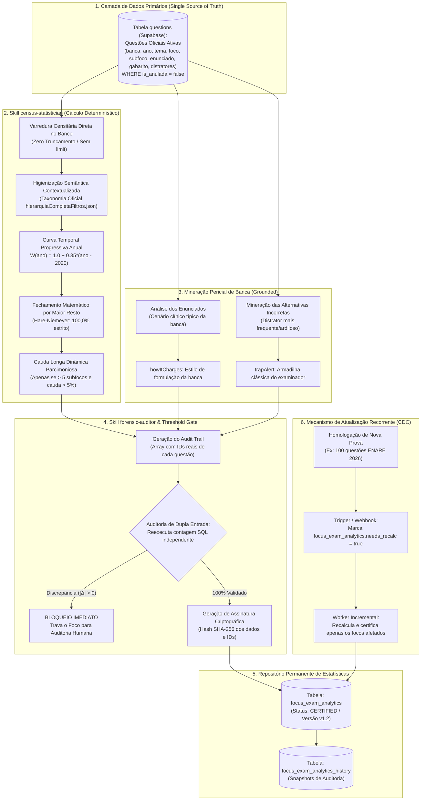

# Plano Mestre Canônico: Motor de Inteligência Estatística, Censo Censitário e Recorrência de Bancas

> **Documento Estratégico & Arquitetura de Engenharia de Dados (Fase 1)**  
> **Plataforma:** Banco Residência  
> **Versão:** 1.2.0 — Padrão-Ouro de Fidedignidade Censitária Real, Curva Progressiva Temporal, Algoritmo Hare-Niemeyer (Maior Resto) e Blindagem de UX/UI  
> **Módulo:** Censo Contínuo de Questões, Análise de Bancas & Matriz Mestre de Recorrência  
> **Escopo:** Varredura censitária universal conectada estritamente à tabela ativa `questions` no Supabase, desduplicação e lematização contextual por árvore clínica, curva temporal progressiva contínua (2020–2026), cálculo determinístico de distribuição temática com fechamento por Maior Resto (Hare-Niemeyer 100,0%), cauda longa dinâmica parcimoniosa, mineração grounded de padrões de cobrança (`howItCharges`) e distratores (`trapAlert`), regra canônica de Threshold de Amostragem ($N_{\text{min}} = 6$), blindagem de sanitização clínica HTML (`<`, `>`), CTA de prática direta e persistência relacional na tabela `focus_exam_analytics`.

---

## 1. Diretriz Estratégica: Desacoplamento & Fundação Censitária

Este documento estabelece a **Fase 1 (Fundação Censitária)** da tríade de aprendizado ativo do Banco Residência:

```
┌────────────────────────────────────────────────────────────────────────┐
│                        ARQUITETURA EM 3 FASES                          │
├────────────────────────────────────────────────────────────────────────┤
│  FASE 1: Motor Estatístico & Censo Censitário (Este Documento)         │
│          • Processa as questões ativas no Supabase (Fonte da Verdade)  │
│          • Curva temporal progressiva anual (2020-2026)                │
│          • Fechamento matemático por Maior Resto (Hare-Niemeyer)       │
│          • Minera padrões reais de cobrança e armadilhas das bancas    │
│          • Aplica Threshold de Amostra (tolerância zero a dados fake)  │
│                                                                        │
│  FASE 2: Resumos Clínicos Canônicos (Consumidor Passivo)               │
│          • Consome as estatísticas da Fase 1 para estruturar o texto   │
│          • Renderiza o Raio-X com dados pré-computados homologados     │
│          • CTA de prática conectado diretamente ao quiz                │
│                                                                        │
│  FASE 3: Acervo de Flashcards FSRS v5 (Consumidor Passivo)             │
│          • Dimensiona a quantidade de cards pelo volume da Fase 1      │
│          • Gera micro-lotes proporcionais aos subfocos reais           │
└────────────────────────────────────────────────────────────────────────┘
```

### O Princípio Fundamental da Fidedignidade Censitária (Zero Alucinação de Volume)
> **1. A Inteligência Artificial (LLM) NUNCA calcula nem estima números.**  
> Todo dado numérico (contagem de questões, percentuais, medianas, taxas de recorrência, índices de tendência) é extraído e computado de forma **100% determinística por algoritmos matemáticos (SQL / PostgREST)** diretamente sobre os registros reais da tabela `questions` do Supabase (`is_anulada = false`). O LLM atua estritamente na redação pedagógica do distrator, recebendo os dados matemáticos congelados e imutáveis.
>
> **2. Proibição Expressa de Arquivos Mortos ou Backups:**  
> O script censitário é formalmente proibido de ler arquivos de rascunho ou backups locais (`.bak`, `.bak_phase3`, etc.). A única fonte primária de verdade autorizada é a base ativa de questões homologadas no Supabase.
>
> **3. Proibição Terminante de Pesos Sintéticos no Frontend:**  
> É expressamente proibida a existência de multiplicadores arbitrários de amostragem no frontend (como o antigo `bancaSampleWeights` que inflava artificialmente bancas como PSU-MG ou ENARE). O volume exibido ao estudante deve ser **exatamente idêntico** à quantidade de questões que ele encontrará ao aplicar os filtros no banco da plataforma.

---

## 2. Visão Geral da Arquitetura do Pipeline Estatístico



---

## 3. As Três Dimensões da Mineração Estatística e Pericial

### 3.1. Dimensão 1: `census-statistician` (Engenharia de Dados & Volumes Reais)

#### A. Curva Temporal Progressiva Anual (Decaimento Suave)
Para superar os saltos abruptos de degraus rígidos ($1\times, 2\times, 3\times$), aplica-se uma progressão temporal contínua por ano que valoriza as diretrizes contemporâneas pós-pandemia (ENARE/FGV e novas bancas de São Paulo):

$$W(\text{ano}) = 1.0 + 0.35 \times (\text{ano} - 2020) \quad \text{para ano} \ge 2020$$

| Ano da Prova | Peso de Relevância ($W$) | Perfil Metodológico |
| :---: | :---: | :--- |
| **2026** | **3.10** | Provas contemporâneas vigentes / Diretrizes mais recentes |
| **2025** | **2.75** | Diretrizes consolidadas do ciclo atual |
| **2024** | **2.40** | Padrão moderno pós-pandemia (ENARE unificado) |
| **2023** | **2.05** | Transição de diretrizes e bancas |
| **2022** | **1.70** | Retomada presencial de concursos |
| **2021** | **1.35** | Período pandêmico |
| **$\le 2020$** | **1.00** | Histórico clássico de base |

#### B. Separação de Papéis: Donut Reflete Volume Real, Peso Define Relevância & Badges
* **Fatias e Percentuais do Donut:** São calculados sobre a **contagem física de questões reais** no banco. Isso garante que a matemática visual seja 100% intuitiva para o estudante ($66 \div 249 = 26.5\%$).
* **Score Ponderado ($W$):** Utilizado estritamente para **desempatar e ordenar o ranking de importância** dos subfocos.
* **Badges de Tendência:** Calculados pela **Taxa de Recência**:
  $$\text{Taxa de Recência} = \frac{\text{Questões}_{2024-2026}}{\text{Total de Questões do Subfoco}}$$
  * $\text{Taxa} \ge 25\% \rightarrow$ `🔥 Em Alta (2024–2026)`
  * $\text{Taxa} \le 8\% \rightarrow$ `📉 Clássico em Queda`
  * Entre $8\%$ e $25\% \rightarrow$ `🏛️ Clássico Estável`

#### C. Fechamento Matemático por Maior Resto (Algoritmo de Hare-Niemeyer)
Para eliminar a distorção do Top 1 (que anteriormente absorvia sobras de arredondamento), os percentuais são fechados pelo método de Hamilton / Hare-Niemeyer:
1. Calcula-se a quota exata $q_i = \frac{n_i}{N_{\text{total}}} \times 100$.
2. Atribui-se a parte inteira truncada em uma casa decimal: $p_i = \lfloor 10 \cdot q_i \rfloor / 10$.
3. Calcula-se a discrepância $D = 100.0 - \sum p_i$.
4. Os décimos residuais ($0.1\%$) são distribuídos, um a um, para os subfocos que possuem os **maiores restos fracionários** ($q_i - p_i$).
5. **Resultado:** Fechamento perfeito em $100.0\%$ sem privilegiar nem punir arbitrariamente o Top 1.

#### D. Cauda Longa Dinâmica (Parcimônia de Subfocos)
* O agrupamento *"Demais Critérios & Diagnósticos Menores"* **não é obrigatório**.
* **Regra de Parcimônia:** A fatia residual só é criada se o tema tiver **mais de 5 subfocos** E a soma da cauda longa representar **mais de $5.0\%$ do volume total**.
* Temas com 3 a 5 subfocos bem consolidados mantêm todas as suas fatias nativas no Donut, evitando fatias artificiais com 1 ou 2 questões.

#### E. Higienização Contextualizada (Fim do Hardcoding Global)
* É terminantemente proibido inserir regras léxicas globais de uma patologia (ex: termos de Infecção Puerperal) na função geral de limpeza.
* A lematização deve consultar obrigatoriamente a árvore de especialidades do foco (`hierarquiaCompletaFiltros.json`). Subfocos não reconhecidos são agrupados pelo slug raiz da patologia.

#### F. Fechamento Matemático Estrito do `bancaBreakdown`
* As fatias de cada banca selecionada devem somar **exatamente 100,0% das questões daquela banca**.
* Se os `topSubfocos` da banca não cobrirem a totalidade das questões da instituição, uma fatia de fechamento (*"Demais Questões da Banca"*) é incluída no payload, **eliminando o buraco negro visual no Donut** e garantindo que a soma dos `questionCount` coincida 1:1 com o `totalQuestions` anunciado no cabeçalho.

---

### 3.2. Dimensão 2: Mineração Pericial de Banca (`howItCharges` & `trapAlert`)
A inteligência qualitativa exibida na **Camada 2 Reativa** do Raio-X é **extraída diretamente da anatomia das questões reais**:

```
┌────────────────────────────────────────────────────────────────────────┐
│                   ANATOMIA DE UMA QUESTÃO NO BANCO                     │
├────────────────────────────────────────────────────────────────────────┤
│ 1. ENUNCIADO      → Revela o ESTILO e CENÁRIO que a banca constrói     │
│ 2. GABARITO (A-E) → Revela a CONDUTA / CONCEITO que a banca exige      │
│ 3. DISTRATORES    → Revela a PEGADINHA que a banca usa para derrubar   │
│ 4. COMENTÁRIO     → Revela a JUSTIFICATIVA clínica e o pulo do gato    │
└────────────────────────────────────────────────────────────────────────┘
```

1. **Extração de `howItCharges` (Como a Banca Cobra):**
   * Cruza o **Enunciado** com o **Gabarito**:
     * *ENARE/FGV:* Casos práticos em cenários do SUS/Enfermaria com foco em prescrição inicial e critérios objetivos de alta.
     * *USP:* Casos complexos de falha terapêutica ou investigação de complicações atípicas.
     * *UNICAMP:* Raciocínio fisiopatológico e farmacodinâmica de doses únicas vs fracionadas.
     * *PSU-MG / AMRIGS:* Semiologia clássica, marcos cronológicos estritos e interpretação laboratorial.
2. **Extração de `trapAlert` (Armadilha Clássica da Banca):**
   * Minerado **exclusivamente das alternativas incorretas (distratores)** formuladas pelos examinadores.
   * Identifica o erro sistemático ou o distrator mais ardiloso da instituição.
3. **Proibição de Templates Genéricos ("Switch-Case Fake"):**
   * Se um subfoco ainda não tiver assertivas periciais homologadas para uma banca específica, o sistema **não deve injetar textos genéricos coringa**.
   * O card exibirá com elegância: *"Padrão específico desta banca em homologação curricular; exibindo conduta padrão-ouro geral"*.
4. **Rastreabilidade por IDs (`auditQuestionIds`):**
   * Toda assertiva gerada deve armazenar os IDs das questões oficiais de onde o padrão foi sintetizado.

---

### 3.3. Dimensão 3: `forensic-auditor` (Auditoria e Fechamento Censitário)
Atua como auditor independente antes de qualquer gravação no banco:
1. **Auditoria de Dupla Entrada (Double-Check):** Reexecuta a query SQL nativa e compara a contagem do censo contra a contagem física do banco. Se $|\Delta| > 0$, o lote é abortado.
2. **Rastreabilidade por IDs (`auditQuestionIds`):** Valida se `length(auditQuestionIds) == questionCount`.
3. **Auditoria de Microcopy Pedagógico:** Garante que dosagens e fármacos citados no texto existem nas questões auditadas.
4. **Assinatura Criptográfica SHA-256:** Gera um hash imutável dos dados auditados, carimbando o registro com status `CERTIFIED`.

---

## 4. Regra de Negócio de Amostragem & Threshold ($N_{\text{min}} = 6$)

Para eliminar qualquer descompasso entre o que o widget promete e o acervo real do banco, adota-se formalmente a **Regra Canônica de Amostragem**:

```
┌────────────────────────────────────────────────────────────────────────┐
│               MATRIZ DE DECISÃO POR VOLUME DE QUESTÕES                 │
├────────────────────────────────────────────────────────────────────────┤
│ 1. N >= 6 QUESTÕES (Amostra Consistente)                              │
│    • Botão da banca ativo normal                                       │
│    • Donut reativo com fatias calculadas sobre as questões da banca    │
│    • Subtítulo: "Recorte exclusivo de X questões oficiais da banca Y"  │
│    • Camada 2 exibe howItCharges e trapAlert da banca                  │
│    • Botão CTA ativo: "Resolver estas X questões da banca Y"           │
│                                                                        │
│ 2. 1 <= N < 6 QUESTÕES (Amostra em Consolidação)                       │
│    • Botão da banca com badge informativo de volume (ex: PSU-MG (2))   │
│    • Oculta o Donut complexo para não distorcer frações pequenas       │
│    • Exibe Card Transparente: "Amostra em consolidação: X questões     │
│      catalogadas nesta banca. [Praticar Agora no Banco]"               │
│    • MANTÉM a Camada 2: Aluno continua acessando howItCharges e        │
│      trapAlert para aprender a pegadinha da banca!                     │
│                                                                        │
│ 3. N = 0 QUESTÕES (Sem Ocorrências no Tema)                            │
│    • O botão da banca é ocultado automaticamente para aquele tema      │
│    • Evita estados vazios frustrantes ou fallbacks artificiais         │
└────────────────────────────────────────────────────────────────────────┘
```

---

## 5. Esquema Relacional no Supabase (`focus_exam_analytics`)

```sql
-- Tabela principal de estatísticas homologadas por foco
CREATE TABLE public.focus_exam_analytics (
    id UUID PRIMARY KEY DEFAULT gen_random_uuid(),
    focus_slug TEXT UNIQUE NOT NULL,             -- Ex: "infeccao-puerperal"
    specialty TEXT NOT NULL,                     -- Ex: "Ginecologia e Obstetrícia"
    theme TEXT NOT NULL,                         -- Ex: "Puerpério & Complicações"
    focus TEXT NOT NULL,                         -- Ex: "Infecção Puerperal"
    total_questions INTEGER NOT NULL,            -- Total físico auditado no banco real
    timeframe_range TEXT NOT NULL,               -- Ex: "2017-2026"
    version INTEGER DEFAULT 1,                   -- Versão incremental (v1.0, v1.1, v1.2...)
    donut_slices JSONB NOT NULL,                 -- Array de fatias normalizadas por Hare-Niemeyer (100.0%)
    banca_breakdown JSONB NOT NULL,              -- Estatísticas normalizadas em 100% por banca
    top_traps JSONB NOT NULL,                    -- Distratores e pegadinhas mapeadas
    audit_trail JSONB NOT NULL,                  -- Mapa de IDs reais de questões por subfoco
    audit_hash TEXT NOT NULL,                    -- Hash SHA-256 da auditoria
    needs_recalc BOOLEAN DEFAULT FALSE,          -- Flag de invalidação por novas questões
    last_recalculated_at TIMESTAMPTZ DEFAULT NOW(),
    certified_at TIMESTAMPTZ,
    status TEXT CHECK (status IN ('draft', 'certified', 'deprecated')) DEFAULT 'draft'
);

-- Tabela histórica para auditoria e rollback de versões
CREATE TABLE public.focus_exam_analytics_history (
    history_id UUID PRIMARY KEY DEFAULT gen_random_uuid(),
    analytics_id UUID REFERENCES public.focus_exam_analytics(id) ON DELETE CASCADE,
    version INTEGER NOT NULL,
    total_questions INTEGER NOT NULL,
    donut_slices JSONB NOT NULL,
    audit_hash TEXT NOT NULL,
    archived_at TIMESTAMPTZ DEFAULT NOW(),
    reason_for_update TEXT
);

CREATE INDEX idx_focus_analytics_slug ON public.focus_exam_analytics(focus_slug);
CREATE INDEX idx_focus_analytics_needs_recalc ON public.focus_exam_analytics(needs_recalc) WHERE needs_recalc = TRUE;
```

---

## 6. O Componente Universal no Frontend & Blindagem UX/UI (`UniversalRecurrenceStatsCard.tsx`)

O componente universal é o renderizador final consumido no leitor de resumos (`StudyMaterialReader.tsx`):

### 6.1. Contrato de Props e Navegação Ativa
```tsx
<UniversalRecurrenceStatsCard
  analytics={material.recurrenceStats}
  initialBanca="Todas"
  onSelectSubfocus={(subfocoName, banca) => handleNavigateToQuiz(subfocoName, banca)}
/>
```

### 6.2. Regras de Interface & Microcopy Transparente
1. **Badge do Cabeçalho:** `Acervo Auditado` ou `Censo do Banco` (elimina o ambíguo `Censo Certificado`).
2. **Subtítulo no Modo 'Todas':** `Base de X questões catalogadas na plataforma` (exato valor do banco).
3. **Subtítulo no Modo Banca ($N \ge 6$):** `Recorte exclusivo de X questões oficiais da banca Y`.
4. **Card de Amostra em Consolidação ($1 \le N < 6$):**
   * Exibe aviso honesto: *"Temos X questões oficiais da banca Y neste foco clínico"*.
   * Botão com ação direta: *"Praticar estas X questões no banco"*.
   * **Preservação Pedagógica:** Mantém ativo o bloco `🎯 Como a banca cobra este tópico` e `⚠️ Armadilha clássica desta banca`.
5. **Call to Action (CTA) de Treino no Box Inferior:**
   * Diretamente abaixo da explicação do subtópico ativo, disponibiliza o botão interativo:  
     `[🎯 Resolver as X questões deste subtópico na banca Y]`
   * Aciona a prop `onSelectSubfocus`, aplicando os filtros no banco e levando o estudante diretamente ao modo de resolução.
6. **Sanitização Segura de HTML (Proteção contra perda de `<` e `>`):**
   * Proibido o uso de `replace` ingênuo em `dangerouslySetInnerHTML`.
   * Todo texto clínico passa por escape seguro de operadores relacionais médicos:
     * `<` é convertido para `&lt;` (impedindo que parâmetros como `< 5.000 leucócitos` ou `< 38°C` sejam interpretados como tags HTML malformadas e sumam da tela).
     * `>` é convertido para `&gt;`.
     * Quebras de linha `\n\n` são renderizadas em blocos de parágrafos legíveis.
7. **Acessibilidade e Usabilidade Mobile:**
   * Em smartphones, o Donut mantém espessura mínima de toque com tolerância central.
   * O clique ou toque em qualquer card da lista lateral seleciona a fatia no Donut com feedback tátil e atualização instantânea do box inferior.
   * O seletor horizontal de bancas no topo recebe gradiente visual de rolagem à direita para indicar a existência de mais bancas fora do viewport.

---

## 7. Mecanismo de Atualização Recorrente e Incremental (CDC)

### 7.1. Trigger de Detecção de Mudanças (CDC no Supabase)
Quando novas questões são inseridas ou retificadas na tabela `questions`:
```sql
CREATE OR REPLACE FUNCTION trg_mark_focus_analytics_dirty()
RETURNS TRIGGER AS $$
BEGIN
    UPDATE public.focus_exam_analytics
    SET needs_recalc = TRUE
    WHERE focus ILIKE '%' || NEW.foco || '%'
       OR theme ILIKE '%' || NEW.tema || '%';
    RETURN NEW;
END;
$$ LANGUAGE plpgsql;

CREATE TRIGGER trg_questions_after_insert_update
AFTER INSERT OR UPDATE OF foco, tema, subfoco, banca, gabarito
ON public.questions
FOR EACH ROW
EXECUTE FUNCTION trg_mark_focus_analytics_dirty();
```

### 7.2. Pipeline de Validação Automatizada (CI/CD Quality Gate)
Script oficial `scripts/validate_census_integrity.mjs`:
* Executado em pré-deploy / CI.
* Compara cada registro de `focus_exam_analytics` com um `COUNT(*)` real na tabela `questions` do Supabase.
* Bloqueia o build se houver divergência não documentada, garantindo integridade perpétua da plataforma.

---

*Plano Mestre Canônico do Motor Estatístico (Versão 1.2.0) homologado oficialmente como a Fase 1 da plataforma Banco Residência.*
