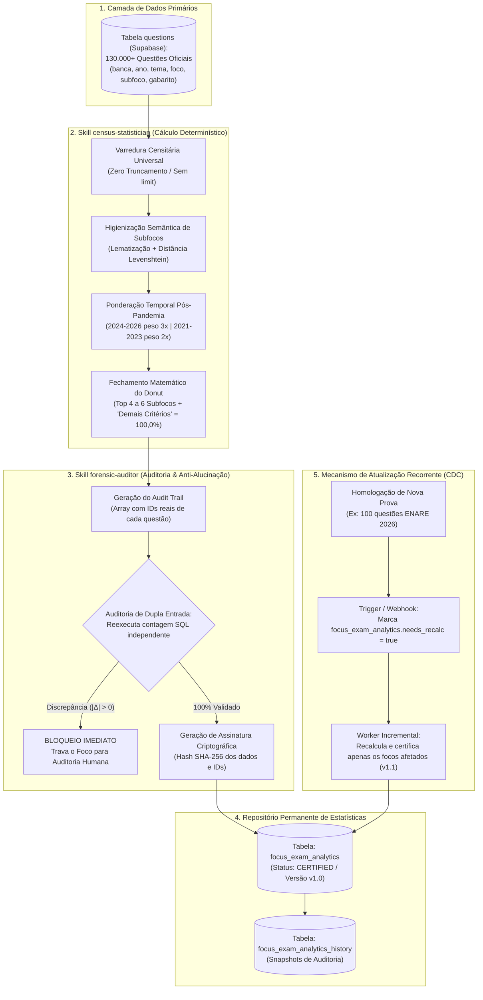

# Plano Mestre Canônico: Motor de Inteligência Estatística, Censo Censitário e Recorrência de Bancas

> **Documento Estratégico & Arquitetura de Engenharia de Dados (Fase 1)**  
> **Plataforma:** Banco Residência  
> **Versão:** 1.0.0 — Padrão-Ouro de Fidedignidade Estatística & Tolerância Zero a Alucinações  
> **Módulo:** Censo Contínuo de Questões, Análise de Bancas & Matriz Mestre de Recorrência  
> **Escopo:** Varredura censitária universal de 130k+ questões oficiais (2017–2026), desduplicação e lematização de subfocos, ponderação temporal bayesiana (2024–2026), cálculo determinístico de distribuição temática com fechamento matemático estrito de 100,0%, auditoria forense de dupla checagem com assinatura criptográfica SHA-256, persistência relacional na tabela `focus_exam_analytics` e pipeline de atualização incremental contínua (CDC / Event-Driven).

---

## 1. Diretriz Estratégica: Desacoplamento & Fundação Censitária

Este documento estabelece a **Fase 1 (Fundação Censitária)** da tríade de aprendizado ativo do Banco Residência:

```
┌────────────────────────────────────────────────────────────────────────┐
│                        ARQUITETURA EM 3 FASES                          │
├────────────────────────────────────────────────────────────────────────┤
│  FASE 1: Motor Estatístico & Censo Censitário (Este Documento)         │
│          • Processa as 130k+ questões e gera a verdade estatística     │
│          • Fonte Única de Verdade (Single Source of Truth)             │
│                                                                        │
│  FASE 2: Resumos Clínicos Canônicos (Consumidor Passivo)               │
│          • Consome as estatísticas da Fase 1 para estruturar o texto   │
│          • Renderiza o Raio-X com dados pré-computados homologados     │
│                                                                        │
│  FASE 3: Acervo de Flashcards FSRS v5 (Consumidor Passivo)             │
│          • Dimensiona a quantidade de cards pelo volume da Fase 1      │
│          • Gera micro-lotes proporcionais aos subfocos reais           │
└────────────────────────────────────────────────────────────────────────┘
```

### O Princípio Fundamental da Fidedignidade
> **A Inteligência Artificial (LLM) NUNCA calcula nem estima números.**  
> Todo dado numérico (contagem de questões, percentuais, medianas, taxas de recorrência, índices de tendência) é extraído e computado de forma **100% determinística por algoritmos matemáticos (Python / SQL)** diretamente sobre os registros reais de questões. O LLM atua estritamente na redação pedagógica do distrator, recebendo os dados matemáticos congelados e imutáveis.

---

## 2. Visão Geral da Arquitetura do Pipeline Estatístico



---

## 3. As Duas Skills Estatísticas Especializadas

### 3.1. Skill 1: `census-statistician` (Engenharia de Dados & Mineração)
Responsável por transformar dados desestruturados de 130k+ questões em estatísticas refinadas:
1. **Varredura Universal Sem Truncamento:** Não utiliza limites arbitrários (`.limit(1000)` ou `.limit(1500)`). Executa varredura total por `foco_slug`.
2. **Higienização de Subfocos (Clustering Semântico):** Agrupa sinônimos e variações de digitação (ex: *"Atonia uterina"*, *"atonia de útero"*, *"Hipotonia/Atonia do Miométrio"*) no mesmo cluster canônico oficial.
3. **Ponderação Temporal Bayesiana:**
   $$\text{Score}_{\text{subfoco}} = \sum_{q \in \text{questões}} W(\text{ano}_q)$$
   Onde:
   * $W(\text{ano}) = 3,0$ para anos $\ge 2024$ (Perfil contemporâneo das bancas líderes: FGV/ENARE, USP nova).
   * $W(\text{ano}) = 2,0$ para anos $2021$ a $2023$.
   * $W(\text{ano}) = 1,0$ para anos $\le 2020$.
4. **Fechamento Matemático do Donut:**
   * Ordena os subfocos por representatividade.
   * Seleciona os Top $4$ a $6$ subfocos.
   * Agrupa a cauda longa no subfoco residual: **"Demais Critérios & Diagnósticos Menores"**.
   * Garante contratualmente que $\sum_{i=1}^{n} \text{percentual}_i \equiv 100,0\%$.

### 3.2. Skill 2: `forensic-auditor` (Checagem Final & Zero-Hallucination)
Atua como auditor independente antes de qualquer gravação no banco:
1. **Auditoria de Dupla Entrada (Double-Check):** Reexecuta a query SQL nativa e compara a contagem do censo contra a contagem física do banco. Se $|\Delta| > 0$, o lote é abortado.
2. **Rastreabilidade por IDs (`auditQuestionIds`):** Todo subfoco exporta a lista exata dos IDs de questões que o originaram. O auditor valida se `length(auditQuestionIds) == questionCount`.
3. **Auditoria de Microcopy Pedagógico:** Valida se as frases explicativas geradas para os distratores contêm termos técnicos congruentes com o cluster e proíbe alucinação de números ou dosagens ausentes nas questões.
4. **Assinatura Criptográfica SHA-256:** Gera um hash imutável dos dados auditados, carimbando o registro com status `CERTIFIED`.

---

## 4. Esquema Relacional no Supabase (`focus_exam_analytics`)

```sql
-- Tabela principal de estatísticas homologadas por foco
CREATE TABLE public.focus_exam_analytics (
    id UUID PRIMARY KEY DEFAULT gen_random_uuid(),
    focus_slug TEXT UNIQUE NOT NULL,             -- Ex: "hemorragia-pos-parto"
    specialty TEXT NOT NULL,                     -- Ex: "Ginecologia e Obstetrícia"
    theme TEXT NOT NULL,                         -- Ex: "Emergências Obstétricas"
    focus TEXT NOT NULL,                         -- Ex: "Hemorragia Pós-Parto (HPP)"
    total_questions INTEGER NOT NULL,            -- Total físico auditado
    timeframe_range TEXT NOT NULL,               -- Ex: "2017-2026"
    version INTEGER DEFAULT 1,                   -- Versão incremental (v1, v2...)
    donut_slices JSONB NOT NULL,                 -- Array de fatias normalizadas (soma 100%)
    banca_breakdown JSONB NOT NULL,              -- Estatísticas específicas por banca
    top_traps JSONB NOT NULL,                    -- Distratores e pegadinhas mapeadas
    audit_trail JSONB NOT NULL,                  -- Mapa de IDs reais de questões por subfoco
    audit_hash TEXT NOT NULL,                    -- Hash SHA-256 da auditoria
    needs_recalc BOOLEAN DEFAULT FALSE,          -- Flag de invalidação por novas questões
    last_recalculated_at TIMESTAMPTZ DEFAULT NOW(),
    certified_at TIMESTAMPTZ,
    status TEXT CHECK (status IN ('draft', 'certified', 'deprecated')) DEFAULT 'draft'
);

-- Tabela histórica para auditoria e rollback de versões
CREATE TABLE public.focus_exam_analytics_history (
    history_id UUID PRIMARY KEY DEFAULT gen_random_uuid(),
    analytics_id UUID REFERENCES public.focus_exam_analytics(id) ON DELETE CASCADE,
    version INTEGER NOT NULL,
    total_questions INTEGER NOT NULL,
    donut_slices JSONB NOT NULL,
    audit_hash TEXT NOT NULL,
    archived_at TIMESTAMPTZ DEFAULT NOW(),
    reason_for_update TEXT
);

CREATE INDEX idx_focus_analytics_slug ON public.focus_exam_analytics(focus_slug);
CREATE INDEX idx_focus_analytics_needs_recalc ON public.focus_exam_analytics(needs_recalc) WHERE needs_recalc = TRUE;
```

---

## 5. Mecanismo de Atualização Recorrente e Incremental (CDC)

Para manter o acervo perfeitamente sincronizado com as novas provas que chegam à plataforma:

### 5.1. Trigger de Detecção de Mudanças (CDC no Supabase)
Quando novas questões são inseridas ou retificadas na tabela `questions`:
```sql
CREATE OR REPLACE FUNCTION trg_mark_focus_analytics_dirty()
RETURNS TRIGGER AS $$
BEGIN
    UPDATE public.focus_exam_analytics
    SET needs_recalc = TRUE
    WHERE focus ILIKE '%' || NEW.foco || '%'
       OR theme ILIKE '%' || NEW.tema || '%';
    RETURN NEW;
END;
$$ LANGUAGE plpgsql;

CREATE TRIGGER trg_questions_after_insert_update
AFTER INSERT OR UPDATE OF foco, tema, subfoco, banca, gabarito
ON public.questions
FOR EACH ROW
EXECUTE FUNCTION trg_mark_focus_analytics_dirty();
```

### 5.2. Endpoint Administrativo de Recálculo (`/api/admin/analytics/recalculate`)
* Permite disparar o recálculo imediato de um foco específico (ex: `POST /api/admin/analytics/recalculate?slug=hemorragia-pos-parto`) ou processar em lote todos os focos com `needs_recalc = TRUE`.
* O pipeline recomputa as fatias, executa o `forensic-auditor`, arquiva a versão anterior na tabela histórica e incrementa `version = version + 1`.

### 5.3. Monitor de Impacto nos Resumos e Flashcards
Se a recalibração de um foco identificar uma variação significativa (ex: subfoco subiu $\ge 8\%$ ou houve alteração do Top 1 de cobrança):
* O sistema gera um log de notificação para a preceptoria médica:
  > *"[ALERTA DE DESVIO ESTATÍSTICO] O foco 'Pré-Eclâmpsia' absorveu 35 novas questões (ENARE 2026). O subfoco 'Sulfato de Magnésio' atingiu 42% de relevância. Sugerida revisão do Resumo Clínico e produção de 4 novos flashcards."*

---

## 6. O Componente Universal no Frontend (`UniversalRecurrenceStatsCard.tsx`)

Todos os componentes estáticos hardcoded (`HppRecurrenceStatsCard`, `ExamRecurrenceStatsCard`, `GemelaridadeRecurrenceStatsCard`) são unificados em um único componente nativo universal:

```tsx
<UniversalRecurrenceStatsCard
  analytics={material.recurrenceStats}
  initialBanca="Todas"
  onSelectSubfocus={(subfoco) => handleFilterQuestions(subfoco)}
/>
```

### Funcionalidades Nativas do Componente Universal:
1. **Donut Interativo com Recharts:** Fatias com raio adaptativo, paleta médica canônica e percentual central dinâmico.
2. **Badges de Tendência:** `[🔥 Em Alta 2024-2026]`, `[🏛️ Clássico Estável]`, `[📉 Em Queda]`.
3. **Filtro de Bancas em Tempo Real:** Botões de alternância (`Todas as Bancas` | `ENARE` | `USP-SP` | `SUS-SP` | `PSU-MG` | `AMRIGS`) recalculando visualmente a rosca em milissegundos.
4. **Fechamento em 100%:** Impossibilidade matemática de ultrapassar 100% ou gerar fatias distorcidas.

---
*Plano Mestre Canônico do Motor Estatístico homologado como a Fase 1 oficial da plataforma Banco Residência.*

