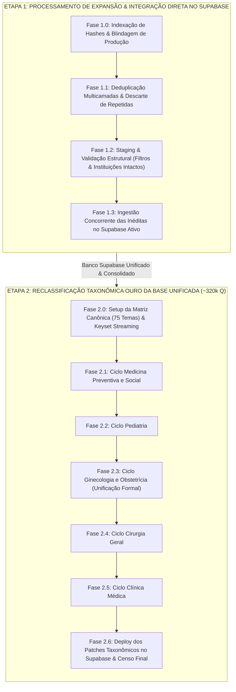
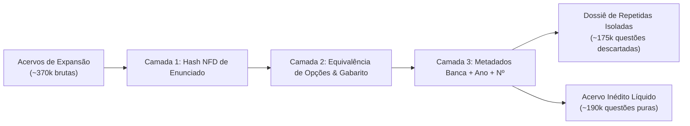
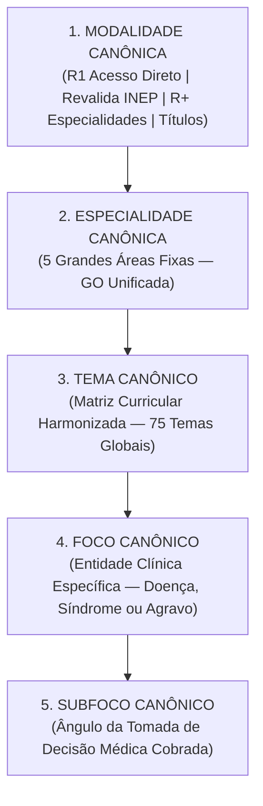

# Plano Mestre Operacional: Expansão com Deduplicação e Reclassificação Integral
## Plataforma Banco Residência Médica — Supabase e Acervos Locais Homologados
### Estratégia em Duas Etapas: 1) Expansão & Integração Direta | 2) Reclassificação Taxonômica Ouro

---

> **Status:** Documento Normativo e Plano de Engenharia Oficial  
> **Data:** Novembro de 2026  
> **Diretiva Estratégica Fundamental:**  
> 1. **Etapa 1:** Deduplicação multicamadas rigorosa dos acervos de expansão (QuestMed, ProvaDeResidência, MedBrave, Hardwork, Apostilas Drive), **mantendo os filtros e instituições exatamente como estão**, e **integração direta das questões inéditas no Supabase ativo**.  
> 2. **Etapa 2:** Com todo o acervo consolidado no Supabase (~320k questões), realizar a **reclassificação taxonômica integral e profunda** de todos os filtros (Modalidade, Especialidade, Tema, Foco e Subfoco) em fases clínicas especializadas.  
> 3. **Bateria de Testes Contínua:** Cada fase possui um conjunto estrito de testes automatizados obrigatórios com critérios de aprovação de 100% antes da fase seguinte.  
> **Modo Atual:** 100% Read-Only (Zero alterações em produção nesta etapa de planejamento).

---

## 1. Arquitetura Geral do Fluxo em Duas Etapas



---

## 2. ETAPA 1: Processamento da Expansão e Integração no Supabase

### Princípios da Etapa 1:
* **Manutenção Estrita dos Metadados:** Os filtros de modalidade, especialidade, tema, foco, subfoco e, acima de tudo, **as instituições originais** de cada questão NÃO SERÃO ALTERADOS nesta etapa. Serão ingeridos exatamente com seus metadados de coleta homologados.
* **Foco em Qualidade Textual:** Exigência de 100% de presença de enunciado, opções estruturadas em JSON válido e gabarito oficial homologado.

---

### Fase 1.0: Indexação de Hashes e Blindagem da Base Ativa
* **Objetivo:** Mapear a impressão digital das 132.947 questões ativas no Supabase (132.965 locais) para criar o escudo anti-duplicação.
* **Metodologia de Hashing:**
  $$H(Q) = \text{SHA256}(\text{norm}(enunciado_{100}) + \text{ord}(\text{norm}(opcoes)))$$
* **Entregável:** `data/staging/banco_ativo_hashes_shield.json`.
* **🧪 Bateria de Testes da Fase 1.0:**
  - `TEST-1.0.1 (Unicidade dos Hashes):` Verificar se o gerador de hash produz colisão interna nula em enunciados com diferenças clínicas reais.
  - `TEST-1.0.2 (Cobertura 100%):` Confirmar que exatamente 132.965 registros locais foram indexados.

---

### Fase 1.1: Deduplicação Multicamadas nos Acervos de Expansão
* **Objetivo:** Cruzar cada acervo de expansão contra a base ativa e **entre si**, expurgando todas as repetidas antes de qualquer inserção.



* **Inventário de Inéditas Puras por Acervo (Sem Duplicatas Inter-Fontes):**
  1. **Hardwork (HardworQ):** **74.771 questões inéditas** com comentários e imagens (108.255 pareadas descartadas de nova inserção).
  2. **ProvaDeResidência (`provaderesidencia_coleta.db`):** **42.975 questões inéditas** de 2010 a 2019.
  3. **MedBrave Clean:** **35.618 questões inéditas** (após expurgo de 10.215 repetidas com QuestMed e 1.846 com PDR).
  4. **QuestMed (`questmed_extracted_exams.db`):** **31.504 questões inéditas** de 2024 a 2026 com comentários completos A-E.
  5. **Apostilas e Livros do Drive:** **7.056 questões inéditas** de fixação conceituais.
* **🧪 Bateria de Testes da Fase 1.1:**
  - `TEST-1.1.1 (Anti-Colisão com Base Ativa):` Garantir que 0% das questões marcadas como inéditas existam no `banco_ativo_hashes_shield.json`.
  - `TEST-1.1.2 (Anti-Colisão Inter-Acervos):` Confirmar que a interseção entre os 5 lotes de inéditas seja rigorosamente zero.
  - `TEST-1.1.3 (Dossiê de Descarte):` Validar que todas as repetidas isoladas possuam seu par de equivalência documentado com ID da questão ativa.

---

### Fase 1.2: Staging, Preservação de Instituições e Normalização Estrutural
* **Objetivo:** Estruturar os registros inéditos no schema exato da tabela `questions` do Supabase sem alterar os filtros clínicos nem as instituições.
* **Schema de Ingestão:**
  ```typescript
  interface StagedExpansionQuestion {
    id: string; // UUID v4 determinístico baseado no hash da questão
    code: string; // Código de prova original preservado
    institution: string; // INTACTA — Nenhuma alteração de nome ou formato
    banca: string; // INTACTA
    year: number; // INTACTO
    tipo_prova: string; // Preservada como coletada
    modalidade: string; // Preservada como coletada
    especialidade: string; // Preservada como coletada
    tema: string; // Preservado como coletado
    foco: string; // Preservado como coletado
    subfoco: string; // Preservado como coletado
    statement: string; // Enunciado integral
    options: Option[]; // Array de alternativas estruturado
    correct_answer: string; // A, B, C, D, E ou ANULADA
    commentary?: string; // Comentário do professor quando disponível
    images?: string[]; // URLs de imagens associadas
    is_anulada: boolean;
    provenance: string; // 'questmed' | 'hardwork' | 'provaderesidencia' | 'medbrave' | 'drive'
  }
  ```
* **🧪 Bateria de Testes da Fase 1.2:**
  - `TEST-1.2.1 (Preservação de Instituição):` Auditoria de integridade para garantir que campos `institution` e `banca` não sofreram truncate, lowercase indesejado ou renomeação.
  - `TEST-1.2.2 (Validade das Opções):` Confirmar que 100% das questões de múltipla escolha possuem opções válidas estruturadas com letras A-D ou A-E.
  - `TEST-1.2.3 (Validade do Gabarito):` Verificar se todo gabarito pertence ao conjunto `{'A', 'B', 'C', 'D', 'E', 'ANULADA'}`.

---

### Fase 1.3: Ingestão Concorrente das Inéditas no Supabase Ativo
* **Objetivo:** Inserir os lotes validados no Supabase via REST API concorrente com lotes de 500 registros e backoff exponencial.
* **Estratégia de Execução:**
  - Inserção com header `Prefer: resolution=merge-duplicates` (UPSERT idempotente por chave de ID único).
  - Atualização concomitante dos arquivos locais JSON em `data/` para manter espelhamento perfeito.
* **🧪 Bateria de Testes da Fase 1.3:**
  - `TEST-1.3.1 (Conservação Volumétrica Supabase):` $\text{Total Final Supabase} = \text{132.947} + N_{\text{inéditas expandidas}}$ (Erro tolerado: 0).
  - `TEST-1.3.2 (Integridade Local vs. Nuvem):` Comparar contadores por instituição e ano entre o Supabase e os arquivos locais.
  - `TEST-1.3.3 (Zero Quebra de Produção):` Teste de leitura no endpoint `/rest/v1/questions` e na interface web garantindo renderização normal das novas questões.

---

## 3. ETAPA 2: Reclassificação Taxonômica Integral da Base Unificada

Com todas as questões (ativas originais + recém-integradas da expansão) residindo de forma segura e estável no Supabase (~320.000 questões), inicia-se a **reclassificação de 5 níveis** para garantir a congruência clínica total.

---

### A Nova Taxonomia Canônica Padrão-Ouro



### Regras de Governança Estrita:
1. **Modalidade:** Mapear rigorosamente por edital em 4 eixos (R1, Revalida, R+, Títulos).
2. **Especialidade (5 Fixas):** Clínica Médica, Cirurgia Geral, Pediatria, Ginecologia e Obstetrícia (unificada), Medicina Preventiva e Social.
3. **Tema (75 Harmonizados):** Alinhados aos editais do ENARE, USP e bancas de ponta.
4. **Foco:** Entidade patológica real. Proibido termos genéricos (*"Geral"*, *"Outros"*, *"Miscelânea"*).
5. **Subfoco:** O ângulo da decisão médica (*Diagnóstico*, *Conduta/Tratamento*, *Manejo Cirúrgico*, *Fisiopatologia*, *Critérios/Escores*, *Rastreamento/Profilaxia*). **Invariante: `subfoco != foco`**.

---

### Metodologia de Reclassificação por Tétrade Clínica
Cada questão é reclassificada avaliando a combinação de 4 vetores:
$$\text{Classificação Prévia} + \text{Enunciado Integral} + \text{Gabarito Oficial} + \text{Comentário do Professor (ou Alternativas)}$$

---

### Cronograma Executivo em Fases Clínicas Especializadas

#### Fase 2.0: Setup da Matriz Canônica e Keyset Streaming
* Configuração do orquestrador local e catalogador de termos em `scripts/reclassificacao_mestre.mjs`.
* Streaming por lotes paginados de 1.000 registros via chaves primárias.

#### Fase 2.1: Ciclo de Medicina Preventiva e Social (~55k questões unificadas)
* **Worker Especialista:** *Preventiva Worker*
* Consolidação nos **6 Temas Canônicos:** *SUS e Legislação*, *Epidemiologia e Estudos*, *Vigilância em Saúde e Notificação*, *Atenção Primária e ESF*, *Saúde do Trabalhador*, *Bioestatística e Testes Diagnósticos*.
* **🧪 Bateria de Testes Fase 2.1:**
  - `TEST-2.1.1:` 0 duplicações `subfoco == foco` na área.
  - `TEST-2.1.2:` 0 questões em temas ou focos genéricos/lixeira.
  - `TEST-2.1.3:` Conservação exata de 100% dos registros de Preventiva.

#### Fase 2.2: Ciclo de Pediatria (~60k questões unificadas)
* **Worker Especialista:** *Pediatria Worker*
* Consolidação nos **20 Temas Curriculares** (Puericultura, Neonatologia, Doenças Exantemáticas, Pneumo Pediátrica, Urgências, etc.).
* Desdobramento do ângulo cognitivo nos subfocos (Curvas OMS, Reanimação Neonatal, PNI).
* **🧪 Bateria de Testes Fase 2.2:**
  - `TEST-2.2.1:` 0 subfocos idênticos ao foco.
  - `TEST-2.2.2:` 0 nós nulos ou órfãos na árvore de Pediatria.

#### Fase 2.3: Ciclo de Ginecologia e Obstetrícia (~65k questões unificadas)
* **Worker Especialista:** *Ginecologia & Obstetrícia Worker*
* **Unificação Formal:** Fusão das categorias legadas de Gineco e Obstetrícia em **Ginecologia e Obstetrícia**.
* Estruturação nos **13 Temas Canônicos** (Pré-natal, Parto, Hemorragias, DHEG, SUA, Climatério, Oncologia Ginecológica, Mastologia, etc.).
* Extinção dos focos residuais *"Geral"*.
* **🧪 Bateria de Testes Fase 2.3:**
  - `TEST-2.3.1:` Unificação de 100% dos registros sob a Grande Área `Ginecologia e Obstetrícia`.
  - `TEST-2.3.2:` 0 ocorrências de termos "Geral/Outros".

#### Fase 2.4: Ciclo de Cirurgia Geral (~50k questões unificadas)
* **Worker Especialista:** *Cirurgia Worker*
* Desdobramento do macro-tema *"Cirurgia Geral e Digestiva"* para **Cirurgia Digestiva e do Aparelho Gastrointestinal**.
* Padronização de *Trauma e Atendimento Inicial (ATLS)*, *Parede Abdominal e Hérnias*, *Princípios Cirúrgicos e Perioperatório*.
* **🧪 Bateria de Testes Fase 2.4:**
  - `TEST-2.4.1:` 0 duplicações `subfoco == foco`.
  - `TEST-2.4.2:` Ausência de temas ambíguos ou dispersos.

#### Fase 2.5: Ciclo de Clínica Médica (~90k questões unificadas)
* **Worker Especialista:** *Clínica Médica Worker*
* Distribuição nas **22 subespecialidades canônicas** (Cardiologia, Pneumologia, Gastroenterologia, Nefrologia, Infectologia, Endocrinologia, Reumatologia, Hematologia, etc.).
* Atribuição de subfocos orientados à decisão (Escores de Risco, Critérios Diagnósticos, Terapia de Primeira Linha).
* **🧪 Bateria de Testes Fase 2.5:**
  - `TEST-2.5.1:` 0 duplicações em 100% dos nós clínicos.
  - `TEST-2.5.2:` Balanço estatístico: nenhum foco com mais de 25% de concentração atípica.

---

### Fase 2.6: Quality Gate Final Global e Deploy dos Patches no Supabase
* **Objetivo:** Aplicar os patches de taxonomia no Supabase com validação atômica por lotes.
* **🧪 Bateria de Testes Finais Globais (T1 a T6):**
  - **T1 (Invariante Anti-Duplicação):** $\forall q \in \text{Banco}, \text{subfoco}(q) \neq \text{foco}(q)$ em 100% dos nós auditados.
  - **T2 (Conservação Volumétrica Absoluta):** $\text{Total Final} = \text{Total Inicial da Etapa 2}$ (Zero questões dropadas).
  - **T3 (Inexistência de Nós Nulos):** 0 valores nulos, vazios ou 'N/A' nos campos de taxonomia.
  - **T4 (Erradicação Total de Lixeiras):** 0 questões com foco "Geral", "Outros" ou "Sem tema".
  - **T5 (Imutabilidade de Instituições e Gabaritos):** Auditoria estrita em 1.000 amostras aleatórias comprovando que `institution`, `banca`, `year` e `correct_answer` permanecem rigorosamente inalterados.
  - **T6 (Consistência Nuvem vs. Local):** Checksums das árvores hierárquicas locais idênticos aos contadores no Supabase.

---

## 4. Matriz Resumo das Fases e Testes de Integridade

| Etapa | Fase | Descrição da Ação | Bateria de Testes Integrada | Critério de Aprovação |
| :---: | :---: | :--- | :--- | :---: |
| **1** | **1.0** | Indexação de Hashes da Base Ativa (132k) | TEST-1.0.1, TEST-1.0.2 | 100% Hashes sem colisão |
| **1** | **1.1** | Deduplicação Multicamadas da Expansão | TEST-1.1.1, TEST-1.1.2, TEST-1.1.3 | 0 Duplicatas nas inéditas |
| **1** | **1.2** | Staging e Preservação de Instituições | TEST-1.2.1, TEST-1.2.2, TEST-1.2.3 | Instituições e opções 100% íntegras |
| **1** | **1.3** | Ingestão das Inéditas no Supabase Ativo | TEST-1.3.1, TEST-1.3.2, TEST-1.3.3 | Total = 132k + Inéditas |
| **2** | **2.0** | Setup da Matriz Canônica (75 Temas) | Validação do catálogo curricular | 75 temas estruturados |
| **2** | **2.1** | Reclassificação Preventiva (~55k q) | TEST-2.1.1, TEST-2.1.2, TEST-2.1.3 | 0 duplicatas / 6 temas |
| **2** | **2.2** | Reclassificação Pediatria (~60k q) | TEST-2.2.1, TEST-2.2.2 | 0 duplicatas / 20 temas |
| **2** | **2.3** | Reclassificação Ginecologia e Obstetrícia (~65k q) | TEST-2.3.1, TEST-2.3.2 | GO unificada / 13 temas |
| **2** | **2.4** | Reclassificação Cirurgia Geral (~50k q) | TEST-2.4.1, TEST-2.4.2 | 0 duplicatas / 14 temas |
| **2** | **2.5** | Reclassificação Clínica Médica (~90k q) | TEST-2.5.1, TEST-2.5.2 | 0 duplicatas / 22 temas |
| **2** | **2.6** | Deploy dos Patches no Supabase & Censo Final | **T1, T2, T3, T4, T5, T6** | Aprovação unânime de todos os gates |

---

## 5. Garantia de Segurança

Nenhuma linha foi alterada no Supabase ou no repositório nesta fase de planejamento. O plano está pronto, auditado e totalmente calibrado para ser executado passo a passo mediante sua autorização.
