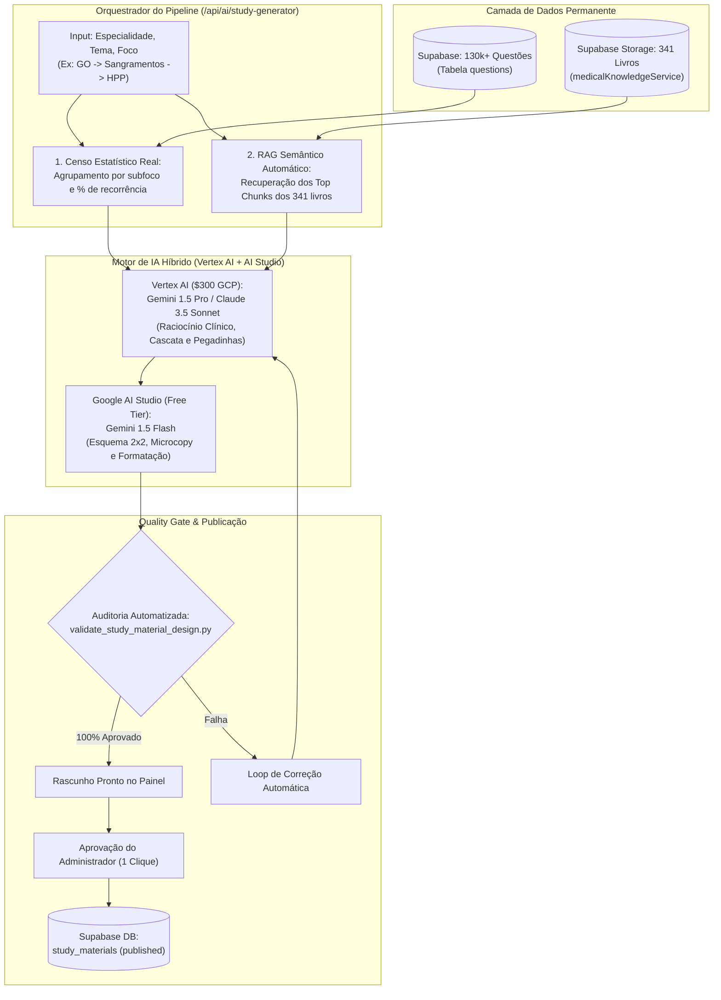

# Plano Mestre Canônico: Engenharia e Criação Adaptativa de Resumos Clínicos de Alto Rendimento

> **Documento Estratégico & Arquitetura de Produção Editorial**  
> **Plataforma:** Banco Residência  
> **Versão:** 2.7.0 — Padrão-Ouro Canônico de Design & UX Médica  
> **Módulo:** Resumos Clínicos Adaptativos & Sistema de Preceptoria Médica  
> **Escopo:** Pipeline de produção em escala para 300+ temas da residência médica, grounding automático na base de 341 livros médicos, censo estatístico em tempo real de 130k+ questões do Supabase, execução híbrida (Google Cloud Vertex AI com \$300 de crédito + Google AI Studio), Design System Canônico (`med-study-design-system`), curadoria humana de alto nível (Human-in-the-Loop) e Quality Gate automatizado em Python.

---

## 1. Diretriz Estratégica: Curadoria Interna vs. Geração por Estudantes

Diferente de interfaces genéricas de chat, os Resumos Clínicos do Banco Residência **não são gerados sob demanda por estudantes**. Eles são produzidos internamente pelo administrador da plataforma através do pipeline de IA, revisados clinicamente e publicados como acervo oficial.

### Vantagens Estratégicas Deste Modelo:
1. **Risco Zero de Alucinação Médica:** Nenhuma conduta ou dose chega ao estudante sem validação prévia contra diretrizes oficiais (PCDT, FEBRASGO, SBC, ATLS).
2. **Multiplicação de Valor dos \$300 de Crédito do GCP:** Um resumo gerado uma única vez atende dezenas de milhares de alunos no banco de dados com custo marginal zero de tokens.
3. **Harmonia Visual Estrita:** Todos os materiais seguem 100% dos 8 testes de design do script `validate_study_material_design.py`.

---

## 2. Visão Geral da Arquitetura do Pipeline de Resumos



---

## 3. Matriz de Preceptores Especialistas por Área Médica

Cada área médica possui premissas de conduta e fontes prioritárias vinculadas ao pipeline:

```
.agents/skills/
├── professor-clinica-medica/          # Harrison, Cecil, SBC, SBPT, SBD, KDIGO, GOLD, GINA
├── professor-cirurgia-geral/          # Sabiston, ATLS 11ª ed, CBC, Colégio Americano de Cirurgiões
├── professor-pediatria/               # Nelson Tratado de Pediatria, SBP, PALS, Caderneta da Criança
├── professor-ginecologia-obstetricia/ # FEBRASGO, Williams, Berek & Novak, FIGO, ACOG
├── professor-medicina-preventiva/     # Rouquayrol, Leis 8.080/8.142, Medronho, SUS
└── professor-especialidades-r-plus/    # Títulos de Especialista (TEGO, TECM, CBO) e R3/R4
```

---

## 4. O Censo Estatístico Automático (Raio-X de Recorrência)

O resumo não ensina o que o livro quer, mas o que as bancas cobram:

1. **Cálculo Determinístico:** O pipeline consulta a tabela `questions` no Supabase e calcula a distribuição real:
   $$\text{Percentual} = \frac{N_{\text{subfoco}}}{N_{\text{total do foco}}} \times 100$$
2. **Priorização das Seções:**
   * **Prioridade Crítica ($\ge 30\%$):** Recebe o maior peso textual e detalhamento cirúrgico de doses e condutas.
   * **Prioridade Alta ($15\%$ a $29\%$):** Recebe matriz explicativa e armadilha clássica.
   * **Prioridade Média ($< 15\%$):** Sintetizada em tópicos diretos.
3. **Alimentação do Donut (`ExamStatItem`):**
   * Preenchimento automático do componente de estatísticas (`ExamRecurrenceStatsCard.tsx` / `HppRecurrenceStatsCard.tsx`) com contagem absoluta (`{questionCount} questões`), percentual central harmonioso (`text-2xl sm:text-3xl`) e legenda limpa.

---

## 5. Especificação Canônica de Design do Resumo (`med-study-design-system` v2.7.0)

A estrutura gerada deve respeitar rigorosamente as seguintes diretrizes:

### 1. Largura Harmonizada
* Container principal expandido (`w-full max-w-7xl mx-auto`), alinhado aos dashboards e leitores da plataforma.

### 2. Topo Limpo e Sem Duplicidade
* O cabeçalho do componente já renderiza o título oficial (`material.title`). O corpo do markdown **não deve conter título H1**.
* **Barra de Tópicos Sticky Flutuante:** Fixa logo abaixo do header principal (`top-[4.5rem] z-20`) com auto-scroll suave centralizando o tópico ativo via Scroll Spy. Sem scrollbars nativas visíveis.

### 3. Raio-X com Donut Recharts Blindado
* Recharts Donut (5 colunas) + Barras de progresso e prioridade (7 colunas).
* **Animação Blindada contra Toque/Rolagem:**
  * `animationBegin={0}`, `animationDuration={800}`, `ease-out`.
  * `pointer-events-none` ativo durante os 800ms de animação inicial.
  * `isAnimationActive=false` e `pointer-events-auto` restaurados em `onAnimationEnd`.
* Zero tooltips escuros flutuantes sobre o gráfico.
* **Lock de Seleção:** Clique no setor ou linha fixa o setor ativo (100% de opacidade) e clareia os inativos (28% de opacidade), exibindo card inferior horizontal de largura total com a explicação direta de prova.
* Rolagem vertical ergonômica ativada para listas com mais de 5 tópicos (`max-h-[310px] overflow-y-auto`).

### 4. Esquema Multicolunas em Matriz 2x2
* Para esquemas com 4 elementos (ex.: 4 Ts da HPP, classificações topográficas), utilizar obrigatoriamente **Matriz 2x2 (2 colunas e 2 linhas)** (`grid-cols-1 md:grid-cols-2`).
* Proibido espremer em 4 colunas verticais (`grid-cols-4`).
* Altura unificada de cabeçalho (`min-h-[46px]`) com microcopy objetivo (máximo 2 a 3 tópicos por quadrante).

### 5. Algoritmo Decisório e Passo a Passo Sintético
* **Passo a Passo Obrigatório:** Precedendo qualquer diagrama ou fluxograma, apresentar 3 a 5 passos numerados objetivos.
* **Ponto Principal Imediato:** Cada passo abre com a regra de ouro em negrito:  
  `**[Ponto Principal]:** Conduta mandatória...`
* **Proibição Estrita:** Zero blocos escuros de Mermaid (` ```mermaid `) e zero SVGs artificiais (`data:image/svg+xml`).

### 6. Caixas de Aviso e Armadilhas de Prova
* Destaque para pegadinhas clássicas de bancas examinadoras (ENARE, USP, UNICAMP):
  > [!WARNING] Armadilha Clássica de Prova: [Descrição da pegadinha de prova]

### 7. Fórmulas Médicas
* Renderização em KaTeX centralizado elegante:
  $$\text{Índice de Choque (SI)} = \frac{\text{FC (bpm)}}{\text{PAS (mmHg)}}$$

### 8. Carrossel de Pontos-Chave
* Localizado imediatamente antes das referências oficiais.
* Loop circular infinito com harmonização cromática dinâmica (`accentConfig.primaryHex`).
* Zero ruído de rodapé ou numeração redundante dentro dos cards.

### 9. Posicionamento de Referências Oficiais
* Exclusivamente no final do resumo sob a seção `## Diretrizes Oficiais & Consensos de Referência`.

---

## 6. O Quality Gate Automatizado (`validate_study_material_design.py`)

Nenhum resumo é promovido a publicado sem passar com zero erros pela suíte de validação:

1. `[CHECK-DESIGN-1]`: Ausência de referências no topo do resumo.
2. `[CHECK-DESIGN-2]`: Presença de referências oficiais no rodapé.
3. `[CHECK-DESIGN-3]`: Ausência de seção estática de pontos-chave duplicando o carrossel.
4. `[CHECK-DESIGN-4]`: Zero diagramas Mermaid escuros.
5. `[CHECK-DESIGN-5]`: Zero SVGs artificiais sintéticos.
6. `[CHECK-DESIGN-6]`: Presença do passo a passo sintético antecedendo o fluxograma.
7. `[CHECK-DESIGN-7]`: Ausência de tooltips flutuantes escuros no Donut.
8. `[CHECK-DESIGN-8]`: Controle de fixação por clique (Lock de Seleção) no Donut.
9. `[CHECK-DESIGN-8.1]`: Matriz 2x2 aplicada em esquemas de 4 elementos.

---

## 7. Roteiro de Execução de Escala (300 Temas)

Com o pipeline integrado na rota `/api/ai/study-generator`:
* **Semana 1:** Ginecologia e Obstetrícia (~60 temas).
* **Semana 2:** Cirurgia Geral e Trauma (~65 temas).
* **Semana 3:** Pediatria e Neonatologia (~55 temas).
* **Semana 4:** Clínica Médica, Preventiva e SUS (~100 temas).
* **Custo Total Estimado de IA:** ~\$25 a \$35 USD (consumindo menos de 12% dos \$300 de crédito do GCP).

---
*Plano Mestre de Resumos Clínicos Canônicos homologado para o Banco Residência.*
