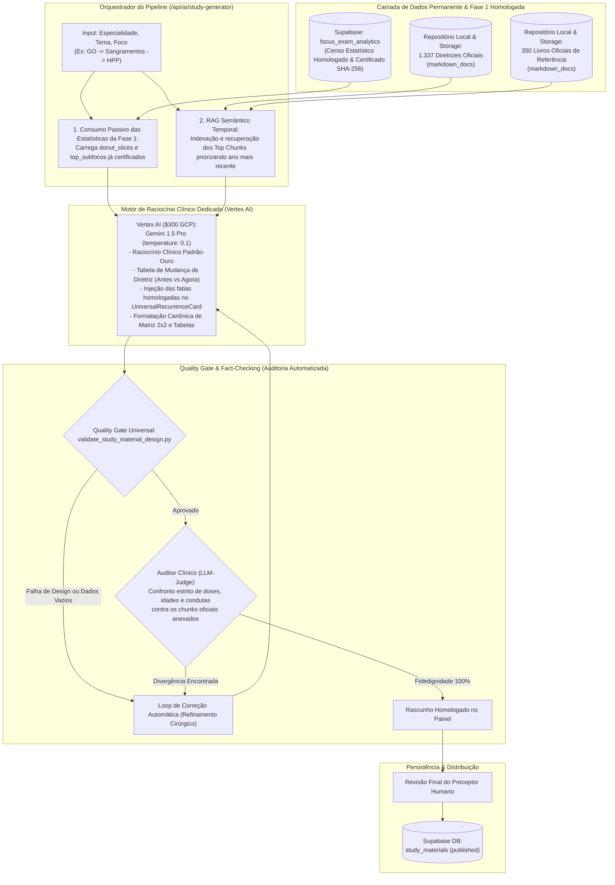

# Plano Mestre Canônico: Engenharia e Criação Adaptativa de Resumos Clínicos de Alto Rendimento

> **Documento Estratégico & Arquitetura de Produção Editorial**  
> **Plataforma:** Banco Residência  
> **Versão:** 3.1.0 — Blindagem Canônica Anti-Redundância, Ground-Truth Iconográfico (Zero Stock Photos), Empilhamento Vertical de Tríades Semiologicas (`cases`) e Interceptação Nativa de Custom Codeblocks  
> **Módulo:** Resumos Clínicos Adaptativos & Sistema de Preceptoria Médica  
> **Escopo:** Pipeline de produção em escala para 300+ temas da residência médica, grounding automático na base de 1.337 diretrizes oficiais e 350 livros médicos com priorização temporal (consenso mais recente), censo estatístico determinístico em tempo real de 130k+ questões do Supabase com recálculo por instituição (ENARE, USP, UNICAMP, SUS-SP, AMRIGS), execução dedicada via Google Cloud Vertex AI (Gemini 1.5 Pro com $300 de crédito), Design System Canônico (`med-study-design-system`), catálogo de 11 esquemas visuais sob demanda com Princípio da Parcimônia Clínica, protocolo de imagens médicas reais com legendas de prova, governança por 3 Skills dedicadas (`clinical-formula-engine`, `clinical-visual-schematics`, `interactive-study-widgets`), tolerância zero a dados estatísticos vazios/falsificados e Quality Gate automatizado em Python/TypeScript.

---

## 1. Diretriz Estratégica: Curadoria Interna & Foco Exclusivo em Resumos

Os Resumos Clínicos do Banco Residência **são o ativo editorial central da plataforma**, produzidos internamente através de um pipeline de IA de alta precisão, revisados por preceptores médicos e publicados como acervo oficial permanente.

### Pilares Estratégicos Deste Modelo:
1. **Foco 100% Exclusivo em Resumos Clínicos:** O pipeline deste plano motor é dedicado exclusivamente à síntese médica canônica. A criação de flashcards fica totalmente desvinculada desta rota, garantindo que 100% do tempo de execução (evitando timeouts de 60s) e da janela de contexto dos modelos de ponta (Gemini 1.5 Pro) sejam empregados no raciocínio clínico, nas nuances de conduta e no rigor de design.
2. **Priorização Temporal Estrita das Diretrizes Oficiais:** A medicina baseada em evidências evolui rapidamente. O pipeline prioriza compulsoriamente os consensos vigentes mais recentes (2024–2026 sobre consensos antigos), explicitando o ano e o órgão emissor de cada conduta.
3. **Mapeamento de Rupturas de Paradigma (O Que Mudou na Diretriz):** O resumo não se limita a expor a conduta atual; ele contrasta didaticamente a prática anterior (que as bancas adoram usar como distrator) com a nova conduta oficial homologada.
4. **Tolerância Zero a Falhas Censitárias:** O resumo é orientado pelo censo real de prova. Se por qualquer motivo os dados estatísticos de um tema não forem calculados ou estiverem ausentes, **o sistema deve obrigatoriamente apontar isso como erro no resumo**, sendo terminantemente proibido o uso de fallbacks silenciosos ou dados de outras patologias.
5. **Harmonia Visual Estrita:** Conformidade mandatória com todos os testes do Quality Gate do script `validate_study_material_design.py`.

---

## 2. Visão Geral da Arquitetura do Pipeline Exclusivo de Resumos



---

## 3. Matriz de Preceptores Especialistas, Fontes das Bancas e Duplo Ranqueamento

Cada área médica opera com parâmetros de recência e órgãos de autoridade máxima vinculados ao pipeline:

```
.agents/skills/
├── professor-clinica-medica/          # Diretrizes SBC (2020-2024), SBPT, SBD (2024), KDIGO (2023-2024), GOLD (2024), GINA (2023), Harrison 21ª ed, Cecil 26ª ed
├── professor-cirurgia-geral/          # Sabiston 21ª ed, ATLS 11ª ed, CBC, Colégio Brasileiro de Cirurgia Digestiva, Guidelines WSES
├── professor-pediatria/               # Nelson Tratado de Pediatria 21ª ed, SBP (Diretrizes 2023-2025), PALS atualizado, Caderneta da Criança MS
├── professor-ginecologia-obstetricia/ # FEBRASGO (Consensos 2022-2025), Williams Obstetrícia 26ª ed, Berek & Novak 16ª ed, FIGO (2023), ACOG
├── professor-medicina-preventiva/     # PCDT Ministério da Saúde vigentes, Rouquayrol 2024, Leis 8.080/8.142, Medronho, PNAB e Portarias SUS
└── professor-especialidades-r-plus/    # Consensos de Sociedades de Especialidade e Provas de Título (TEGO, TECM, CBC)
```

### 3.1. Mecanismo de Dupla Priorização: Peso de Banca ($W_{\text{Banca}}$) + Recência Suave ($W_{\text{Recência}}$)

Para evitar o **apagão de conhecimento** em temas onde consensos seminais continuam plenamente vigentes (ex.: manuais clássicos do Ministério da Saúde e critérios diagnósticos canônicos de provas), **não se utiliza filtro rígido de ano mínimo**. Em vez disso, o motor de RAG aplica uma **fórmula de re-ranqueamento dinâmico**:

$$\text{Score Final} = \text{Score Semântico} \times W_{\text{Banca}} \times W_{\text{Recência}}$$

#### A. Matriz de Autoridade das Bancas Brasileiras ($W_{\text{Banca}}$):
Prioriza estritamente os órgãos cujos documentos formam o espelho de gabarito e a bibliografia oficial das bancas (ENARE, USP-SP, UNICAMP, SUS-SP, PSU-MG, AMRIGS, INEP/Revalida):

| Nível de Autoridade | Fontes Oficiais Incluídas | Peso ($W_{\text{Banca}}$) | Impacto no Concurso |
| :--- | :--- | :---: | :--- |
| **Nível 1A: Órgão Federal Regulador** | **Ministério da Saúde (MS)**: PCDTs, Cadernos de Atenção Básica, Manuais Técnicos da SAPS. | **1.6** | Referência legal máxima das bancas públicas; gabaritos baseados em PCDT são irrefutáveis. |
| **Nível 1B: Sociedades Nacionais Especializadas** | **FEBRASGO** (GO), **SBP** (Pediatria), **SBC** (Cardio), **SBD** (Diabetes), **SBPT** (Pneumo), **CBC** (Cirurgia). | **1.5** | Consensos cobrados diretamente nos enunciados de R1, R3 e Provas de Título. |
| **Nível 2: Livros-Texto Clássicos de Edital** | **Williams** (Obstetrícia), **Berek & Novak** (Gineco), **Sabiston** (Cirurgia), **Harrison/Cecil** (Clínica), **Nelson** (Pediatria), **ATLS** 10ª/11ª ed. | **1.3** | Bibliografia expressa dos editais de grandes bancas paulistas e federais. |
| **Nível 3: Diretrizes Internacionais de Ponta** | **ACOG**, **CDC**, **WHO/OMS**, **Surviving Sepsis Campaign**, **GOLD**, **GINA**, **KDIGO**. | **1.1** | Aplicadas quando não há divergência nacional ou quando a questão cobra atualização global de ponta. |
| **Nível 4: Literatura Geral / Suporte** | Revisões narrativas, estudos observacionais gerais. | **1.0** | Apoio conceitual secundário. |

#### B. Função de Recência Suave ($W_{\text{Recência}}$) sem Ano Mínimo de Corte:
$$W_{\text{Recência}} = 1.0 + \left(\frac{\text{Ano} - 2015}{20}\right) \times 0.5$$
* Documentos recentes (2024–2026) ganham boost proporcional ($W \approx 1.25$ a $1.28$), assumindo o topo do contexto.
* Consensos seminais consolidados (ex.: 2012–2015) mantêm peso base ($W \approx 1.0$), **nunca sendo descartados** se forem a única referência vigente para aquele tema.
* Se um mesmo órgão tiver duas versões no acervo (ex.: FEBRASGO 2017 e FEBRASGO 2024), a de 2024 assume compulsoriamente a conduta vigente, enquanto a de 2017 é enviada ao modelo apenas como distrator histórico para a tabela de Ruptura de Paradigma.

---

## 4. Consumo do Censo Estatístico Homologado (Fase 1) & Rigor no Gráfico Donut

O Resumo Clínico não calcula estatísticas em tempo de execução: ele é um **consumidor passivo e estrito** da matriz homologada da Fase 1 (`focus_exam_analytics`):

1. **Injeção dos Dados Certificados:** O pipeline busca a linha correspondente em `focus_exam_analytics` via `focus_slug` e utiliza o array de fatias normalizado (`donut_slices`, soma 100,0% certificada com hash SHA-256).
2. **Priorização e Sequenciamento das Seções Clínicas:**
   * **Prioridade Crítica ($\ge 30\%$):** Recebe o maior peso textual, detalhamento cirúrgico de doses, fluxos imediatos e alertas centrais. O tópico número 1 do resumo deve cobrir obrigatoriamente o subfoco de maior relevância.
   * **Prioridade Alta ($15\%$ a $29\%$):** Recebe matriz explicativa e armadilha clássica de prova.
   * **Prioridade Média ($< 15\%$):** Sintetizada em tópicos diretos e objetivos.
3. **Serialização no Token `exam-stats` e Renderização Universal:**
   * Os dados homologados alimentam nativamente o componente `<UniversalRecurrenceStatsCard />`, estruturados com o contrato canônico expandido (`RecurrenceSliceItem`):
     * `focusExplanation: string`: Explicação clínica canônica densa do que o candidato deve saber sobre o tópico (doses exatas, cascata cronológica de condutas, critérios e trials de referência).
     * `bancaPatterns: Record<string, BancaPatternDetail>`: Padrões específicos de cobrança por banca examinadora (`ENARE`, `USP`, `UNICAMP`, `PSU-MG`, `AMRIGS`, `SUS-SP`), contendo `howItCharges` (formulação de questão) e `trapAlert` (armadilha/distrator clássico da banca).
     * `bancaBreakdown: Record<string, BancaBreakdownItem>`: Censo estratificado de questões por instituição para recalcular proporções reativamente.
4. **REGRA DE OURO — Tolerância Zero a Dados Falsos ou Vazios:**
   * **É terminantemente proibido utilizar fallbacks silenciosos** (como injetar dados de Miomatose Uterina ou estimativas genéricas) caso o foco ainda não possua estatísticas na Fase 1.
   * Se o foco não estiver com status `CERTIFIED` em `focus_exam_analytics`, **o Quality Gate deve obrigatoriamente bloquear a geração do Resumo Clínico**, exigindo a homologação prévia do censo estatístico.

---

## 5. Especificação Canônica de Design do Resumo (`med-study-design-system` v2.8.0)

A estrutura visual e didática gerada deve respeitar rigorosamente as seguintes diretrizes:

### 1. Dinamismo de Seções & Variabilidade por Foco Clínico
* **Quantidade e Qualidade Moldadas ao Foco:** É diretriz central do Design System que a **quantidade de seções (tipicamente entre 5 e 9 seções clínicas)** e a **profundidade analítica** variem organicamente de acordo com a complexidade intrínseca de cada patologia.
  * Temas com múltiplos estadiamentos, farmacoterapia pesada e procedimentos cirúrgicos (ex.: STFF, HPP, Pré-Eclâmpsia Grave, Câncer de Colo Uterino) expandem livremente em profundidade (150 a 300+ linhas).
  * Temas focais, cirúrgicos pontuais ou conceituais mantêm síntese objetiva e concisa, sem preenchimento artificial.

### 2. Topo Limpo & Regra de Titulação Médica Semântica Obrigatória
* **Regra de Topo Limpo (Zero H1 no Corpo do Markdown):** O cabeçalho do leitor (`StudyMaterialReader.tsx`) já renderiza o título oficial em tipografia de destaque (`material.title`). O corpo do markdown **não deve conter nenhum título H1 (`# `)**, devendo iniciar diretamente na contextualização clínica de prova ou no bloco censitário `exam-stats`. Qualquer H1 no markdown gera duplicação visual e ruído estético desnecessário.
* **Proibição Expressa de Meta-Títulos Abstratos:** É terminantemente proibido utilizar títulos como `"## 2. Definições Modernas"`, `"## 3. Matriz 2x2 & Classificações"` ou `"## 4. Algoritmo Decisório"`.
* **Titulação Clínica Obrigatória:** Cada cabeçalho `## ` deve conter o termo médico real da patologia, sinal, estadiamento ou conduta (ex.: `"## 2. Ultrassonografia no 1º Trimestre: Sinal do Lambda vs. Sinal do T"`, `"## 3. Classificação de Quintero (Estádios I a V) & Parâmetros de Doppler"`), pois **esses títulos geram automaticamente as pílulas de navegação rápida da barra flutuante (`sectionPills`)**.
* **Barra de Tópicos Sticky Flutuante:** Fixa logo abaixo do header principal (`top-[4.5rem] z-20`) com auto-scroll suave centralizando o tópico ativo via Scroll Spy com a cor de acento do usuário.

### 3. Raio-X com Donut Recharts Blindado e Dinâmico (`UniversalRecurrenceStatsCard`)
* O leitor (`StudyMaterialReader.tsx`) intercepta o bloco `exam-stats`, decodifica o payload JSON e renderiza nativamente o componente `<UniversalRecurrenceStatsCard />`.
* **Seletor de Bancas Mandatório na Barra Superior:**
  * O cabeçalho do card deve conter **obrigatoriamente um seletor horizontal de bancas sempre visível e funcional** (`Todas`, `ENARE`, `USP`, `UNICAMP`, `PSU-MG`, `AMRIGS`, `SUS-SP`).
  * A troca de banca recalcula imediatamente os volumes amostrais e percentuais do gráfico Donut e da lista lateral, alterando dinamicamente o subtítulo ("*Distribuição proporcional de X questões...*" vs. "*Recorte amostral exclusivo de Y questões da banca Z*").
* **Animação Blindada contra Toque/Rolagem:**
  * `animationBegin={0}`, `animationDuration={900}`, `ease-out`.
  * `pointer-events-none` ativo durante o tempo de animação inicial para evitar que toques acidentais durante a rolagem mobile quebrem o estado da renderização.
  * Zero tooltips flutuantes escuros sobre o gráfico.
* **Dupla Camada Explicativa do Tópico Ativo (Padrão Ouro de Alta Densidade):**
  * **Camada 1 — O Que Você Deve Saber (Explicação Clínica Canônica):** O setor ativo exibe o campo `focusExplanation` (ou `takeaway`) com formatação rica em negrito (`**...**`), cobrindo definição etiológica, doses exatas de fármacos, tempos de permanência, trials de referência e critérios de alta.
  * **Camada 2 — Como a Banca Cobra Este Tópico (Reatividade Imediata por Banca):** Diretamente abaixo da explicação clínica, renderiza o bloco dinâmico `🎯 Como a banca [Banca Selecionada] cobra este tópico:`. Este bloco consome `bancaPatterns[selectedBanca]` e se altera **em tempo real** conforme o usuário clica nas bancas do seletor superior, explicitando o estilo de formulação da questão daquela instituição, os distratores favoritos e a caixa de alerta `⚠️ Armadilha clássica desta banca:`.
* **Sanitização de Formatação:** O texto explicativo de ambas as camadas deve obrigatoriamente renderizar formatações inline (negrito, itálico) através de sanitização HTML, nunca exibindo asteriscos brutos.

### 4. Esquemas Visuais em Matriz 2x2: Responsividade e Microcopy Telegráfica
* **Matriz 2x2 Modular (Cards em Grade vs. Tabelas Longas):**
  * Para polaridades clínicas opostas (ex.: *Fatores de Risco vs. Fatores de Proteção*) ou entidades quaternárias (ex.: *Regra dos 4 Ts da HPP*), o padrão visual preferencial é a disposição em **Cards Modulares em Grade 2x2** (`grid-cols-1 md:grid-cols-2 gap-4 sm:gap-5`).
  * **Proibição de Tabelas Monolíticas Densas:** Tabelas nativas de markdown com múltiplos parágrafos longos por célula causam compressão severa e quebra forçada em smartphones. Quando estruturada em markdown nativo ou cartões, cada quadrante da matriz deve conter **microcopy telegráfica** (máximo de 3 a 4 tópicos enxutos com marcadores diretos e uma caixa de armadilha `⚠️ Prova:` ou `🚫 Prova:`).
* **Tabelas Clínicas e Anatômicas Estruturadas (Markdown Nativo):**
  * Para estadiamentos extensos, tabelas de fármacos, doses e vias de administração, utilizar tabelas nativas de markdown com alinhamento explícito (`| :--- | :---: | :--- |`). O leitor estiliza automaticamente com cantos arredondados, fundo contrastante e tipografia clara.

### 5. Algoritmo Decisório e Passo a Passo Sintético
* **Passo a Passo Obrigatório:** Precedendo qualquer fluxograma decisório, apresentar de 3 a 5 passos numerados objetivos.
* **Ponto Principal Imediato:** Cada passo abre com a regra de ouro em negrito:  
  `**[Ponto Principal]:** Conduta mandatória...`
* **Proibição Estrita:** Zero blocos escuros de Mermaid (` ```mermaid `) e zero SVGs artificiais (`data:image/svg+xml`).

### 6. Caixas de Aviso e Armadilhas Clássicas de Prova
* Destaque para pegadinhas clássicas de bancas examinadoras (ENARE, USP, UNICAMP, PSU-MG):
  > [!WARNING] Armadilha Clássica de Prova: [Descrição exata do distrator que a banca utiliza para induzir o candidato ao erro]

### 7. NOVA SEÇÃO MANDATÓRIA: O Que Mudou na Diretriz Recente? (Ruptura de Paradigma)
Toda patologia sujeita a atualização de consenso deve conter uma seção destacada no corpo do resumo contrastando a conduta desatualizada com a norma vigente:

````markdown
### 🔄 O Que Mudou na Diretriz Recente? (Ruptura de Paradigma)

| Ponto de Conduta | Prática Antiga (Pegadinha das Bancas) | Nova Conduta Oficial Homologada | Diretriz Vigente / Ano |
| :--- | :--- | :--- | :--- |
| **Ponto Clínico Chave** | [Conduta revogada que ainda aparece em gabaritos desatualizados] | [Conduta padrão-ouro atual] | [Órgão Oficial / Ano (Ex: FEBRASGO 2024)] |

> [!IMPORTANT] Alerta de Atualização para Provas de 2024-2026:
> [Explicação direta de como as bancas mais recentes estão formulando as questões para punir quem estudou por diretrizes antigas]
````

### 8. Fórmulas Médicas & Operadores de Implicação Clínica (KaTeX)
* **Zero Quebras e Zero Código Exposto:** Proibição terminante de texto cru com barras invertidas (`\begin{cases}`, `\text{...}`). Todo cálculo ou critério deve renderizar em cartões matemáticos centrais ou tipografia matemática integrada.
* **Fórmulas de Bloco:** Delimitadas por `$$ ... $$` em linhas dedicadas:
  $$\text{Índice de Choque (SI)} = \frac{\text{FC (bpm)}}{\text{PAS (mmHg)}}$$
* **Operadores Lógicos Mandatórios:** `\implies` ($\implies$), `\iff` ($\iff$), `\ge` ($\ge$), `\le` ($\le$), `\approx` ($\approx$), `\times` ($\times$).
* **Ambiente de Chaves Clínicas (`cases`):** Padronizado obrigatoriamente para tríades, tétrades e critérios diagnósticos:
  $$\text{Tríade de Bumm} \implies \begin{cases} \text{1. Febre persistente com taquicardia desproporcional} \\ \text{2. Útero subinvoluído, doloroso e amolecido à palpação} \\ \text{3. Lóquios achocolatados e intensamente fétidos} \end{cases}$$
* **Governança:** Regido pela skill `.agents/skills/clinical-formula-engine/SKILL.md`.

### 9. Anatomia Canônica do Raio-X de Recorrência (Modelo Imagem 3 + Filtro de Bancas)
* **Lado Esquerdo:** Donut proporcional com percentual central em tipografia de destaque (`XX%`), legenda `"recorrência em provas"` e aviso de interação `"Passe o mouse ou toque nos setores do gráfico para detalhar"`.
* **Lado Direito:** Lista de subfocos com:
  1. Ponto colorido na cor semântica do subfoco.
  2. Nome do subfoco em negrito.
  3. Badge de prioridade semântica (`Crítica` em vermelho, `Alta` em âmbar, `Média` em azul).
  4. Contagem explícita (`{q} questões`).
  5. **Barra de progresso horizontal animada** (`w-full h-1.5 rounded-full`) preenchida na cor do subfoco sobre trilha cinza suave.
* **Box Inferior Reativo:** Card destacado com índice numérico circular (`1`, `2`, `3`), título cardinal do subfoco e parágrafo tático de conduta destacando termos decisivos em negrito.
* **Filtro Dinâmico de Bancas (Obrigatório):**
  - O seletor de bancas no topo (`Todas`, `AMRIGS`, `SUS-SP`, `UNESP`, `UNICAMP`, etc.) deve ser **100% funcional e reativo**.
  - Ao clicar em uma banca, o Donut recalcula instantaneamente as fatias com base no `bancaBreakdown`, atualizando as porcentagens centrais, as barras de progresso e o totalizador de questões da instituição.
* **Governança:** Regido pela skill `.agents/skills/interactive-study-widgets/SKILL.md`.

### 10. Catálogo Canônico de 11 Esquemas Visuais Modulares (Princípio da Parcimônia Clínica)
> [!IMPORTANT] Princípio da Parcimônia e Relevância Real
> **Proibição de Poluição Visual:** Esquemas visuais devem ser adicionados **estritamente se houver necessidade clínica pedagógica**, limitando-se a no máximo **1 a 2 esquemas por resumo**. Nunca forçar matrizes ou diagramas em temas lineares e descritivos.

Quando clinicamente oportuno, o autor/motor seleciona exatamente o esquema ideal entre os 11 modelos canônicos:
1. **Esquema Bipolar (2 Colunas):** Fatores de Risco vs. Fatores de Proteção, Indicações vs. Contraindicações, Parto Normal vs. Cesárea (com alertas de prova no rodapé de cada coluna).
2. **Esquema Pipeline Decisório (3 Etapas):** Investigação armada ou manejo sequencial (Etapa 1: *Exame Inicial* $\rightarrow$ Etapa 2: *Exame de Cavidade* $\rightarrow$ Etapa 3: *Padrão-Ouro / Conduta Refinada*).
3. **Esquema de Cenários Clínicos & Farmacoterapia:** Grade horizontal de 3 cenários (*Assintomática / Desejo Reprodutivo / Tratamento Definitivo*) correlacionados a blocos de farmacoterapia comparada.
4. **Esquema Matriz 4 Quadrantes (2x2):** Matriz balanceada para síndromes com 4 pilares mnemônicos cardinais (ex: 4 Ts da HPP, 4 causas de febre puerperal, 4 classes FIGO).
5. **Linha do Tempo / Cronologia Clínica:** Eixo horizontal temporal com marcos clínicos que separam fisiológico de patológico por dia ou hora pós-evento.
6. **Escada Terapêutica (Step-Up):** Degraus empilhados de manejo para patologias que falham na 1ª linha e exigem escalonamento progressivo de invasividade com critérios de falha.
7. **Matriz Diferencial de Alta Fricção:** Tabela comparativa em 3-4 colunas verticais contrastando doenças quase idênticas, destacando a *"Palavra-Chave Patognomônica"* no topo.
8. **Árvore de Decisão Bifurcada:** Triagem rápida de emergência dividindo a conduta em dois braços opostos: *Braço Estável (Verde)* vs. *Braço Instável (Vermelho)*.
9. **Grid de Escore Preditivo:** Tabela de pontuação somatória associada a 3 cartões de conduta imediata orientada por faixas de corte (Baixo, Médio e Alto Risco).
10. **Anatomia Topográfica em Camadas:** Camadas teciduais sobrepostas para infecções de ferida cirúrgica ou lacerações onde a profundidade dita a conduta e o esquema antimicrobiano.
11. **Cartão de Toxicidade Farmacológica & Antídotos:** Card de segurança vermelha/âmbar para drogas de alto risco, sequência de sinais de intoxicação e antídoto de resgate imediato.

* **Sintaxe Declarativa:** Incorporação no markdown via blocos semânticos ````clinical-scheme`.
* **Governança:** Regido pela skill `.agents/skills/clinical-visual-schematics/SKILL.md`.

#### 10.1. Regra de Ouro Anti-Redundância em Esquemas Visuais
* **Proibição de Subtítulo Redundante:** Quando um título de seção (`## 3. Fatores de Risco...`) já introduz o tema, é expressamente proibido inserir um subtítulo intermediário repetindo as mesmas palavras (ex: `Matriz 2x2: Fatores Determinantes de Risco...`).
* **Título Interno do Card Opcional:** O card do esquema visual deve deixar `title` e `subtitle` vazios/omitidos caso o título da seção já o introduza. O cabeçalho exibirá apenas o badge de diretriz no canto superior direito (`badge: "Diretriz FEBRASGO / CDC"`), eliminando duplicações visuais.
* **Proibição de Despejo de Quadrantes em Texto:** Nunca despejar listas markdown com `#### 🔴 Quadrante 1:...` abaixo do card visual. O card visual já é o componente canônico oficial. Despejar o texto abaixo cria poluição e aspecto de rascunho de IA não revisado.

### 11. Protocolo Mandatório de Imagens Médicas Reais com Legendas Estruturadas
* **Autenticidade e Qualidade (Ground-Truth Iconográfico):** Todo resumo com foco em patologia cirúrgica, propedêutica armada (USG, TC, RNM, Histeroscopia) ou semiologia externa deve incluir **imagens reais e autênticas** de alta resolução extraídas de fontes médicas abertas (Wikimedia Commons, Radiopaedia, NCBI/PubMed Central Open Access) ou do banco de questões da plataforma.
* **Proibição Estrita de Fotos Sem Contexto:** Fotos de bancos genéricos, vetores decorativos, salas cirúrgicas vazias, equipamentos sem paciente e cliparts são **terminantemente proibidos**. Cada imagem deve retratar o sítio anatômico ou achado semiológico exato discutido.
* **Legenda Estruturada Obrigatória em 3 Itens:**
  ```markdown
  ![**[Achado Visual Cardinal]**: Descrição semiológica precisa do exame. • **[Diagnóstico Associado]**: Patologia associada. • **[Ponto Crítico de Prova]**: Armadilha clássica cobrada pelas bancas.](/images/clinical/exemplo.jpg)
  ```
* **Estilização no Leitor:** Moldura suave (`rounded-2xl border border-zinc-200 dark:border-zinc-800`), sombra sutil, zoom responsivo e legenda em itálico estilizada com separadores temáticos.

### 12. Carrossel de Pontos-Chave das Provas
* Localizado imediatamente antes das referências oficiais.
* Loop circular infinito harmonizado com a cor de acento do usuário (`accentConfig.primaryHex`), navegável por setas, botões, atalhos de teclado ($\leftarrow$ / $\rightarrow$) e touch swipe. Zero repetição estática no corpo do texto.

#### 12.1. Apresentação Empilhada Obrigatória de Tríades Semiologicas (`cases`)
* Fórmulas de tríade, pêntade ou critérios múltiplos usando `\begin{cases}` devem sempre ser renderizadas como **cards verticais empilhados** (`Tx`, `1`, `2`, `3`), e jamais colapsadas horizontalmente em uma única linha com marcadores inline.
* **Governança:** Regido pela skill `.agents/skills/clinical-formula-engine/SKILL.md`.

### 13. Isolamento Estrito de Focos Clínicos no Leitor
* A associação entre foco e material de estudo em `FlashcardsView.tsx` deve ocorrer estritamente pelo campo `m.focus` (`normalizeText(m.focus) === normalizeText(focoSelecionado)`).
* É expressamente vedado usar o tema como critério amplo de busca inicial, garantindo que temas com múltiplos focos abram seus respectivos resumos clínicos independentes.

### 14. Posicionamento de Referências Oficiais
* Exclusivamente no final do resumo sob a seção `## Diretrizes Oficiais & Consensos de Referência`, contendo o nome da sociedade, documento e ano de publicação. Proibido posicionar referências no topo do resumo.

### 15. Blindagem Contra Vazamento de Blocos Técnicos (Zero Raw JSON)
* Blocos declarativos de alto rendimento (`diff-diagnosis`, `clinical-score`, `clinical-scheme`, `exam-stats`) devem obrigatoriamente possuir interceptadores nativos ricos na camada de renderização (`StudyMaterialReader.tsx`). É terminantemente proibido que o leitor exponha blocos `<pre><code>` brutos ou sintaxe JSON na tela do estudante.

---

## 6. O Quality Gate Automatizado & Fact-Checking Clínico

Nenhum resumo é promovido ao status de publicado sem passar com **zero erros** pela suíte de validação:

### Bateria de Verificação Automatizada (v3.1.0):
1. `[CHECK-DESIGN-1]`: Ausência de bloco de referências no topo do resumo.
2. `[CHECK-DESIGN-2]`: Presença de referências oficiais no rodapé com indicação de ano e órgão.
3. `[CHECK-DESIGN-3]`: Ausência de seção estática de pontos-chave duplicando o carrossel.
4. `[CHECK-DESIGN-4]`: Zero diagramas Mermaid escuros (` ```mermaid `).
5. `[CHECK-DESIGN-5]`: Zero SVGs artificiais (`data:image/svg+xml`).
6. `[CHECK-DESIGN-6]`: Presença do passo a passo sintético antecedendo o fluxograma decisório.
7. `[CHECK-DESIGN-7]`: **Titulação Semântica Obrigatória:** Zero meta-títulos abstratos como `"## Definições"` ou `"## Algoritmo Decisório"`. Todos os títulos devem conter termos médicos reais.
8. `[CHECK-DESIGN-8]`: **Validação do Censo e Donut Recharts:** O bloco `exam-stats` deve conter JSON parseável válido com dados reais. **Se não houver dados, o teste REPROVA o resumo imediatamente como ERRO.**
9. `[CHECK-DESIGN-9]`: **Ruptura de Paradigma:** Presença da seção ou tabela *"O Que Mudou na Diretriz Recente"* para temas com atualização de consenso.
10. `[CHECK-DESIGN-10]`: Matriz 2x2 ou esquemas modulares aplicados em conformidade com o catálogo canônico.
11. `[CHECK-CLINICAL-11]`: **Auditoria Clínica de Fidedignidade (Fact-Checking):** Checagem cruzada das doses, idades de corte e linhas terapêuticas contra os trechos das diretrizes anexadas (tolerância zero a alucinações farmacológicas).
12. `[CHECK-FORMULA-12]`: **Validação KaTeX e Zero Quebras:** Verificação de delimitadores matemáticos (`$$`), fechamento estrito de ambientes `cases`/`aligned` e zero código LaTeX bruto exposto no leitor.
13. `[CHECK-SCHEME-13]`: **Auditoria de Esquemas Visuais (Princípio da Parcimônia):** Máximo de 1 a 2 esquemas por resumo, com justificativa clínica de necessidade e presença obrigatória de box de pegadinha de prova.
14. `[CHECK-IMAGE-14]`: **Imagens Médicas Reais com Legenda Estruturada:** Garantia de que imagens clínicas incluídas possuem legenda com Achado Cardinal, Diagnóstico Associado e Ponto Crítico de Prova.
15. `[CHECK-RECURRENCE-15]`: **Reatividade do Censo e Bancas:** Validação da estrutura `bancaBreakdown` para viabilizar o filtro de instituições no Raio-X.
16. `[CHECK-DESIGN-16]`: **Anti-Redundância Estrita:** Zero repetição de títulos em subtítulos intermediários e zero despejo de quadrantes em texto corrido abaixo do card visual.
17. `[CHECK-IMAGE-17]`: **Ground-Truth Iconográfico Estrito:** Zero fotos de bancos genéricos, salas cirúrgicas vazias ou mocks; todas as imagens devem ser registros clínicos ou propedêuticos reais.
18. `[CHECK-WIDGET-18]`: **Zero Vazamento Técnico:** Interceptação nativa completa no leitor para `diff-diagnosis` e `clinical-score`.

---

## 7. Roteiro de Execução de Escala (300 Temas)

Com o pipeline integrado na rota `/api/ai/study-generator` e focado 100% em resumos:
* **Semana 1:** Ginecologia e Obstetrícia (~60 temas) — Prioridade para consensos FEBRASGO e MS.
* **Semana 2:** Cirurgia Geral e Trauma (~65 temas) — Prioridade para ATLS 11ª ed e Sabiston.
* **Semana 3:** Pediatria e Neonatologia (~55 temas) — Prioridade para SBP e Nelson.
* **Semana 4:** Clínica Médica, Preventiva e SUS (~100 temas) — Prioridade para SBC, SBD, GOLD e PCDTs.
* **Custo Total Estimado de IA:** ~\$20 a \$30 USD (consumindo menos de 10% dos \$300 de crédito do GCP na Vertex AI).

---
*Plano Mestre Canônico de Resumos Clínicos v3.0.0 homologado para o Banco Residência.*
