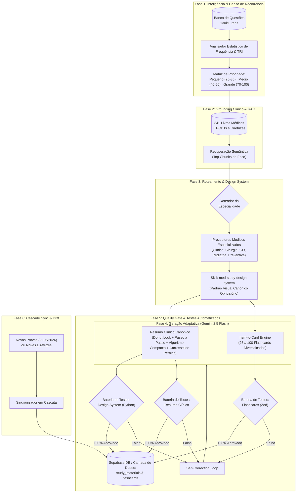

# Plano Mestre Unificado: Engenharia, Criação Adaptativa e Atualização em Massa de Resumos Clínicos e Flashcards (FSRS)

> **Documento Estratégico & Arquitetura de Produção em Escala**  
> **Plataforma:** Banco Residência  
> **Versão:** 2.7.0 — Padrão-Ouro Canônico de Design & UX Médica  
> **Escopo:** Pipeline automatizado ponta a ponta, preceptores especializados por área médica, Design System Canônico (`med-study-design-system`), resumos adaptativos de alto rendimento com largura harmonizada (`max-w-7xl`), barra sticky abaixo do topo (`top-[4.5rem]`) com bordas retangulares e scroll spy suave, ausência de duplicidade de título H1, Donut com animação blindada contra toques acidentais e rolagem móvel (`pointer-events-none` durante entrada e desligamento pós-término), cabeçalho limpo (sem badges de 10k questões ou frequência temática), percentual central proporcional e harmonioso (`text-2xl sm:text-3xl`), exibição da contagem de questões nas barras e rolagem para > 5 tópicos, esquemas 2x2 anti-sobrecarga, fluxogramas compactos precedidos de passo a passo sintético e com Ponto Principal no topo de cada passo, carrossel de pontos-chave com cores adaptadas dinamicamente ao tema do estudante, sem ruído de rodapés e em loop circular infinito no rodapé, referências oficiais no final, eliminação estrita de redundâncias, flashcards multimodais (25 a 100 por foco), testes automatizados determinísticos de dados e de design.

---

## 1. Princípios Norteadores e Lições Aprendidas (Superação do Modelo de Miomas)

O protótipo de Miomatose Uterina validou a eficácia do foco cirúrgico voltado para bancas examinadoras. No entanto, sua execução revelou vícios e limitações que este plano mestre **corrige e supera definitivamente**:

### Matriz de Evolução Técnica: O Que Manter vs. O Que Superar

| Pilar | Abordagem Anterior (Miomas) | Novo Padrão de Engenharia Unificado (Versão 2.2.0) |
| :--- | :--- | :--- |
| **Imagens dos Cards** | ❌ **Geração de SVGs artificiais/sintéticos** (retângulos com texto dentro gerados por código, sem valor clínico real). | ✅ **Zero imagens artificiais.** Cards conceituais usam texto limpo e Cloze nativo em Tailwind. Imagens só entram se forem **exames médicos reais autênticos** (radiografias, tomografias, ECGs, dermatoscopias) sob licenças abertas (Wikimedia CC, JETem, OpenStax, Radiopaedia). |
| **Estrutura dos Resumos** | ⚠️ **Template engessado e com redundâncias** (mesmo texto repetido no snippet, introdução, cards e pontos-chave). | ✅ **Modelo Adaptativo & Anti-Redundância:** A IA molda as seções com microcopy cirúrgico. Cada conceito é aprofundado apenas uma vez. |
| **Gráficos e Diagramas** | ❌ **Mermaid escuro com popup preto** cobrindo dados e sem integração harmônica. | ✅ **Componentes Nativos Canônicos (Recharts Donut):** Sem tooltips escuros flutuantes; clique no setor fixa o foco temático (lock de seleção) clareando os inativos; caixa inferior com explicação direta de prova. |
| **Navegação no Resumo** | ⚠️ Barra de tópicos estática no meio da página e parágrafo de resumo ocupando espaço. | ✅ **Barra Sticky Flutuante com Scroll Spy:** Fica fixada no topo durante a rolagem (`sticky`), destacando o tópico ativo na cor do tema do estudante. Snippet redundante removido. |
| **Fluxogramas Decisórios** | ⚠️ Diagramas verticais compridos ou Mermaid rígido. | ✅ **Fluxograma Compacto + Passo a Passo Anterior:** Resumo sintético em passos numerados (1 a 5) antes do fluxograma, com componente visual compacto e ajustado à tela. |
| **Pérolas de Alto Rendimento** | ⚠️ Lista estática de tópicos no meio do texto repetindo o que já foi dito. | ✅ **Carrossel Horizontal de Cards no Rodapé:** Similar aos cards de acesso rápido da home do estudante, posicionado no final do resumo, eliminando a seção estática duplicada. |
| **Referências Oficiais** | ⚠️ Bloco de citação ocupando o topo do resumo antes do conteúdo. | ✅ **Posicionamento Exclusivo no Rodapé:** Seção limpa `## Diretrizes Oficiais & Consensos de Referência` ao final do material. |
| **Tipologia de Flashcards** | ⚠️ Dependência excessiva de *cloze deletion*. | ✅ **Acervo Multimodal Diversificado:** Combinação balanceada de **Perguntas Diretas**, **Cloze Deletion**, **Exames Reais com Oclusão** e **Mini-Casos de Pronto-Socorro** (25 a 100 cards por assunto). |

---

## 2. Visão Geral da Arquitetura do Pipeline



---

## 3. Matriz de Preceptores Especialistas e Design System

```
.agents/skills/
├── med-study-design-system/     # Manual Canônico de UI/UX, Componentes Nativos e Ausência de Redundâncias
├── professor-clinica-medica/    # Harrison, Cecil, SBC, SBPT, SBD, KDIGO, GOLD, GINA
├── professor-cirurgia-geral/    # Sabiston, ATLS 11ª ed, CBC, Colégio Americano de Cirurgiões
├── professor-pediatria/         # Nelson Tratado de Pediatria, SBP, PALS, Caderneta da Criança
├── professor-ginecologia-obstetricia/ # FEBRASGO, Williams, Berek & Novak, FIGO, ACOG
├── professor-medicina-preventiva/ # Rouquayrol, Leis 8.080/8.142, Medronho, SUS
└── professor-especialidades-r-plus/  # Títulos de Especialista (TEGO, TECM, CBO) e R3/R4
```

---

## 4. O Modelo de Resumo Clínico Adaptativo (Estrutura Canônica v2.3.0)

A estrutura visual obedece às regras estritas do Design System:

1. **Largura Harmonizada com a Plataforma:**
   * Container principal expandido (`w-full max-w-7xl mx-auto`) alinhado perfeitamente com os painéis bento, flashcards e resoluções de questões.
2. **Topo Limpo e Ausência de H1 Duplicado:**
   * O cabeçalho do componente já renderiza o título oficial (`material.title`). O parser descarta qualquer H1 redundante no corpo do markdown.
   * **Barra de Tópicos Sticky Flutuante:** Fixa logo abaixo do header principal (`top-[4.5rem] z-20`) sem cobri-lo, sem label redundante `"TÓPICOS:"`, sem barras de rolagem nativas visíveis e com auto-scroll suave centralizando o tópico ativo conforme o estudante navega.
3. **Raio-X de Recorrência Temática:**
   * Gráfico Donut em Recharts integrado (5 colunas) + Barras de progresso e prioridade (7 colunas).
   * **Animação Blindada contra Toque/Rolagem (Zero Interrupção):**
     * Executa com `animationBegin={0}` e `animationDuration={800}` com `ease-out`.
     * `pointer-events-none` ativo durante os 800ms de desenho inicial, impedindo que toques na tela ou arrastos de rolagem interfiram no ciclo de animação.
     * Após o término (`onAnimationEnd`), `isAnimationActive` é desligado (`false`) e `pointer-events-auto` é restaurado, garantindo transições táteis instantâneas sem re-animações defeituosas ou congelamentos de arco.
   * **Cabeçalho Limpo:** Apenas o ícone temático e o título oficial, sem badges (`+10k Questões Auditadas`), legendas ou subtítulos redundantes.
   * Zero tooltips escuros flutuantes sobre o gráfico.
   * Centro do Donut proporcional e arejado: exibe apenas o percentual (`text-2xl sm:text-3xl`) e a legenda `"recorrência em provas"`, sem encostar nas bordas e sem repetir o nome do tema.
   * Lista temática com exibição da **quantidade absoluta de questões** (`{questionCount} questões`) em vez da porcentagem redundante, com design, cores e microcopy canônicos no padrão Miomas (zero esbranquiçamento opaco).
   * **Rolagem Vertical para Mais de 5 Tópicos:** Se o foco contiver > 5 tópicos (como Miomas com 9 tópicos), o container ativa rolagem vertical ergonômica (`max-h-[310px] overflow-y-auto pr-1`).
   * Clique em qualquer setor ou linha fixa o setor ativo (**Lock de Seleção**, opacidade 100% no setor) e clareia os inativos no donut (opacidade 28%).
   * Card horizontal inferior de largura total trazendo explicação direta, cirúrgica e com termos em negrito sobre o que as bancas mais cobram.
4. **Esquema Multicolunas em Matriz 2x2 (Topografia / 4 Ts):**
   * **Distribuição Anti-Sobrecarga:** Esquemas com 4 elementos devem utilizar obrigatoriamente **Matriz 2x2 (2 colunas e 2 linhas)** (`grid-cols-1 md:grid-cols-2`), eliminando a compressão vertical de 4 colunas espremidas (`grid-cols-4`).
   * **Microcopy Objetivo:** Cada card contém no máximo 2 a 3 tópicos diretos e arejados, evitando blocos densos de texto.
   * Grid com altura de cabeçalho unificada (`min-h-[46px]`), garantindo alinhamento pixel-perfect de divisórias e badges.
   * Caixas de aviso inferiores padronizadas (`🚫 Prova:`, `⚠️ Prova:`, `✓ Prova:`).
5. **Algoritmo Decisório Compacto:**
   * Precedido obrigatoriamente por um **Passo a Passo Sintético** em tópicos curtos.
   * **Ponto Principal Imediato:** Cada passo abre com destaque (`Target` icon) trazendo a regra de ouro mandatória do passo em termos em negrito.
   * **Tipografia Padronizada:** Textos em `text-xs leading-snug` com negrito cirúrgico em conceitos-chave, divididos em Ações Imediatas vs. Doses & Fármacos, e alerta de pegadinha (`pearl`).
6. **Hierarquia de Listas e Fórmulas:**
   * Subtópicos recuados visualmente com conector lateral (`ml-6 pl-4 border-l-2`) e indicador de derivação (`↳`), diferenciando tópicos principais de secundários.
   * Fórmulas matemáticas em caixas centrais elegantes com fração (numerador sobre denominador), sem escape de código LaTeX cru como `\frac`.
7. **Carrossel de Pontos-Chave das Provas:**
   * Localizado imediatamente antes das referências oficiais.
   * **Loop Circular Infinito:** Exibe o último card (ex.: Card 8) à esquerda do Card 1, mantendo o card ativo sempre no centro de foco com transição fluida deslizante.
   * **Harmonização Cromática Dinâmica:** Bordas, anel de destaque e marcadores numéricos circulares adotam dinamicamente a cor do tema ativo (`accentConfig.primaryHex` e `accentConfig.bgRgba`).
   * **Zero Ruído Textual nos Cards:** Sem rodapés repetitivos (`Regra Decisiva da Prova`, `Ponto #X`) e sem paginação redundante (`X de Y`) dentro do card, contendo exclusivamente o número ordinal e a regra essencial em negrito.
   * Suporte completo à navegação por teclado (`ArrowLeft` / `ArrowRight`), botões `< >` e gestos touch móveis.
8. **Seção Final de Referências:**
   * Exclusivamente no rodapé sob `## Diretrizes Oficiais & Consensos de Referência`.

---

## 5. Matriz de Flashcards Multimodal (25 a 100 Cards por Tema)

* **Pequeno / Específico:** 25 a 35 cards.
* **Médio / Recorrente:** 40 a 60 cards.
* **Grande / Macro-Tema de Alta Recorrência:** 70 a 100 cards.
* **Formatos:** Perguntas Diretas, Cloze Deletion sanitizados, Exames Reais com Oclusão e Mini-Casos de Pronto-Socorro.
* **Schema Zod:** Validação estrita de limites de caracteres (verso máximo de 120 caracteres, comentário explicativo de até 350 caracteres, zero SVGs sintéticos).

---

## 6. Bateria de Testes Automatizados (Quality Gate de 6 Níveis)

1. **Teste 1 — Validação Estrita de Contrato (Zod Runner):** Limites de caracteres e campos obrigatórios.
2. **Teste 2 — Integridade de Cloze & Atomicidade:** Apenas o termo de ruptura clínica é ocultado.
3. **Teste 3 — Auditoria de Fatos Clínicos (Grounded Fact-Checking):** Cruzamento contra os 341 livros médicos do Supabase.
4. **Teste 4 — Auditoria Automatizada do Design System (`validate_study_material_design.py`):**
   * Topo limpo sem referências e sem snippet duplicado.
   * Referências oficiais no rodapé.
   * Ausência de seção estática de pontos-chave (substituída pelo carrossel).
   * Zero Mermaid escuro e zero SVGs artificiais.
   * Passo a passo sintético antecedendo o fluxograma.
   * Donut Recharts sem tooltip preto e com lock de seleção.
   * Barra sticky com scroll spy e parser de listas hierárquicas.
5. **Teste 5 — Simulação Psicométrica FSRS:** Intervalos e fatores de facilidade consistentes.
6. **Teste 6 — Compilação Estrita de Tipagem (`npx tsc --noEmit`):** Zero erros TypeScript no projeto.

---

## 7. Protocolo de Sincronização em Cascata (Cascade Sync)

Novas questões e novas diretrizes homologadas disparam o recálculo de recorrência, atualizam o Donut Chart, adaptam o resumo mantendo a harmonia visual do Design System e propagam a nota de evolução histórica nas questões do banco.

---
*Plano Mestre v2.2.0 homologado com Design System Canônico e Qualidade Visual Garantida no Banco Residência.*
