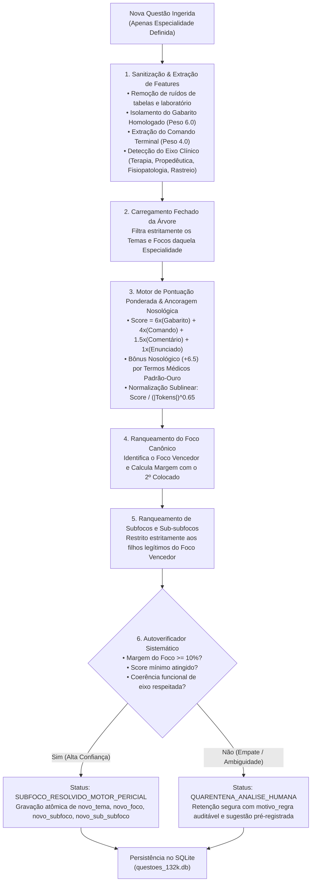

# Plano Estratégico do Motor de Classificação Taxonômica para Novas Questões
## Plataforma Banco Residência Médica — Pipeline Canônico para Questões com Apenas Especialidade
### Arquitetura Híbrida: Sanitização Clínica + Blindagem de Distratores + Ancoragem Nosológica + Autoverificador Sistemático

---

## 1. Visão Geral & Escopo de Aplicação

O **Motor de Classificação para Novas Questões** é a solução de engenharia médica desenvolvida para receber questões em estado bruto (ingestão via OCR de editais, crawlers ou novos bancos parceiros) que contenham **apenas a Especialidade / Grande Área definida** e conduzi-las, de forma determinística, segura e sem alucinação, até a folha mais profunda da taxonomia médica canônica:

$$\text{Especialidade (N1)} \longrightarrow \text{Tema (N2)} \longrightarrow \text{Foco (N3)} \longrightarrow \text{Subfoco (N4)} \longrightarrow \text{Sub-subfoco (N5)}$$

### Premissas Invioláveis de Arquitetura:
1. **Fonte Única da Verdade Fechada:** O motor jamais cria, inventa ou altera nomes de nós. Todo nó de destino pertence estritamente ao catálogo `data/catalogo_arvore_canonica_completa.json` (79 Temas, 435 Focos e mais de 1.000 Subfocos/Sub-subfocos).
2. **Blindagem de Distratores ($w_{\text{dist}} = 0.0$):** Alternativas incorretas têm peso ZERO. Jamais somam pontos positivos, eliminando a atração por diagnósticos diferenciais errados da vinheta.
3. **Ancoragem Tripla no Gabarito Homologado:** O conceito clínico da alternativa correta recebe peso prioritário ($w_{\text{gab}} = 6.0$), atuando como bússola diagnóstica.
4. **Isolamento e Rastreabilidade Transacional:** Execução restrita ao SQLite local (`data/questoes_132k.db`) com transações em lote, rollback explícito em falhas e preservação imutável das colunas históricas (`antigo_tema`, `antigo_foco`, `antigo_subfoco`).
5. **Autoverificador Sistemático Anti-Default:** Casos de empate técnico (margem $< 10\%$) ou inconsistência entre intenção clínica (terapêutica vs diagnóstica) são retidos na quarentena com logs detalhados, proibindo atribuições cegas ao primeiro elemento da lista.

---

## 2. Diagrama de Fluxo do Motor

---

## 3. Modelo Matemático de Pontuação Canônica

A pontuação de afinidade de um nó candidato $C_k$ em relação à questão clínica $Q$ é expressa pela equação:

$$\text{RawScore}(C_k) = w_{\text{gab}} \cdot \mathcal{M}(\text{Gabarito}, C_k) + w_{\text{cmd}} \cdot \mathcal{M}(\text{Comando}, C_k) + w_{\text{com}} \cdot \mathcal{M}(\text{Comentário}, C_k) + w_{\text{enunc}} \cdot \mathcal{M}(\text{Enunciado}, C_k) + 0.0 \cdot \mathcal{M}(\text{Distratores}, C_k) + \sum_{A \in \text{Âncoras}} \text{Bonus}(A, C_k)$$

$$\text{ScoreFinal}(C_k) = \frac{\text{RawScore}(C_k)}{\left(\max(1, |\text{Tokens}(C_k)|)\right)^{0.65}}$$

### Calibração de Pesos:
* **$w_{\text{gab}} = 6.0$:** A alternativa homologada como correta possui o maior poder discriminatório.
* **$w_{\text{cmd}} = 4.0$:** O comando terminal define o objetivo cognitivo da questão.
* **$w_{\text{com}} = 1.5$:** O comentário oficial esclarece a justificativa pedagógica.
* **$w_{\text{enunc}} = 1.0$:** A vinheta clínica contextualiza o cenário do paciente.
* **$w_{\text{dist}} = 0.0$ (Zero):** Distratores são cegados para não induzir atração por pegadinhas.
* **$\text{Bonus}(A) = +6.5$:** Bônus concedido quando o texto contém âncoras patognomônicas (ex.: *Chlamydia*, *AMH*, *PALM-COEIN*, *POP-Q*, *BI-RADS*).
* **Exponente $0.65$:** Evita o viés de inflação por extensão de títulos longos.

---

## 4. Estrutura Operacional dos Scripts

| Script | Função Principal | Comando de Execução |
| :--- | :--- | :--- |
| [`scripts/motor_classificacao_novas_questoes.mjs`](file:///c:/bancoresidencia/bancoresidencia/scripts/motor_classificacao_novas_questoes.mjs) | Motor universal de classificação para novas questões de todas as especialidades. | `node scripts/motor_classificacao_novas_questoes.mjs [--especialidade <nome>] [--execute] [--limit <n>]` |
| [`scripts/classificar_todas_orfas_ginecologia.mjs`](file:///c:/bancoresidencia/bancoresidencia/scripts/classificar_todas_orfas_ginecologia.mjs) | Executor especializado que liquidou os casos legados de *Miscelânea* em Ginecologia. | `node scripts/classificar_todas_orfas_ginecologia.mjs [--execute]` |
| [`data/catalogo_arvore_canonica_completa.json`](file:///c:/bancoresidencia/bancoresidencia/data/catalogo_arvore_canonica_completa.json) | Árvore Canônica Oficial Imutável (Fonte Única da Verdade). | Insumo JSON fechado. |

---

## 5. Bateria de Invariantes & Quality Gates

Ao final da execução com `--execute`, o motor audita automaticamente os seguintes invariantes:
* **I1. Integridade de Censo:** Nenhuma questão é deletada ou duplicada.
* **I2. Fechamento Taxonômico:** $100\%$ dos nós atribuídos existem na árvore canônica.
* **I3. Anti-Duplicação:** $\text{Subfoco} \neq \text{Foco}$ em qualquer circunstância.
* **I4. Zero Sufixos Artificiais:** Proibição de textos como `: Diagnóstico e Conduta`.
* **I5. Rastreabilidade Histórica:** As colunas `antigo_*` permanecem imutáveis.

