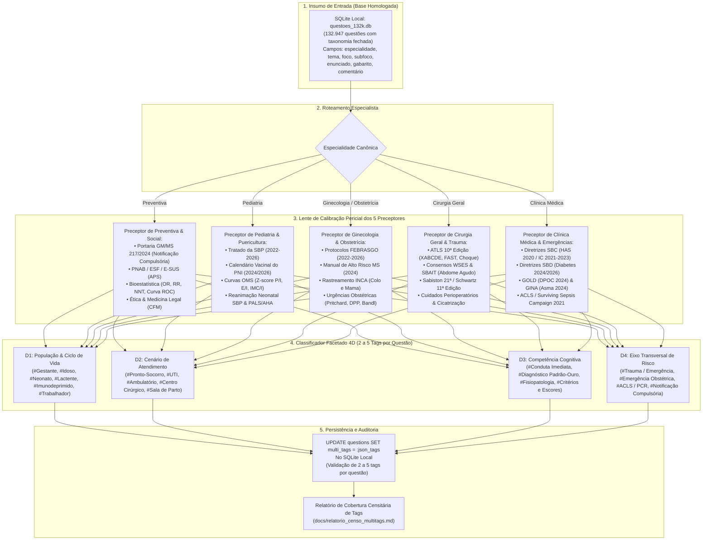

# Plano Estratégico do Motor Especialista Independente de Multi-Tags (132.947 Questões)
## Enriquecimento Ontológico e Semântico Pós-Homologação Taxonômica
### Arquitetura Desacoplada: Matriz Geral 4D (População, Cenário, Competência, Transversal) Calibrada pela Perícia dos 5 Preceptores Médicos

---

> [!IMPORTANT]
> **Diretrizes e Decisões de Arquitetura:**
> 1. **Desacoplamento Total:** Este motor é um pipeline **100% independente do motor de recategorização taxonômica**. Ele opera após a homologação das 4-tuplas (`Especialidade` $\rightarrow$ `Tema` $\rightarrow$ `Foco` $\rightarrow$ `Subfoco`), enriquecendo a base sem interferir na árvore de filtros primária.
> 2. **Tags Gerais e Padronizadas:** As tags geradas são canônicas, universais e padronizadas no vocabulário DeCS/MeSH, divididas em 4 grandes eixos (População, Cenário, Competência e Interface Transversal).
> 3. **O Papel dos Preceptores como Calibradores de Precisão:** O conhecimento clínico aprofundado dos 5 Preceptores Médicos Especialistas **não cria micro-tags fragmentadas**, mas atua como a **lente clínica de alta resolução** para identificar quando uma questão pertence a uma tag geral mesmo sem a palavra óbvia (ex.: *Pritchard* $\rightarrow$ `#Gestante / Puerpério` e `#Pronto-Socorro / Sala Vermelha`; *noradrenalina* $\rightarrow$ `#UTI / Terapia Intensiva`), além de bloquear falsos positivos (ex.: sorologias negativas de HIV).
> 4. **Isolamento no Localhost:** Executa transacionalmente via SQLite local ([`data/questoes_132k.db`](file:///c:/bancoresidencia/bancoresidencia/data/questoes_132k.db)), gravando na coluna `multi_tags` em formato JSON (`["#Tag1", "#Tag2", ...]`). Zero alterações no Supabase.

---

## 1. Visão Geral da Arquitetura do Pipeline



---

## 2. A Matriz Canônica das 4 Dimensões Gerais (DeCS/MeSH)

O motor atribui estritamente tags pertencentes a esta matriz fechada de alta utilidade para o estudante:

### Dimensão 1: População & Ciclo de Vida (Quem é o paciente-índice?)
* `#Gestante / Puerpério`: Gestantes em qualquer trimestre, puérperas, trabalho de parto ou pré-natal.
* `#Idoso / Geriatria`: Pacientes $\ge 60$ anos, síndromes geriátricas, polifarmácia, demência, quedas.
* `#Neonato / RN`: Recém-nascidos do nascimento até o 28º dia de vida, prematuros e sala de parto.
* `#Lactente / Pediátrico`: Crianças de 29 dias a 2 anos (aleitamento, vacinas de lactente, DNPM precoce).
* `#Criança / Pediatria`: Crianças de 2 a 12 anos incompletos (doenças exantemáticas, idade escolar).
* `#Adolescente`: Indivíduos de 12 a 18 anos incompletos (Tanner, vulnerabilidade, saúde sexual).
* `#Imunodeprimido / HIV`: Pacientes com imunodeficiência comprovada (HIV+, CD4 baixo, transplante, quimioterapia, neutropenia febril).
* `#Trabalhador`: Patologias ocupacionais, LER/DORT, pneumoconioses, acidentes de trabalho.

### Dimensão 2: Cenário de Atendimento (Onde ocorre a ação?)
* `#Pronto-Socorro / Sala Vermelha`: Urgências e emergências clínicas/cirúrgicas, dor aguda súbita, instabilidade inicial, UPA.
* `#UTI / Terapia Intensiva`: Cuidados intensivos, choque refratário, ventilação mecânica, monitorização invasiva (PAM/PVC/Swan-Ganz).
* `#Ambulatório / Atenção Primária`: Consultas de rotina, rastreamento assintomático, UBS, ESF, puericultura, seguimento crônico.
* `#Centro Cirúrgico / Bloco`: No intraoperatório, laparotomia, anestesia geral, inventário cirúrgico.
* `#Sala de Parto`: Trabalho de parto ativo, expulsivo, dequitação, assistência ao parto vaginal ou cesariana.
* `#Enfermaria / Internação`: Paciente internado em enfermaria clínica/cirúrgica estável.

### Dimensão 3: Competência Cognitiva (Qual a habilidade médica testada?)
* `#Conduta Imediata`: O que fazer agora (droga de escolha, procedimento de emergência, manejo terapêutico inicial).
* `#Diagnóstico Padrão-Ouro`: Qual o exame definitivo ou hipótese mais provável perante os achados.
* `#Fisiopatologia`: Qual o mecanismo patogênico, etiologia ou base molecular/fisiológica do quadro.
* `#Critérios e Escores Clínicos`: Aplicação de escores prognósticos, classificações de gravidade ou cálculos bioestatísticos.
* `#Rastreamento / Prevenção`: Indicação de exames periódicos assintomáticos, vacinação, profilaxias primária e secundária.

### Dimensão 4: Eixo Transversal de Risco (Interface de Alta Densidade)
* `#Trauma / ATLS`: Vítimas de acidentes, trauma contuso/penetrante, sistemática do ABCDE.
* `#Emergência Obstétrica`: Pré-eclâmpsia grave/eclâmpsia, DPP, placenta prévia, hemorragia pós-parto, rotura uterina.
* `#ACLS / PCR`: Parada cardiorrespiratória, ritmos chocáveis e não-chocáveis, pós-PCR.
* `#Notificação Compulsória (SINAN)`: Agravos da Portaria GM/MS 217 (notificação compulsória imediata ou semanal).

---

## 3. O Conhecimento Real dos 5 Preceptores como Lente de Calibração

O papel da preceptoria médica é **fazer a ponte semântica** entre termos técnicos ultrassubjetivos e as tags gerais:

```
┌────────────────────────────────────────────────────────────────────────┐
│                   A LENTE DO PRECEPTOR MÉDICO                          │
├────────────────────────────────────────────────────────────────────────┤
│ • Preceptor de Pediatria:                                              │
│   "Pentavalente + VIP + Rotavírus aos 2 meses"                         │
│   ───(Lente Pericial)───> Classifica como:                            │
│   [ #Lactente / Pediátrico ] + [ #Ambulatório / Atenção Primária ] +    │
│   [ #Rastreamento / Prevenção ]                                        │
│                                                                        │
│ • Preceptor de Obstetrícia:                                            │
│   "Secundigesta 32 sem, PA 160x110, iniciado esquema de Zuspan"        │
│   ───(Lente Pericial)───> Classifica como:                            │
│   [ #Gestante / Puerpério ] + [ #Pronto-Socorro / Sala Vermelha ] +    │
│   [ #Conduta Imediata ] + [ #Emergência Obstétrica ]                   │
│                                                                        │
│ • Preceptor de Clínica Médica:                                         │
│   "Dor torácica típica há 40 min, supra de ST em DII, DIII e aVF"       │
│   ───(Lente Pericial)───> Classifica como:                            │
│   [ #Adulto ] + [ #Pronto-Socorro / Sala Vermelha ] +                  │
│   [ #Conduta Imediata ]                                                │
│                                                                        │
│ • Preceptor de Cirurgia:                                               │
│   "Vítima de colisão auto x anteparo, FAST positivo no Morrison"       │
│   ───(Lente Pericial)───> Classifica como:                            │
│   [ #Pronto-Socorro / Sala Vermelha ] + [ #Conduta Imediata ] +        │
│   [ #Trauma / ATLS ]                                                   │
│                                                                        │
│ • Preceptor de Preventiva:                                             │
│   "Sorologias de rotina: Anti-HIV e HBsAg não reagentes"               │
│   ───(Lente Pericial)───> BLOQUEIA #Imunodeprimido/HIV (Sem Falso +)  │
│   [ #Ambulatório / Atenção Primária ] + [ #Rastreamento / Prevenção ]  │
└────────────────────────────────────────────────────────────────────────┘
```

---

## 4. O Algoritmo de Execução do Motor Independente (`motor_multitags_preceptores.mjs`)

O script opera em lotes de cursor de alta performance, sem travar o banco:

```javascript
import fs from 'fs';
import path from 'path';
import { DatabaseSync } from 'node:sqlite';

const dbPath = path.resolve('data/questoes_132k.db');
const db = new DatabaseSync(dbPath);
db.exec('PRAGMA journal_mode = WAL;');
db.exec('PRAGMA synchronous = NORMAL;');

// Garante que a coluna multi_tags existe
const cols = db.prepare('PRAGMA table_info(questions)').all().map(c => c.name);
if (!cols.includes('multi_tags')) {
  db.exec("ALTER TABLE questions ADD COLUMN multi_tags TEXT DEFAULT '[]';");
}

console.log('🚀 MOTOR INDEPENDENTE DE MULTI-TAGS DOS PRECEPTORES MÉDICOS');
console.log('⚡ Processando 132.947 questões com inteligência de preceptoria...');

const BATCH_SIZE = 2500;
let lastId = '';
let processed = 0;
const totalCount = db.prepare('SELECT count(*) as c FROM questions').get().c;

const updateStmt = db.prepare('UPDATE questions SET multi_tags = ? WHERE id = ?;');

while (processed < totalCount) {
  const rows = db.prepare(`
    SELECT id, code, especialidade, tema, foco, subfoco, statement, options, correct_answer, commentary, is_anulada
    FROM questions
    WHERE id > ?
    ORDER BY id ASC
    LIMIT ?;
  `).all(lastId, BATCH_SIZE);

  if (!rows || rows.length === 0) break;

  db.exec('BEGIN TRANSACTION;');

  for (const q of rows) {
    lastId = q.id;
    const tags = evaluatePreceptorMultiTags(q);
    updateStmt.run(JSON.stringify(tags), q.id);
    processed++;
  }

  db.exec('COMMIT;');
  process.stdout.write(`\r   ⏳ Processadas: ${processed.toLocaleString('pt-BR')} / ${totalCount.toLocaleString('pt-BR')} (${((processed/totalCount)*100).toFixed(1)}%)   `);
}

console.log('\n\n✅ Enriquecimento ontológico de Multi-Tags concluído com sucesso!');
db.close();
```

---

## 5. Bateria de Invariantes das Multi-Tags (Quality Gates)

O motor independente passa por uma auditoria estrita após a execução:
1. **Invariante de Censo:** $100\%$ das 132.947 questões possuem array JSON válido.
2. **Invariante de Extensão:** Todas as questões possuem entre **2 e 5 tags** (nem tag única monótona, nem overtagging caótico).
3. **Invariante Anti-Ruído:** Zero falsos positivos em sorologias negativas para HIV ou históricos familiares de demência/idoso em pacientes jovens.
4. **Invariante de Dicionário Fechado:** $100\%$ das tags emitidas pertencem à matriz de 22 tags canônicas homologadas.
