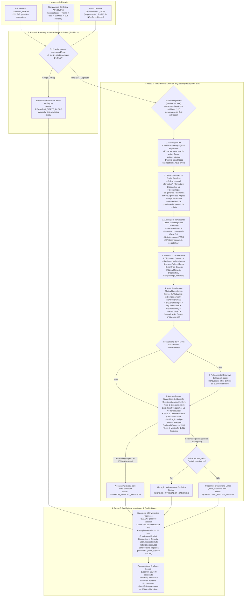

# Plano Estratégico de Reestruturação Taxonômica Integral (132.947 Questões)
## Motor Canônico de Alocação e Direcionamento Ancorado em Árvore Alvo Dinâmica
### Arquitetura em 3 Passos: Remanejos em Bloco (1:1 / N:1) + Motor Pericial de Preceptores (1:N: Tema, Foco, Subfoco e Sub-subfoco) + Quality Gates

---

> [!IMPORTANT]
> **Premissa Canônica do Motor & Isolamento de Ambiente:**
> 1. **Foco Exclusivo na Taxonomia Canônica:** O motor é **100% dedicado à classificação hierárquica** (`Especialidade` $\rightarrow$ `Tema` $\rightarrow$ `Foco` $\rightarrow$ `Subfoco` $\rightarrow$ `Sub-subfoco`). A geração de multi-tags transversais foi **totalmente desacoplada** para um motor pericial independente posterior, garantindo que a redistribuição taxonômica seja cirúrgica, auditável e sem sobrecarga semântica.
> 2. **Árvore de Destino como Fonte Única da Verdade:** O motor **NÃO** inventa, cria ou altera a taxonomia. A nova árvore de filtros entregue pela curadoria médica (`targetCanonicalTree.json`) é a **Fonte Única da Verdade Imutável**. Qualquer nó de destino deve pertencer estritamente a essa árvore fechada. É **expressamente proibida** a geração de sufixos artificiais como `: Diagnóstico e Conduta`.
> 3. **Isolamento Absoluto no Localhost (Zero Supabase):** A execução restringe-se integralmente ao SQLite local ([`data/questoes_132k.db`](file:///c:/bancoresidencia/bancoresidencia/data/questoes_132k.db)) e aos geradores de dados locais do frontend. Nenhuma alteração, migração ou escrita é realizada no Supabase de produção.
> 4. **Independência Dinâmica da Árvore de Entrada:** O motor é orientado a parâmetros (`--tree <caminho>`). Quando a nova árvore for entregue, o motor redistribuirá todas as 132.947 questões para ela de forma reproduzível, determinística e auditável.

---

## 1. Visão Geral da Arquitetura em 3 Passos



---

## 2. Insumos e Carregamento Dinâmico com Suporte a Sub-subfocos

O motor suporta estruturas de árvore de **3, 4 e 5 níveis**:
`Especialidade` $\rightarrow$ `Tema` $\rightarrow$ `Foco` $\rightarrow$ `Subfoco` $\rightarrow$ `Sub-subfoco`.

```javascript
// Indexador Canônico Flexível com Suporte a Sub-subfocos
export function buildCanonicalIndex(inputTree) {
  const specialties = new Set();
  const temaMap = new Map();         // temaLower -> { especialidade, tema }
  const focoMap = new Map();         // focoLower -> { especialidade, tema, foco, subfocosList: [], subSubfocosMap }
  const canonicalTuples = new Set(); // "Esp|||Tema|||Foco|||Subfoco[|||SubSubfoco]"

  let treeObject = inputTree;
  if (Array.isArray(inputTree.hierarquia_padrao)) {
    treeObject = {};
    for (const espNode of inputTree.hierarquia_padrao) {
      const espName = espNode.especialidade;
      treeObject[espName] = {};
      for (const t of espNode.temas || []) {
        treeObject[espName][t.tema] = {};
        for (const f of t.focos || []) {
          treeObject[espName][t.tema][f.foco] = f;
        }
      }
    }
  }

  for (const [esp, temas] of Object.entries(treeObject)) {
    if (esp === 'metadata') continue;
    specialties.add(esp);
    for (const [tema, focos] of Object.entries(temas)) {
      const temaLower = tema.toLowerCase().trim();
      temaMap.set(temaLower, { especialidade: esp, tema });

      for (const [foco, focoData] of Object.entries(focos)) {
        const focoLower = foco.toLowerCase().trim();

        let subfocosList = [];
        const subSubfocosMap = new Map(); // subfocoLower -> [subSubfoco1, subSubfoco2]

        if (Array.isArray(focoData)) {
          subfocosList = focoData;
        } else if (focoData && typeof focoData.subfocos === 'object') {
          if (Array.isArray(focoData.subfocos)) {
            subfocosList = focoData.subfocos;
          } else {
            for (const [subName, subVal] of Object.entries(focoData.subfocos)) {
              subfocosList.push(subName);
              // Suporte a Sub-subfocos quando estruturados como array ou objeto filho
              if (Array.isArray(subVal)) {
                subSubfocosMap.set(subName.toLowerCase().trim(), subVal);
              } else if (subVal && typeof subVal === 'object' && subVal.sub_subfocos) {
                subSubfocosMap.set(subName.toLowerCase().trim(), subVal.sub_subfocos);
              }
            }
          }
        }

        // Sanitização estrita: elimina sufixos artificiais se existirem no input
        subfocosList = subfocosList.filter(s => !s.includes(': Diagnóstico e Conduta'));

        focoMap.set(focoLower, {
          especialidade: esp,
          tema,
          foco,
          subfocosList,
          subSubfocosMap
        });

        for (const sub of subfocosList) {
          canonicalTuples.add(`${esp}|||${tema}|||${foco}|||${sub}`);
          const subSubs = subSubfocosMap.get(sub.toLowerCase().trim()) || [];
          for (const ss of subSubs) {
            canonicalTuples.add(`${esp}|||${tema}|||${foco}|||${sub}|||${ss}`);
          }
        }
      }
    }
  }

  return { specialties, temaMap, focoMap, canonicalTuples };
}
```

---

## 3. Passo 1: Remanejos Diretos Determinísticos (Focos e Temas via De-Para)

### Objetivo
Processar em bloco e com **zero margem de erro** todas as questões cujos focos/temas antigos possuem correspondência inequívoca ($1 \rightarrow 1$ ou $N \rightarrow 1$) ou sinonímia comprovada com a nova árvore de destino. A LLM atua estritamente na identificação prévia de sinonímias e remanejos macro entre o catálogo legado e o catálogo novo.

### Regras Canônicas de Negócio do Passo 1:
1. **Remanejo em Bloco Restrito a Focos e Temas:**
   O remanejo direto em bloco aplica-se **exclusivamente a `novo_tema` e `novo_foco`**. Os subfocos e sub-subfocos **NUNCA são herdados ou fixados em bloco** pelo De-Para, pois na nova árvore canônica cada foco é desdobrado em subfocos inéditos e estruturados (ex: 2 subfocos por foco e 2-3 sub-subfocos).
2. **Desmembramentos $1 \rightarrow N$ no Nível de Foco:**
   Quando um foco legado agregava entidades distintas (ex: *Vaginose Bacteriana e Tricomoníase*), o De-Para lista os novos focos candidatos (`novo_focos: [...]`). O motor pericial analisa o enunciado e gabarito da questão para resolver primeiro o foco vencedor.
3. **Encaminhamento Obrigatório ao Passo 2:**
   Uma vez cravado o `novo_foco` (via De-Para ou desmembramento), a questão é encaminhada imediatamente para o **Passo 2**, onde seus subfocos e sub-subfocos são distribuídos pericialmente dentre os filhos legítimos daquele foco ajustado.
4. **Preservação Histórica Idempotente (`antigo_*`):**
   As colunas `antigo_tema`, `antigo_foco` e `antigo_subfoco` são imutáveis e mantêm 100% de rastreabilidade.

```sql
-- Atualização determinística em bloco restrita a Tema e Foco:
UPDATE questions
SET novo_tema = :novo_tema,
    novo_foco = :novo_foco,
    status_recategorizacao = 'REMANEJO_DIRETO_BLOCO',
    motivo_regra = :motivo_regra
WHERE COALESCE(antigo_tema, tema) = :antigo_tema
  AND COALESCE(antigo_foco, foco) = :antigo_foco;
-- Subfoco e Sub-subfoco são refinados questão a questão no Passo 2.
```

---

## 4. Passo 2: Motor Pericial Questão a Questão (Preceptores Especialistas)

### As 5 Autoridades Curriculares dos Preceptores Médicos:
- **Preceptor de Medicina Preventiva e Social:** Portaria GM/MS nº 217/2024 (Notificação Compulsória), PNAB/ESF, Leis 8.080/8.142, Rouquayrol, Fletcher, Bioestatística e Ética Médica.
- **Preceptor de Cirurgia Geral e Trauma:** ATLS 10ª Edição, Consensos WSES & SBAIT, CBC, Sabiston 21ª Edição, Schwartz 11ª Edição.
- **Preceptor de Ginecologia e Obstetrícia:** Protocolos FEBRASGO (2022-2026), Manual de Alto Risco do MS (2024), Rastreamento INCA, Rezende, Berek & Novak.
- **Preceptor de Pediatria e Puericultura:** Tratado da SBP (2022-2026), Reanimação Neonatal da SBP (2024), Calendário Vacinal do PNI (2024/2026), Curvas OMS, PALS/AHA, Nelson 21ª/22ª Edição.
- **Preceptor de Clínica Médica e Emergências:** Diretrizes SBC (HAS 2020 / IC 2021-2023), Diretrizes SBD (Diabetes 2024/2026), GOLD/GINA (DPOC/Asma 2024), KDIGO (DRC), Surviving Sepsis, Harrison 21ª Edição.

---

### 4.1. Preceptor Sanitizer, Smart Command & Option Profiler

#### A. Smart Command Resolver (Ordem Terminal Informativa vs. Perfil de Alternativas):
A ordem terminal do enunciado **só deve ser isolada como comando se for clinicamente útil e informativa** (ex.: perguntando diretamente conduta, terapêutica, hipótese diagnóstica, exame padrão-ouro, fisiopatologia, mecanismo de ação, rastreamento ou vigilância epidemiológica).
Se a ordem terminal for meramente protocolar ou genérica (*"Assinale a alternativa correta/incorreta"*, *"Com base no caso acima, analise as afirmativas"*, *"Marque a opção verdadeira"*), o motor **NÃO** a utiliza como comando e aciona imediatamente o **Option Profiler** e a varredura retrógrada no corpo da vinheta:

```javascript
export function resolveSmartCommandAndProfile(statement, optionsRaw, commentary) {
  if (!statement) return { commandText: '', intent: 'NEUTRO', source: 'EMPTY' };

  const cleaned = statement
    .replace(LAB_REGEX, '')
    .replace(/(?:Figura|Imagem|Quadro|Tabela)\s+\d+:[^\n]+/gi, '')
    .replace(/Fonte:\s*[^\n]+/gi, '')
    .trim();

  const lines = cleaned.split('\n').map(l => l.trim()).filter(l => l.length > 0);

  // 1. Padrões de Comandos Clinicamente Informativos
  const informativePatterns = [
    /\bqual\s+(?:é\s+)?(?:a\s+|o\s+)?(?:melhor\s+|mais\s+adequad[ao]\s+|mais\s+apropriad[ao]\s+)?(conduta|tratamento|terapia|medicamento|medica[cç][aã]o|droga|dose|esquema|abordagem|cirurgia|procedimento|manejo)/i,
    /\bqual\s+(?:é\s+)?(?:a\s+|o\s+)?(?:melhor\s+|mais\s+prov[aá]vel\s+|principal\s+)?(diagn[oó]stico|hip[oó]tese|exame|achado|propedeutica|bi[oó]psia)/i,
    /\b(fisiopatologia|mecanismo|etiologia|agente\s+etiol[oó]gico|causa\s+mais\s+comum|fator\s+de\s+risco)/i,
    /\b(rastreamento|preven[cç][aã]o|vacina|imuniza[cç][aã]o|periodicidade)/i,
    /\b(notifica[cç][aã]o|coeficiente|taxa|indicador|sensibilidade|especificidade|estudo\s+de\s+coorte|caso-controle)/i,
    /\bdeve-se\s+(iniciar|prescrever|solicitar|realizar|indicar|administrar)/i
  ];

  let usefulCommand = '';
  for (let i = lines.length - 1; i >= Math.max(0, lines.length - 3); i--) {
    for (const pat of informativePatterns) {
      if (pat.test(lines[i])) {
        usefulCommand = lines[i];
        break;
      }
    }
    if (usefulCommand) break;
  }

  if (usefulCommand) {
    const intent = detectClinicalIntent(usefulCommand, statement);
    return { commandText: usefulCommand, intent: intent.primaryIntent, source: 'TERMINAL_COMMAND' };
  }

  // 2. Se a ordem terminal for genérica, aciona o Option Profiler (Perfil das Alternativas)
  let options = [];
  try {
    options = typeof optionsRaw === 'string' ? JSON.parse(optionsRaw || '[]') : (optionsRaw || []);
  } catch {
    options = [];
  }
  const optionTexts = options.map(o => `${o.text || ''} ${o.explanation || ''}`.toLowerCase()).join(' ');

  const therapyTerms = /(?:mg|mcg|ml|gotas|iv|vo|im|sc|laparotomia|laparoscopia|drenagem|ressuscitacao|infusao|intubacao|sulfato|ceftriaxona|penicilina|metronidazol|amoxicilina|insulina|heparina|anti-hipertensivo|beta-bloqueador|diuretico|analgesia|hidroclorotiazida|metildopa|hidralazina|losartana|enalapril|corticoterapia|oxigenioterapia|suporte\s+ventilatorio|procedimento\s+cirurgico|observacao|alta\s+hospitalar|internacao)/i;
  const diagExamTerms = /(?:tomografia|ressonancia|ultrassonografia|radiografia|eco|ecocardiograma|endoscopia|colonoscopia|biopsia|sorologia|pcr|cultura|gram|eletrocardiograma|ecg|dosagem|analise\s+liquorica|angiotomografia)/i;
  const fisioTerms = /(?:mutacao|autoanticorpo|anticorpo|mecanismo|receptor|transmissao|fisiopatogenese|fisiopatologia|etiologia|antigeno|enzima|linfocitos|bacteriana|viral|fungica|parasitaria)/i;
  const epidemTerms = /(?:notificacao\s+compulsoria|imediata|semanal|taxa\s+de|coeficiente\s+de|estudo\s+transversal|ensaio\s+clinico|sensibilidade|especificidade|vies\s+de|quarentena)/i;

  if (therapyTerms.test(optionTexts) && !diagExamTerms.test(optionTexts)) {
    return { commandText: 'Perfil de Alternativas: Conduta / Terapêutica', intent: 'TERAPIA', source: 'OPTION_PROFILE' };
  }
  if (diagExamTerms.test(optionTexts) && !therapyTerms.test(optionTexts)) {
    return { commandText: 'Perfil de Alternativas: Propedêutica / Diagnóstico', intent: 'DIAGNOSTICO', source: 'OPTION_PROFILE' };
  }
  if (epidemTerms.test(optionTexts)) {
    return { commandText: 'Perfil de Alternativas: Epidemiologia / Prevenção', intent: 'EPIDEMIOLOGIA', source: 'OPTION_PROFILE' };
  }
  if (fisioTerms.test(optionTexts)) {
    return { commandText: 'Perfil de Alternativas: Fisiopatologia / Etiologia', intent: 'FISIOPATOLOGIA', source: 'OPTION_PROFILE' };
  }

  // 3. Fallback: Varredura retrógrada no corpo da vinheta
  for (let i = lines.length - 1; i >= 0; i--) {
    if (/\?$/.test(lines[i]) || /qual\s+/i.test(lines[i]) || /deve-se\s+/i.test(lines[i])) {
      const intent = detectClinicalIntent(lines[i], statement);
      if (intent.primaryIntent !== 'NEUTRO') {
        return { commandText: lines[i], intent: intent.primaryIntent, source: 'BODY_INTERROGATIVE' };
      }
    }
  }

  return { commandText: lines[lines.length - 1] || '', intent: 'NEUTRO', source: 'FALLBACK' };
}
```

#### B. Parser Resiliente de Gabarito e Blindagem contra Distratores:
O gabarito oficial histórico da banca examinadora (`q.correct_answer`) já está disponível e homologado.
> [!IMPORTANT]
> **Blindagem de Distratores:**
> As alternativas incorretas recebem **peso 0.0**. Elas **jamais somam pontos positivos**, eliminando o vício de atração que pontuava a favor de diagnósticos diferenciais errados.

```javascript
export function parseQuestionOptions(optionsRaw, correctAnswerRaw, isAnulada) {
  let options = [];
  try {
    options = typeof optionsRaw === 'string' ? JSON.parse(optionsRaw || '[]') : (optionsRaw || []);
  } catch {
    options = [];
  }

  const normalizedAns = String(correctAnswerRaw || '').trim().toUpperCase();
  const isAnuladaBool = Boolean(isAnulada) || normalizedAns === 'ANULADA' || !normalizedAns;

  let correctOptionText = '';
  const distractorTexts = [];

  for (const opt of options) {
    const letter = String(opt.letter || '').trim().toUpperCase();
    const text = `${opt.text || ''} ${opt.explanation || ''}`.trim();
    if (!isAnuladaBool && letter === normalizedAns) {
      correctOptionText = text;
    } else {
      distractorTexts.push(text);
    }
  }

  return {
    isAnulada: isAnuladaBool,
    correctOptionText,
    distractorText: distractorTexts.join(' ')
  };
}
```

#### C. Ancoragem na Classificação Antiga da Questão (`HistoricalClassificationAnchor`)
A classificação prévia da questão (`antigo_foco` e `antigo_subfoco`) atua como um **prior bayesiano de alta relevância**:
* Se o subfoco antigo já indicava um eixo claro (ex.: *"Tratamento da Asma"* ou *"Conduta Cirúrgica"*), os nós concorrentes da nova árvore que pertencem ao mesmo eixo funcional recebem um bônus de ancoragem ($w_{\text{antigo}} = 3.0$ e bônus de eixo $+2.5$).
* Evita que questões históricas já pacificadas sofram dispersão semântica aleatória para eixos opostos por causa de palavras isoladas na vinheta clínica.

#### D. Dicionários Canônicos Universais de Eixos Funcionais (Cross-Especialidades)
| Eixo Funcional | Expressões e Sinônimos Clínicos Injetados |
| :--- | :--- |
| **`EIXO_CONDUTA_TERAPEUTICA`** | `tratamento`, `terapia`, `terapeutica`, `conduta`, `manejo`, `prescrever`, `prescricao`, `medicamento`, `droga`, `farmaco`, `adjuvante`, `cirurgia`, `cirurgico`, `procedimento`, `dose`, `esquema`, `primeira linha`, `refratario`, `estabilizacao` |
| **`EIXO_DIAGNOSTICO_PROPEDEUTICA`** | `diagnostico`, `criterios`, `hipotese`, `exame`, `propedêutica`, `confirmatorio`, `padrao-ouro`, `biopsia`, `achado`, `rastreamento`, `estadiamento`, `escore`, `sinais e sintomas` |
| **`EIXO_FISIOPATOLOGIA_ETIOLOGIA`** | `fisiopatologia`, `etiologia`, `mecanismo`, `agente etiológico`, `transmissao`, `mutacao`, `fisiopatogenese`, `autoanticorpo`, `patogenia` |
| **`EIXO_EPIDEMIOLOGIA_PREVENTIVA`** | `notificacao`, `vigilancia`, `coeficiente`, `taxa`, `incidencia`, `prevalencia`, `sensibilidade`, `especificidade`, `vies`, `risco relativo`, `razao de chances`, `quarentena` |

---

### 4.2. Vetor de Afinidade Clínica Normalizado e Arquitetura `Bottom-Up Token Bubble`

#### A. Arquitetura "Bottom-Up Token Bubble" (Herança Ascendente de Vocabulário)
Cada Subfoco (Nível 3) herda os termos clínicos, fármacos e procedimentos detalhados em seus **Sub-subfocos filhos (Nível 4)**:
$\text{Vocabulário}(C_k) = \text{Tokens}(\text{Título}(C_k)) \cup \bigcup_{j} \text{Tokens}(\text{SubSubfoco}_{k,j}) \cup \text{DicionárioEixo}(\text{Eixo}(C_k))$

#### B. Equação de Pontuação Calibrada com Blindagem de Distratores:

$$\text{RawScore}(C_k) = w_{\text{gab}} \cdot \text{Match}(\text{Gabarito}, C_k) + w_{\text{cmd}} \cdot \text{Match}(\text{Comando/Perfil}, C_k) + w_{\text{antigo}} \cdot \text{Match}(\text{ÂncoraAntiga}, C_k) + w_{\text{cen}} \cdot \text{Match}(\text{CenárioLimpo}, C_k) + w_{\text{com}} \cdot \text{Match}(\text{Comentário}, C_k) + 0.0 \cdot \text{Match}(\text{Distratores}, C_k) + \text{IntentBoost}(C_k) + \text{AnchorBoost}(C_k)$$

$$\text{ScoreFinal}(C_k) = \frac{\text{RawScore}(C_k)}{(|Tokens(C_k)|)^{0.65}}$$

* **Pesos Canônicos:** $w_{\text{gab}} = 6.0$, $w_{\text{cmd}} = 4.0$ (ou $2.0$ se houver negação), $w_{\text{antigo}} = 3.0$, $w_{\text{cen}} = 1.0$, $w_{\text{com}} = 1.0$, $w_{\text{dist}} = 0.0$ (ZERO).
* **`IntentBoost(C_k)`:** Bônus de $+4.0$ quando o eixo do candidato coincide com a intenção detectada pelo comando ou perfil das opções.
* **`AnchorBoost(C_k)`:** Bônus de $+2.5$ quando o eixo do candidato coincide com o eixo do `antigo_subfoco`.
* **Blindagem de Distratores:** Peso zero ($w_{\text{dist}} = 0.0$) impede que distratores inflacionem candidatos incorretos.

---

### 4.3. Refinamento Recursivo de Sub-subfocos (Quando Presentes na Árvore)
Quando o subfoco alocado possui ramificações em **Sub-subfocos**, o mesmo motor pericial entra em ação recursivamente entre os filhos legítimos daquele subfoco.

---

### 4.4. Autoverificador Sistemático Obrigatório (`QuestionAllocationVerifier`)

Toda questão resolvida pelo motor pericial deve passar pelo **Autoverificador Dedicado** antes de qualquer gravação no banco de dados.

```javascript
export function verifyCandidateAllocation(chosenCandidate, secondCandidate, intent, ancientSubfoco, candidateList) {
  if (!chosenCandidate) {
    return { aprovado: false, motivo: 'Nenhum candidato selecionado.' };
  }

  const chosenAxis = classifyCandidateAxis(chosenCandidate.nome);

  // Teste 1: Congruência de Eixo (Anti-Inversão Terapêutica vs Diagnóstica)
  if (intent === 'TERAPIA' && chosenAxis.isDiag && !chosenAxis.isTherapy) {
    const hasTherapySibling = candidateList.some(c => classifyCandidateAxis(c).isTherapy);
    if (hasTherapySibling) {
      return {
        aprovado: false,
        motivo: `[Autoverificador] Incongruência de eixo: intenção TERAPIA, mas nó '${chosenCandidate.nome}' é puramente DIAGNÓSTICO.`
      };
    }
  }

  if (intent === 'DIAGNOSTICO' && chosenAxis.isTherapy && !chosenAxis.isDiag) {
    const hasDiagSibling = candidateList.some(c => classifyCandidateAxis(c).isDiag);
    if (hasDiagSibling) {
      return {
        aprovado: false,
        motivo: `[Autoverificador] Incongruência de eixo: intenção DIAGNÓSTICO, mas nó '${chosenCandidate.nome}' é puramente TERAPIA.`
      };
    }
  }

  // Teste 2: Desvio Histórico Grave sem Margem Confiável (> 30%)
  if (ancientSubfoco) {
    const ancientAxis = classifyCandidateAxis(ancientSubfoco);
    const isConflict = (ancientAxis.isTherapy && chosenAxis.isDiag && !chosenAxis.isTherapy) ||
                       (ancientAxis.isDiag && chosenAxis.isTherapy && !chosenAxis.isDiag);
    if (isConflict && secondCandidate && secondCandidate.normalizedScore > 0) {
      const margin = (chosenCandidate.normalizedScore - secondCandidate.normalizedScore) / chosenCandidate.normalizedScore;
      if (margin < 0.30) {
        return {
          aprovado: false,
          motivo: `[Autoverificador] Desvio histórico não dominante em relação a '${ancientSubfoco}' (margem ${(margin * 100).toFixed(1)}% < 30%).`
        };
      }
    }
  }

  // Teste 3: Margem Mínima de Segurança (>= 15%)
  if (secondCandidate && secondCandidate.normalizedScore > 0) {
    const margin = (chosenCandidate.normalizedScore - secondCandidate.normalizedScore) / chosenCandidate.normalizedScore;
    if (margin < 0.15) {
      return {
        aprovado: false,
        motivo: `[Autoverificador] Empate técnico: margem estreita de ${(margin * 100).toFixed(1)}% (< 15%) entre '${chosenCandidate.nome}' e '${secondCandidate.nome}'.`
      };
    }
  }

  // Teste 4: Score Zero
  if (chosenCandidate.normalizedScore === 0) {
    return {
      aprovado: false,
      motivo: '[Autoverificador] Score zero: ausência de sinal clínico diferencial.'
    };
  }

  return { aprovado: true, motivo: `Aprovado pelo autoverificador com Score ${chosenCandidate.normalizedScore}.` };
}
```

* **Se o Autoverificador APROVAR:** Grava `targetSubfoco = chosenCandidate.nome` e `status = 'SUBFOCO_PERICIAL_REFINADO'`.
* **Se o Autoverificador REPROVAR:**
  - Se existir nó integrador canônico na árvore (ex.: *"Aspectos Gerais"* ou o próprio foco) $\rightarrow$ `status = 'SUBFOCO_INTEGRADOR_CANONICO'`.
  - Se persistir incerteza $\rightarrow$ `status = 'QUARENTENA_ANALISE_HUMANA'` e **`novo_subfoco = NULL`** (proibição absoluta de default cego).

---

### 4.5. Resolução Pericial da Quarentena via Pool Gratuito Gemini com Auto-Stop Seguro

Para as questões que caírem em quarentena (~1.500 a 2.500 casos), o pipeline aciona o script especialista desacoplado [`scripts/resolver_quarentena_llm_free.mjs`](file:///c:/bancoresidencia/bancoresidencia/scripts/resolver_quarentena_llm_free.mjs):

#### A. Arquitetura de Custo Zero (Free Tier Guard):
1. **Pool de Chaves do `.env.local`:** O script carrega dinamicamente todas as chaves gratuitas do Google AI Studio (`GEMINI_API_KEY`, `GEMINI_API_KEY_1`, `GEMINI_API_KEY_2`, etc.).
2. **Capacidade do Pool:** Com 3 chaves gratuitas, o sistema dispõe de **45 RPM** (15 RPM por chave) e **4.500 requisições diárias gratuitas** (1.500 RPD por chave) — capacidade suficiente para liquidar a quarentena inteira em um único dia.
3. **Mecanismo de Auto-Stop Imediato:**
   - O worker monitora o consumo de cada chave em tempo real (mantendo folga de segurança em 14 RPM).
   - Ao detectar HTTP 429 com esgotamento de cota diária (`Queries per day`), a chave é marcada como esgotada no dia.
   - Quando **todas as chaves do pool esgotarem suas cotas diárias gratuitas**, o script **interrompe a execução imediatamente**, preserva transacionalmente o SQLite e exibe o relatório de progresso. Nenhuma tentativa de tarifação ou cobrança ocorre.
4. **Structured Output Fechado (Zero Alucinação):**
   - A LLM recebe o enunciado, o gabarito oficial homologado, a classificação antiga e a **lista fechada de subfocos válidos** daquele foco.
   - O modelo responde em JSON estruturado com a escolha restrita e justificativa clínica concisa.

```bash
# Execução da Resolução da Quarentena via Pool Gratuito:
node scripts/resolver_quarentena_llm_free.mjs [--limit <n>] [--execute] [--especialidade <nome>]
```

---

## 5. Passo 3: Auditoria de Invariantes & Quality Gates

A homologação taxonômica exige validação de **10 Invariantes Rigorosos**:

| Invariante | Regra Lógica / Matemática | Tolerância |
| :--- | :--- | :---: |
| **I1. Censo Exato** | $\sum \text{questões processadas} = 132.947$ | **Zero tolerância** |
| **I2. Fechamento Taxonômico** | $100\%$ das tuplas pertencem à nova árvore entregue | **Zero nós órfãos** |
| **I3. Anti-Duplicação** | $\text{LOWER(TRIM(novo\_subfoco))} \neq \text{LOWER(TRIM(novo\_foco))}$ | **Zero duplicatas** |
| **I4. Zero Sufixos Artificiais** | Nenhuma questão com `: Diagnóstico e Conduta` | **Zero ocorrências** |
| **I5. Rastreabilidade Histórica** | `antigo_tema`, `antigo_foco` e `antigo_subfoco` 100% preenchidos e imutáveis | **Zero nulos** |
| **I6. Integridade de Sub-subfocos** | Quando houver Sub-subfocos, validação rigorosa de pertencimento | **Zero órfãos no 4º nível** |
| **I7. Sanitização Textual** | Ausência de strings vazias, tabs residuais ou nulos nos novos campos | **Zero campos em branco** |
| **I8. Dossiê de Quarentena** | Relatório gerado com lista de IDs, top scores e justificativas clínicas | **Auditoria documentada** |
| **I9. Coerência Funcional de Eixo** | Questões cujo comando seja de Conduta/Terapia com gabarito de fármaco/cirurgia não podem ser alocadas em subfoco diagnóstico se houver subfoco de tratamento concorrente no foco | **Zero inversões de eixo** |
| **I10. Proibição do Default Zero** | Nenhuma questão com Score Zero pode ser atribuída silenciosamente a `candidateList[0]` sem validação de filhos | **Zero fallbacks cegos** |

---

## 6. Estratégia de Execução Localhost (Alta Performance & Zero Impacto Supabase)

### Paginação por Cursor (`Keyset Pagination`):
```sql
SELECT id, code, especialidade, tema, foco, subfoco, antigo_tema, antigo_foco, antigo_subfoco,
       statement, options, correct_answer, commentary, is_anulada
FROM questions
WHERE id > :last_id
ORDER BY id ASC
LIMIT :batch_size;
```

### Script CLI Unificado:
O script [`scripts/pipeline_recategorizacao_fases.mjs`](file:///c:/bancoresidencia/bancoresidencia/scripts/pipeline_recategorizacao_fases.mjs) opera estritamente na taxonomia:
```bash
node scripts/pipeline_recategorizacao_fases.mjs --tree <nova_arvore.json> [--depara <matriz.json>] [--execute] [--limit <n>]
```
