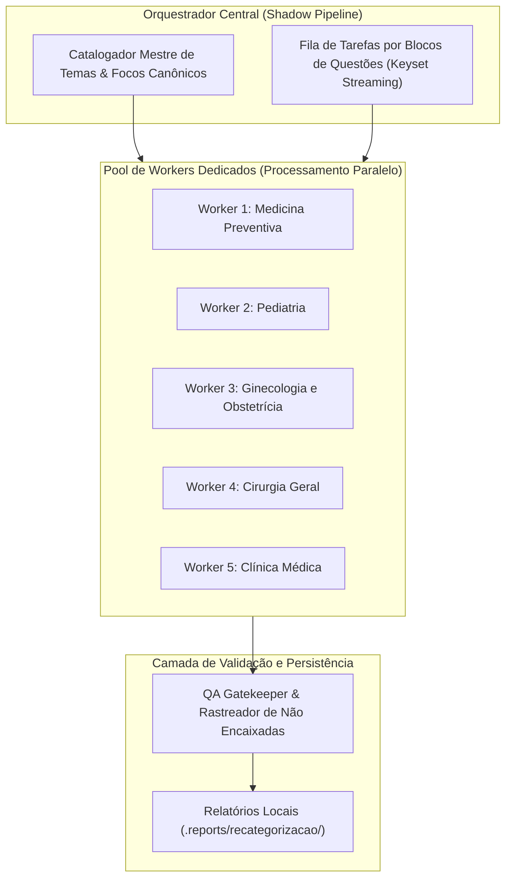

# Plano Estratégico de Reestruturação Taxonômica Integral com Workers Dedicados
## Reengenharia de Temas, Focos e Subfocos para as 132k Questões
### Execução 100% Read-Only (Modo Sombra — Zero Alteração no Supabase ou na Plataforma)

---

> [!IMPORTANT]
> **Garantia de Isolamento Total de Produção:**
> Este plano detalha a metodologia para reestruturar completamente a taxonomia clínica da plataforma (permitindo criação, unificação, renomeação e eliminação de **Temas**, **Focos** e **Subfocos**). Nenhuma linha de produção será modificada no Supabase sem sua aprovação explícita. O processamento opera em arquivos e relatórios de auditoria locais offline.

---

## 1. O que Mudou na Diretriz do Projeto?

Anteriormente, os **Temas** estavam travados e engessados pela matriz antiga. Com a sua nova autorização, o projeto ganha **liberdade de curadoria taxonômica de nível padrão-ouro**, alinhada aos grandes cursinhos (Medcurso, Sanar, Hardwork) e editais oficiais (ENARE, USP, UNICAMP):

| Nível Hierárquico | Regra de Governança | O que podemos fazer agora? |
| :--- | :--- | :--- |
| **1. Especialidade** | **FIXA E CANÔNICA** | Mantém as 5 Grandes Áreas da Residência Médica (Clínica Médica, Cirurgia Geral, Pediatria, Ginecologia e Obstetrícia, Medicina Preventiva e Social). |
| **2. Tema** | **FLEXÍVEL E OTIMIZADO (NOVO)** | **Unificar temas redundantes** (ex.: juntar *Epidemiologia* e *Estudos Epidemiológicos*), **eliminar temas vazios/lixeira** (como *Geral*), e **criar temas essenciais** ausentes. |
| **3. Foco** | **CLÍNICO CANÔNICO** | Doença, agravo ou síndrome clínica estruturante. |
| **4. Subfoco** | **ÂNGULO DE COBRANÇA** | Etapa da decisão médica (Diagnóstico, Tratamento/Conduta, Rastreamento, Fisiopatologia, Critérios/Escores). |

---

## 2. A Arquitetura de Workers Dedicados (Parallel Processing Engine)

Para realizar a análise profunda das 132.947 questões sem lentidão, a equipe utilizará um **Pool de Workers Concorrentes em Node.js**:

### Como Atuam os Workers Dedicados:
1. **Isolamento de Memória:** Cada worker processa sua respectiva área médica de forma independente, evitando gargalos de CPU e memory leaks.
2. **Leitura Paginada por Chave Primária (Keyset):** `WHERE id > last_seen_id ORDER BY id ASC LIMIT 1000` via `SELECT` passivo.
3. **Análise de Profundidade:**
   * **Enunciado:** Identifica a história clínica e contexto.
   * **Gabarito Oficial:** Fixa o conceito cobrado pela banca.
   * **Comentário do Professor:** Resolve ambiguidades entre patologias sobrepostas.
   * **Classificação Prévia:** Serve de bússola para não perder o rastreio histórico.
4. **Alocação Inteligente com Liberdade de Tema:**
   * Se a questão estava em um tema inadequado (ex.: uma questão de *Violência Sexual* que estava em Ginecologia Geral, mas cobra profilaxias de DSTs do Ministério da Saúde), o worker pode realocar para o Tema canônico correto dentro da Grande Área.

---

## 3. Plano de Execução em Fases

---

### Fase 0: Desenho da Matriz Curricular Padrão-Ouro e Setup dos Workers
* **Objetivo:** Estabelecer a lista definitiva de **Temas Modernos** por especialidade antes de alocar as questões.
* **Ações Principais:**
  1. **Harmonização de Temas em Preventiva:** Unificar *Epidemiologia* e *Estudos Epidemiológicos e Medidas de Associação*; unificar *Políticas Públicas* e *SUS*; expurgar temas vazios.
  2. **Harmonização em Cirurgia:** Criar temas limpos para *Trauma e Emergência*, *Abdome Agudo*, *Afecções da Parede Abdominal*, *Cirurgia Digestiva*, *Perioperatório*, separando cirurgias de subespecialidades.
  3. **Harmonização em GO:** Definir fronteira cirúrgica clara entre o caderno de Obstetrícia e o de Ginecologia.
  4. **Setup do Script dos Workers:** Implementação do motor multi-worker em `scripts/recategorizacao_workers.mjs`.

---

### Fase 1: Ciclo de Medicina Preventiva e Social (~22k questões)
* **Worker Dedicado:** *Preventiva Worker*.
* **Otimização de Temas Proposta:**
  * **Tema 1:** *Sistema Único de Saúde e Políticas Públicas* (Unificado).
  * **Tema 2:** *Epidemiologia e Estudos Epidemiológicos* (Unificado).
  * **Tema 3:** *Vigilância em Saúde e Doenças de Notificação Compulsória*.
  * **Tema 4:** *Atenção Primária à Saúde e Estratégia Saúde da Família*.
  * **Tema 5:** *Saúde do Trabalhador e Patologias Ocupacionais*.
  * **Tema 6:** *Bioestatística e Avaliação de Testes Diagnósticos*.
  * **Tema 7:** *Ética Médica, Bioética e Medicina Legal*.
* **Processamento:** Varredura integral das ~22.039 questões, alocando tema $\rightarrow$ foco $\rightarrow$ subfoco.

---

### Fase 2: Ciclo de Pediatria (~24k questões)
* **Worker Dedicado:** *Pediatria Worker*.
* **Otimização de Temas Proposta:**
  * **Tema 1:** *Puericultura e Crescimento Infantil*.
  * **Tema 2:** *Desenvolvimento Neuropsicomotor e Distúrbios do Comportamento*.
  * **Tema 3:** *Neonatologia e Reanimação em Sala de Parto*.
  * **Tema 4:** *Aleitamento Materno e Nutrição Infantil*.
  * **Tema 5:** *Infectologia Pediátrica e Doenças Exantemáticas*.
  * **Tema 6:** *Pneumologia Pediátrica e Infecções Respiratórias*.
  * **Tema 7:** *Gastroenterologia e Desidratação Pediátrica*.
  * **Tema 8:** *Nefrologia e Urologia Pediátrica*.
  * **Tema 9:** *Urgências, Trauma e Terapia Intensiva Pediátrica*.
  * **Tema 10:** *Cardiologia, Reumatologia e Hematologia Pediátrica*.

---

### Fase 3: Ciclo de Ginecologia e Obstetrícia (~27k questões)
* **Worker Dedicado:** *Ginecologia & Obstetrícia Worker*.
* **Otimização de Temas Proposta:**
  * **Bloco Obstetrícia:**
    * *Assistência Pré-natal e Diagnóstico de Gestação*
    * *Hemorragias da Primeira Metade da Gestação*
    * *Hemorragias da Segunda Metade da Gestação*
    * *Doenças Hipertensivas e Intercorrências Clínicas na Gestação*
    * *Trabalho de Parto, Partograma e Distócias*
    * *Puerpério Normal e Patológico*
    * *Medicina Fetal e Avaliação da Vitalidade Fetal*
  * **Bloco Ginecologia:**
    * *Sangramento Uterino Anormal e Patologias Benignas do Útero*
    * *Ginecologia Endócrina, Ciclo Menstrual e SOP*
    * *Climatério, Menopausa e Terapia de Reposição Hormonal*
    * *Oncologia Ginecológica (Colo, Endométrio, Ovário, Vulva)*
    * *Mastologia e Rastreamento de Doenças da Mama*
    * *Infecções Ginecológicas, Vulvovaginites e DIP*
    * *Planejamento Familiar e Contracepção*
    * *Uroginecologia e Prolapsos Genitais*
    * *Infertilidade Conjugal e Reprodução Assistida*

---

### Fase 4: Ciclo de Cirurgia Geral (~21k questões)
* **Worker Dedicado:** *Cirurgia Worker*.
* **Otimização de Temas Proposta:**
  * *Trauma e Atendimento Inicial (ATLS 10ª Edição)*
  * *Abdome Agudo Sistematizado (Inflamatório, Perfurativo, Obstrutivo, Vascular, Hemorrágico)*
  * *Afecções da Parede Abdominal e Hérnias*
  * *Cirurgia do Esôfago, Estômago e Duodeno*
  * *Cirurgia Biliar e Pancreática*
  * *Coloproctologia e Cirurgia Intestinal*
  * *Princípios Fundamentais em Cirurgia e Cuidados Perioperatórios*
  * *Oncologia Cirúrgica e Tumores Digestivos*
  * *Urologia Cirúrgica*
  * *Cirurgia Vascular e Doenças Arteriais/Venosas*
  * *Cirurgia Pediátrica*
  * *Cirurgia Torácica*

---

### Fase 5: Ciclo de Clínica Médica (~38k questões)
* **Worker Dedicado:** *Clínica Médica Worker*.
* **Otimização de Temas Proposta:**
  * *Cardiologia*
  * *Pneumologia*
  * *Nefrologia e Distúrbios Hidroeletrolíticos*
  * *Gastroenterologia e Hepatologia*
  * *Infectologia e Terapia Antimicrobiana*
  * *Endocrinologia e Metabologia*
  * *Reumatologia e Doenças Autoimunes*
  * *Hematologia e Hemoterapia*
  * *Neurologia Clínica*
  * *Dermatologia Clínica*
  * *Medicina de Emergência e Terapia Intensiva*
  * *Geriatria e Cuidados Paliativos*
  * *Nutrologia e Toxicologia Clínica*

---

### Fase 6: Bateria de Testes Finais e Consolidação do Censo Mestre
* **Ações:**
  1. **Execução da Bateria de 5 Testes de Integridade** (Conservação do volume de 132.947 questões, anti-duplicação, verificação de não-nulos, balanço de distribuição e comprovação de imutabilidade do Supabase).
  2. **Geração do Dossiê Mestre de Mudança de Temas:** Relatório visual mostrando como os 111 temas antigos foram refinados e organizados na nova matriz canônica.
  3. **Entrega dos Arquivos JSON e Markdown:** Matrizes completas gravadas em `.reports/recategorizacao/` para livre navegação e auditoria.

---

## 4. O que Acontece com Questões que Não se Encaixarem?

Qualquer questão que tratar de tema anômalo, regional específico ou que não pertença com clareza a nenhum subfoco da nova árvore será enviada para o **Dossiê de Quarentena**. O relatório detalhará:
* ID, código da questão, banca e ano.
* Texto do enunciado e gabarito.
* Diagnóstico do Worker Especialista: por que a questão não se encaixou.
* Proposta de criação de novo subfoco sob medida.

---

## 5. Próximo Passo

O plano estratégico está desenhado, estruturado e calibrado para suas diretrizes. **Nenhuma linha foi alterada no banco de produção e nenhum script foi iniciado**.

Quando desejar, basta autorizar o início do processo para ativarmos o Worker Pool em modo sombra.