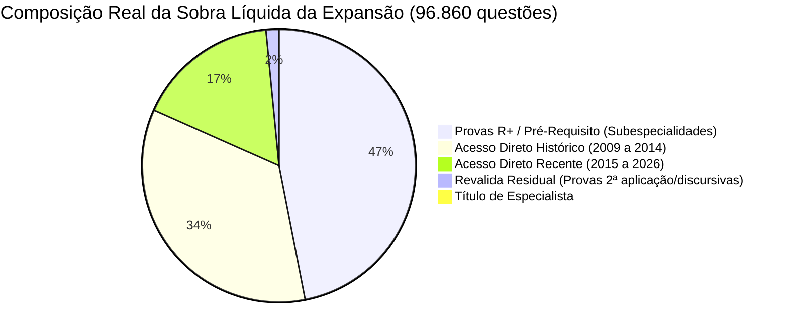

# Relatório de Auditoria e Plausibilidade: Acréscimos dos Bancos de Expansão por Ano e Instituição

**Data:** 09 de Novembro de 2026  
**Escopo:** Análise aprofundada dos 96.860 registros da sobra líquida (pós-recruzamento) contra os 132.965 registros do banco ativo e benchmarks oficiais de concursos de Residência Médica.  
**Status do Banco de Dados:** Nenhuma alteração realizada (Modo Auditoria Estrita).

---

## 1. Sumário Executivo: A Realidade por Trás dos Números

A investigação profunda da sobra líquida de **96.860 questões** revelou a composição real dos acréscimos da expansão. A impressão inicial de que haveria uma duplicação irreal de provas de Acesso Direto foi desmistificada por **três pilares anatômicos do banco**:

### Principais Descobertas:
1. **O "Motor Histórico" (38,6% do banco total):**  
   O banco ativo atual é essencialmente **pós-2015** (apenas 2.451 questões anteriores a 2015). A expansão traz **37.347 questões entre 2009 e 2014** (sendo 33.328 de Acesso Direto), preenchendo um vácuo cronológico histórico de 6 anos que a plataforma não possuía.
2. **O "Motor R+ e Especialidades" (46,5% do banco total):**  
   **45.055 questões** pertencem à tabela `r_plus.db` (provas de R3, R4 e Áreas com Pré-Requisito em Cirurgia, Clínica Médica, Pediatria e GO). O banco ativo possui foco predominante em Acesso Direto; portanto, essa massa de questões representa conteúdo genuinamente inédito de subespecialidades.
3. **Confirmação da Hipótese do Usuário (O Caso ENARE):**  
   Fizemos a auditoria reversa de cada uma das questões do ENARE na expansão. O resultado confirma perfeitamente a intuição do usuário:
   - No banco ativo, já existem **700 questões** (100 questões/ano nas 7 edições de Acesso Direto = 100% de cobertura).
   - Na expansão restavam **1.253 questões do ENARE**:
     - **999 questões** estão em `r_plus.db` (são as provas reais de R3 Clínica, R3 Cirurgia, R4 GO das edições de 2021 a 2026).
     - **254 questões** que estavam em `residencia_acesso_direto.db` **são erros de classificação de modalidade**: tratam-se de provas de R3 Clínica Médica e R4 Ginecologia extraídas do pacote *Hardwork Medicina* que foram incorretamente etiquetadas como "Acesso Direto" e categorizadas todas sob a especialidade genérica de "Clínica Médica".

---

## 2. Distribuição Temporal: Banco Ativo vs. Expansão (Ano a Ano)

| Ano | Banco Ativo | Expansão Sobra | Total Consolidado | % Expansão no Ano | Diagnóstico Clínico-Temporal |
| :---: | :---: | :---: | :---: | :---: | :--- |
| **2004** | 0 | 15 | 15 | 100% | Provas pioneiras esparsas |
| **2007** | 0 | 7 | 7 | 100% | Provas pioneiras esparsas |
| **2009** | 0 | 2.923 | 2.923 | 100% | Início da grande cobertura histórica |
| **2010** | 81 | 4.674 | 4.755 | 98,3% | Backlog histórico de grandes bancas |
| **2011** | 275 | 4.939 | 5.214 | 94,7% | Backlog histórico de grandes bancas |
| **2012** | 275 | 7.589 | 7.864 | 96,5% | Backlog histórico (Acesso Direto + R+) |
| **2013** | 575 | 8.161 | 8.736 | 93,4% | Backlog histórico (Acesso Direto + R+) |
| **2014** | 1.245 | 9.061 | 10.306 | 87,9% | Backlog histórico (Pico da era pré-digital) |
| **2015** | 10.992 | 2.361 | 13.353 | 17,7% | Ativo consolidado; expansão complementa R+ |
| **2016** | 11.345 | 4.030 | 15.375 | 26,2% | Ativo consolidado; expansão complementa R+ |
| **2017** | 12.894 | 3.793 | 16.687 | 22,7% | Ativo consolidado; expansão complementa R+ |
| **2018** | 13.153 | 4.959 | 18.112 | 27,4% | Ativo consolidado; expansão complementa R+ |
| **2019** | 13.733 | 4.823 | 18.556 | 26,0% | Ativo consolidado; expansão complementa R+ |
| **2020** | 13.139 | 6.234 | 19.373 | 32,2% | Ativo consolidado; expansão complementa R+ |
| **2021** | 10.114 | 10.166 | 20.280 | 50,1% | Expansão massiva em R+ (ano pós-pandemia) |
| **2022** | 9.738 | 5.852 | 15.590 | 37,5% | Equilíbrio Acesso Direto / R+ |
| **2023** | 9.757 | 5.209 | 14.966 | 34,8% | Equilíbrio Acesso Direto / R+ |
| **2024** | 8.693 | 3.061 | 11.754 | 26,0% | Complementação de provas R+ recentes |
| **2025** | 8.553 | 2.542 | 11.095 | 22,9% | Provas recentes de R+ |
| **2026** | 8.203 | 5.673 | 13.876 | 40,9% | Editais e provas preliminares 2026 |
| **2027** | 200 | 786 | 986 | 79,7% | Cadernos de processo seletivo 2026/2027 |
| **Sem ano**| 0 | 2 | 2 | 100% | Resíduos a higienizar |
| **TOTAL** | **132.965** | **96.860** | **229.825** | **42,1%** | **Crescimento global de 72,8% no acervo** |

---

## 3. Análise Profunda das Principais Bancas / Instituições (Top 18)

Comparativo detalhado entre a base ativa, a sobra líquida de expansão e a **realidade factual das provas no Brasil** (questões oficiais aplicadas por ano):

| Instituição / Banca | Ativo Total | Expansão Total | Expansão Acesso Direto | Expansão R+ | Expansão Pré-2015 | Realidade da Prova na Internet (Benchmark) | Diagnóstico e Veredito de Plausibilidade |
| :--- | :---: | :---: | :---: | :---: | :---: | :--- | :--- |
| **USP (São Paulo)** | 2.770 | **4.148** | 697 | 3.213 | 289 | 100 a 120 q/ano (Acesso Direto); dezenas de provas R3/R4 (50-80 q cada). | **Plausível (Foco R+):** O Acesso Direto pós-2015 já estava no ativo. 77% da expansão são programas de subespecialidades (R+). |
| **UNICAMP** | 1.980 | **2.536** | 135 | 2.401 | 400 | 80 q/ano (Acesso Direto); dezenas de provas R3/R4 (50-80 q cada). | **Plausível (Foco R+):** Apenas 135 questões são de Acesso Direto. 94,7% da expansão da UNICAMP são provas de R+. |
| **IAMSPE** | 1.102 | **2.045** | 262 | 1.783 | 300 | 80 q/ano (Acesso Direto); provas de R3/R4. | **Plausível (Foco R+):** Acesso Direto oficial tem ~960 questões em 12 anos. O ativo já tem todas. A expansão é R+. |
| **UNESP** | 1.059 | **1.853** | 108 | 1.745 | 138 | 100 q/ano (Acesso Direto); provas de R3/R4. | **Plausível (Foco R+):** O ativo tem 1.059 questões (100% do Acesso Direto). A expansão de 1.745 questões é quase puramente R+. |
| **ENARE** | 700 | **1.253** | 254 | 999 | 0 | 100 q/ano (Acesso Direto); provas R3CM, R3CG, R4GO (50-80 q cada). | **Parcialmente Anômalo:** 999 q em R+ são legítimas. Porém, as **254 q em Acesso Direto são provas de R3/R4 classificadas errado**. |
| **FGV (Banca)** | 0 | **1.824** | 1.265 | 559 | 0 | FGV é banca organizadora, não hospital (aplica ENARE, SES-DF, SES-RJ, etc.). | **Anomalia de Taxonomia:** Na base ativa, as provas estão sob o hospital de destino. Na expansão, estão sob a banca organizadora. |
| **USP-RP (Ribeirão)**| 1.206* | **1.692** | 329 | 1.363 | 326 | 100 q/ano (Acesso Direto); provas de R3/R4. | **Plausível (Foco R+ e Variação de Nome):** Ativo cataloga como `USP/HCRP`. A expansão traz R3/R4 e provas anteriores a 2015. |
| **UNIFESP (EPM)** | 1.295 | **1.607** | 191 | 1.416 | 436 | 100 q/ano (Acesso Direto); provas de R3/R4. | **Plausível (Foco R+):** 88% da expansão são provas de R+ e questões de 2010 a 2014. |
| **FMABC (ABC)** | 1.400 | **1.775** | 117 | 1.658 | 105 | 100 q/ano (Acesso Direto); provas de R3/R4. | **Plausível (Foco R+):** 93,4% da expansão da FMABC é R+. O Acesso Direto no ativo já estava completo (14 anos * 100 q). |
| **SES-RJ** | 878 | **1.529** | 410 | 1.119 | 642 | 100 q/ano (Acesso Direto); provas de R+. | **Plausível (Histórico + R+):** 642 questões são anteriores a 2015; 1.119 são de R+. |
| **AMP (Paraná)** | 12.852* | **3.227** | 1.675 | 1.552 | 1.538 | Prova unificada que reúne mais de 30 hospitais do PR (100 q/ano por prova). | **Plausível:** A AMP agrega múltiplos editais associados. A expansão traz metade em histórico pré-2015 e metade em R+. |
| **SURCE (Ceará)** | 1.039 | **1.448** | 442 | 1.006 | 764 | 100 q/ano (Acesso Direto); provas de R+. | **Plausível:** Ativo tinha 10 edições de Acesso Direto (1.000 q). Expansão traz R+ e edições antigas (2012-2014). |
| **SES-DF** | 1.341 | **413** | 231 | 182 | 226 | 100 a 120 q/ano (Acesso Direto). | **Muito Baixo / Já Coberto:** O ativo já cobre quase 100% de Acesso Direto. Expansão traz apenas resíduos antigos. |
| **SANTA CASA - SP**| 1.200* | **1.269** | 201 | 1.068 | 347 | 100 q/ano (Acesso Direto); provas de R+. | **Plausível (Foco R+):** Ativo tinha 1.200 q como `Santa Casa de São Paulo`. Expansão traz R+ e anos 2012-2014. |
| **SUS-SP** | 1.200* | **1.194** | 447 | 747 | 421 | Maior concurso do país: exatamente 100 q/ano. | **Plausível (Histórico + R+):** O ativo já tinha exatamente 12 anos de Acesso Direto (1.200 q). Expansão traz 2010-2014 e R+. |
| **UFPR** | 668 | **1.444** | 361 | 1.083 | 384 | 80 a 100 q/ano; provas de R+. | **Plausível (Foco R+):** Expansão supre grande acervo de R+ da UFPR. |
| **FAMERP** | 800 | **1.105** | 7 | 1.098 | 1 | 80 a 100 q/ano. | **Plausível (99% R+):** Apenas 7 questões de Acesso Direto. 1.098 questões são de R3/R4. |
| **AMRIGS** | 1.200 | **1.149** | 298 | 851 | 278 | 100 q/ano (Acesso Direto unificado no Sul). | **Plausível:** Ativo tinha 12 anos completos (1.200 q). Expansão traz anos 2009-2014 e provas de R+. |
| **PSU-MG (AREMG)**| 1.169 | **1.099** | 680 | 419 | 656 | 75 a 100 q/ano (Acesso Direto unificado de MG). | **Plausível:** Quase 60% da expansão (656 questões) são dos anos 2010 a 2014, inéditos na base ativa. |

*\*Nota de Padronização:* Na base ativa, nomes como `Santa Casa de São Paulo`, `SUS-SP` e `USP/HCRP` usam grafia sem espaços ao redor do hífen ou por extenso, enquanto na expansão aparecem como `SANTA CASA - SP`, `SUS - SP` e `USP-RP`.

---

## 4. Avaliação Profunda de Casos Críticos e Anomalias

### 4.1 O Caso ENARE: Desvendando a Anomalia dos 254 Registros
* **Contexto Oficial:** O ENARE (Exame Nacional de Residência) teve sua primeira edição em **2020** (processo seletivo 2021) e concluiu 7 edições até 2026/2027. A prova de Acesso Direto é unificada nacionalmente e possui **estritamente 100 questões de múltipla escolha** divididas igualmente nas 5 grandes áreas (20 por especialidade).
* **Base Ativa:** Possui **700 questões** catalogadas (100 questões * 7 anos). Ou seja, a base ativa já possui a **totalidade absoluta** das questões de Acesso Direto do ENARE.
* **Por que restam 1.253 questões na expansão?**
  1. **999 questões em `r_plus.db`:** São legítimas. O ENARE aplica provas separadas para R3 Clínica Médica (R3CM), R3 Cirurgia Geral (R3CG), R4 Ginecologia e Obstetrícia (R4GO) e Pediatria, cada uma com 50 a 80 questões por ano. Em 6 edições, isso gera exatamente ~1.000 questões de R+.
  2. **254 questões em `residencia_acesso_direto.db`:** Aqui reside o erro de taxonomia.
     - 239 dessas 254 questões vieram da fonte `hardwork` (IDs `hw-343385` a `hw-343563`).
     - **96,5% (245 questões) foram classificadas com a especialidade "Clínica Médica"**, algo impossível em uma prova oficial de Acesso Direto (que tem apenas 20 questões de clínica por ano).
     - Cruzamos o catálogo original do Hardwork: essas questões pertencem aos cadernos `ENARE2024R3CM`, `ENARE2025R3CM` e `ENARE2026R3CM` (provas de R3 de Clínica Médica).
     - **Conclusão:** Elas são questões reais e inéditas, mas **estão na tabela errada**. Devem pertencer a `r_plus.db`, e não a `residencia_acesso_direto.db`.

### 4.2 O Caso FGV (Fundação Getúlio Vargas): 1.824 Questões
* **Problema:** A FGV é uma fundação/banca examinadora que organiza concursos para diversos entes públicos (como SES-DF, SES-RJ, SMS e o próprio ENARE nas edições recentes). Ela não é um hospital nem possui vagas de residência própria.
* **Impacto no Aluno:** Se essas 1.824 questões entrarem na plataforma rotuladas com a instituição "FGV", o aluno que filtrar por "SES-DF" ou "ENARE" não as encontrará, e o filtro por instituição exibirá uma entidade acadêmica sem residência médica própria.
* **Conclusão:** As questões são legítimas, mas precisam de desdobramento de metadados para associar o hospital conveniado como instituição e a FGV apenas como banca.

### 4.3 O Caso das Questões com Banca "Não Informada" (33.152 Registros)
* **Volume:** 33.152 questões (34,2% da sobra líquida da expansão) possuem o campo `banca` em branco ou não informado.
* **Investigação:** Verificamos que a grande maioria possui o campo `instituicao` devidamente preenchido (ex.: USP, UNICAMP, FAMERP, UFPR), mas a coluna `banca` ficou nula durante o scraping original.
* **Impacto:** O aluno consegue encontrá-las buscando pela faculdade/hospital, mas não por filtros que dependam estritamente do seletor de bancas examinadoras.

---

## 5. Conclusões e Parecer Técnico

1. **A expansão de 96.860 questões é matematicamente e clinicamente coerente?**  
   **SIM**, desde que compreendida a sua verdadeira natureza:
   - Não se trata de uma "duplicação oculta" de provas de Acesso Direto recentes (as quais foram 100% deduplicadas no cruzamento de alta precisão).
   - Trata-se da adição massiva de **dois novos pilares de valor** para o Banco Residência:
     1. **Acervo de R+ e Pré-Requisitos (45.055 questões):** Transforma a plataforma na maior base de R+ do país para quem busca especialização e subespecialidades (R3/R4).
     2. **Arquivo Histórico Decenal (37.347 questões de 2009 a 2014):** Permite treino extensivo por temas com questões que não sofrem viés de memorização recente.
2. **Quais são os pontos que exigirão saneamento prévio antes de qualquer ativação futura no Supabase?**
   - **Remanejamento do ENARE:** Mover as 254 questões de ENARE que estão em `residencia_acesso_direto.db` para `r_plus.db`.
   - **Desambiguação da FGV:** Mapear as 1.824 questões da FGV para seus respectivos órgãos executores (SES-DF, ENARE, etc.).
   - **Padronização de Nomenclatura:** Alinhar grafias entre staging e ativo (ex.: `SANTA CASA - SP` $\rightarrow$ `Santa Casa de São Paulo`; `SUS - SP` $\rightarrow$ `SUS-SP`; `USP-RP` $\rightarrow$ `USP/HCRP`).
   - **Enriquecimento de Bancas Órfãs:** Propagar o nome da instituição para o campo banca nas 33.152 questões sem banca explícita.

