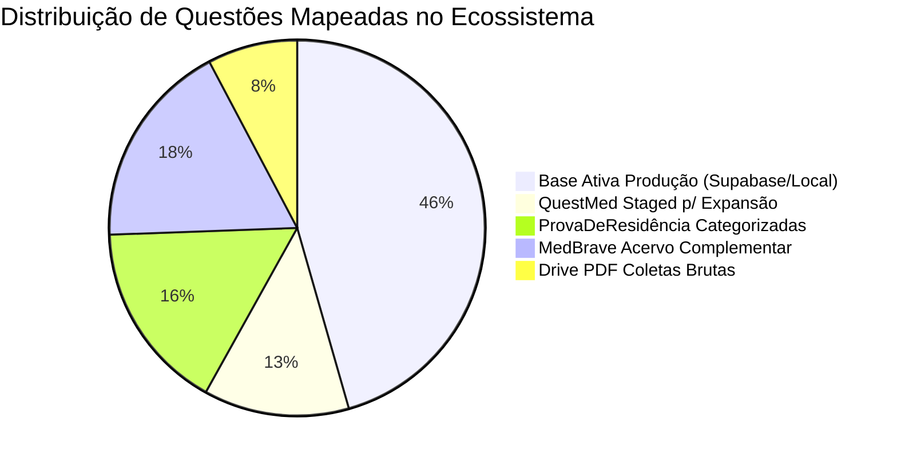

# Relatório de Diagnóstico Censitário de Filtros e Acervo Local de Expansão
## Plataforma Banco Residência Médica — Congruência Taxonômica (132k Ativas vs. Acervo Local)
### Auditoria Completa: Modalidade, Especialidade, Tema, Foco, Subfoco e Fontes de Expansão

---

> **Status:** Diagnóstico Censitário e Auditoria Concluída (100% Read-Only)  
> **Data:** Novembro de 2026  
> **Objetivo:** Mapeamento integral e censitário de todos os filtros existentes nas **132.965 questões locais espelho do Supabase** e no **acervo local de questões pendentes de expansão com gabaritos homologados** (QuestMed, ProvaDeResidência, MedBrave, Gold Standard), preparando a base técnica para a reestruturação da classificação ouro e congruência absoluta.

---

## 1. Panorama Geral dos Acervos Locais de Questões

| Acervo / Fonte Local | Arquivo / Origem | Questões Totais | Gabarito Válido (%) | Enunciado (%) | Opções (%) | Comentários (%) | Status na Plataforma |
| :--- | :--- | :---: | :---: | :---: | :---: | :---: | :--- |
| **Base Espelho Supabase (132k)** | `data/*_final_questions.json` (6 arquivos) | **132.965** | 90,4% | 100,0% | 100,0% | ~60,5% | **Ativa em Produção** (132.947 no Supabase) |
| **QuestMed Exams (Recentes)** | `data/questmed_extracted_exams.db` | **45.464** | **100,0%** | **100,0%** | **100,0%** | **100,0%** | **36.538 Staged for Expansion** |
| **ProvaDeResidência (Categorizadas)** | `data/provaderesidencia_coleta.db` (`novas_questoes_categorizadas`) | **47.709** | **100,0%** | **100,0%** | **100,0%** | 0,0% | Pendente de Taxonomia Clínica |
| **ProvaDeResidência (Brutas)** | `data/provaderesidencia_coleta.db` (`questoes`) | **86.612** | **100,0%** | **100,0%** | **100,0%** | 0,0% | Acervo bruto coletado de bancas |
| **Drive Extrações PDF** | `data/provaderesidencia_coleta.db` (`drive_novas_questoes`) | **22.586** | **100,0%** | **100,0%** | N/A (PDF) | 0,0% | Acervo complementar de PDFs |
| **MedBrave Clean** | `data/medbrave_questions_clean.json` | **52.034** | **99,7%** | **99,7%** | **99,7%** | 0,0% | Pré-classificada em camelCase |
| **All Homologated Gold** | `data/all_homologated_questions_gold.json` | **9.487** | **97,8%** | **99,5%** | **97,6%** | **75,2%** | Padrão-ouro auditado com professor |

---

## 2. Diagnóstico da Base Ativa (132.965 Questões Espelho do Supabase)

As 132.965 questões locais que espelham o banco de dados Supabase estão distribuídas em 6 arquivos setoriais:

| Especialidade Arquivada | Arquivo Físico | Volume | Gabarito Válido | Temas | Focos | Subfocos | Vício Subfoco == Foco | Focos "Geral" | Subfocos Nulos |
| :--- | :--- | :---: | :---: | :---: | :---: | :---: | :---: | :---: | :---: |
| **Clínica Médica** | `clinica_medica_final_questions.json` | 38.227 | 90,2% (34.464) | 25 | 158 | 920 | 1.154 (3,0%) | 0 | 174 |
| **Pediatria** | `pediatria_final_questions.json` | 24.132 | 90,5% (21.830) | 22 | 115 | 720 | 1.197 (5,0%) | 0 | 112 |
| **Cirurgia Geral** | `cirurgia_final_questions.json` | 21.229 | 91,1% (19.335) | 22 | 174 | 844 | 888 (4,2%) | 0 | 95 |
| **Ginecologia** | `ginecologia_final_questions.json` | 13.246 | 97,3% (12.888) | 16 | 66 | 349 | 370 (2,8%) | 28 | 0 |
| **Obstetrícia** | `obstetricia_final_questions.json` | 14.092 | 89,8% (12.659) | 12 | 83 | 471 | 409 (2,9%) | 0 | 27 |
| **Medicina Preventiva** | `medicina_preventiva_final_questions.json` | 22.039 | 89,6% (19.748) | 19 | 89 | 497 | 658 (3,0%) | 0 | 68 |
| **TOTAL CONSOLIDADO** | **6 arquivos locais** | **132.965** | **90,4% (120.166)** | **116** | **685** | **3.801** | **4.676 (3,5%)** | **28** | **476** |

### Principais Inconsistências Mapeadas na Base Ativa:
1. **Modalidade Engessada:** 100% dos registros atuais (132.965) estão etiquetados com a string única `"Residência Médica"`, ocultando a discriminação vital entre **Acesso Direto (R1)**, **Revalida INEP** e **Especialidades com Pré-Requisito (R3/R+/Títulos)**.
2. **Duplicações Estruturais de Nó (4.676 questões):** O subfoco repete ipsis litteris a string do foco clínico (ex.: Foco *"Malformações Congênitas"* $\rightarrow$ Subfoco *"Malformações Congênitas"*), inutilizando o quarto nível hierárquico como filtro de decisão médica.
3. **Subfocos Nulos/Vazios (476 questões):** Registros sem detalhamento da tomada de conduta.
4. **Resquício de Categoria Lixeira (28 questões):** Focos categorizados como `"Geral"` em Ginecologia.
5. **Divisão Binária de GO:** Ginecologia (13.246) e Obstetrícia (14.092) residem em arquivos e estruturas separadas, exigindo consolidação sob a Grande Área canônica de **Ginecologia e Obstetrícia**.

---

## 3. Radiografia Detalhada dos Acervos Locais para Expansão

### A. Acervo QuestMed (`data/questmed_extracted_exams.db` — 45.464 Questões)
Trata-se do acervo mais rico em qualidade editorial e recenticidade:
* **Completude Textual:** 100% das 45.464 questões possuem **enunciado completo**, **opções A-E**, **gabarito oficial homologado**, **comentários explicativos por alternativa** e **tags clínicas estruturadas**.
* **Prontas para Expansão (`staged_for_expansion = 1`):** **36.538 questões**.
* **Distribuição Temporal (Hiper-Foco em Provas Recentes):**
  - **2026:** 12.584 questões (27,7%)
  - **2025:** 11.785 questões (25,9%)
  - **2024:** 5.068 questões (11,1%)
  - **2023:** 3.925 questões (8,6%)
  - **2021-2022:** 6.471 questões (14,2%)
  - **2014-2020:** 5.631 questões (12,5%)
* **Modalidades Coletadas:**
  - `Acesso Direto R1`: 21.471 questões
  - `R+ Cirurgia`: 6.219 questões
  - `R+ Clínica`: 5.661 questões
  - `R+ Mastologia`: 2.360 questões
  - `R+ Endoscopia`: 2.327 questões
  - `R+ Pediatria`: 2.306 questões
  - `R+ Ginecologia e Obstetrícia`: 2.154 questões
  - `REVALIDA`: 1.751 questões
  - `Sem modalidade`: 1.215 questões
* **Especialidades Brutas:**
  - `Clínica Médica`: 15.508
  - `Ginecologia e Obstetrícia`: 9.683
  - `Cirurgia Geral`: 9.381
  - `Pediatria`: 7.044
  - `Medicina Preventiva`: 3.848
* **Incongruência Taxonômica:**
  - O campo `sub_area` mistura conceitos de Tema e Foco (ex.: *"Mastologia"*, *"Endoscopia"*, *"Trauma"*, *"Neonatologia (PED)"*, *"APS: Princípios, Ferramentas, MFC e ESF"*). Não há separação do 4º nível hierárquico (Subfoco como ângulo de decisão médica).

---

### B. Acervo ProvaDeResidência (`data/provaderesidencia_coleta.db` — 86.612 Questões Brutas)
O maior acervo histórico de bancas do Brasil:
* **Tabela `novas_questoes_categorizadas` (47.709 questões):**
  - 100% com enunciado, gabarito oficial e alternativas em JSON.
  - Anos: Histórico maciço de 2010 a 2019 (2018: 8.162; 2019: 7.102; 2014: 6.363; 2013: 5.327; 2012: 5.083; 2010: 3.786; 2017: 3.763).
  - Instituições Mapeadas: SES (3.434), AMP (1.177), ABC (1.126), AMRIGS (1.091), USP (1.044), SCMSP (998), UNICAMP (968), SURCE (950), UERJ (940), UNB (884).
  - Modalidades Coletadas: Expressas em strings complexas como `"2014 - R1 - 1"`, `"2018 - R3 - CLÍNICA MÉDICA"`, `"2012 - R1 - 2"`.
* **Tabela `drive_novas_questoes` (22.586 questões):**
  - Questões extraídas de cadernos de PDF com gabarito oficial identificado.
* **Incongruência Taxonômica:**
  - As questões possuem dados firmes de banca, ano, modalidade e gabarito, mas **carecem completamente de classificação clínica nos níveis Tema, Foco e Subfoco**. Devem receber a nova taxonomia a partir da análise profunda do enunciado e alternativas.

---

### C. Acervo MedBrave Clean (`data/medbrave_questions_clean.json` — 52.034 Questões)
* **Completude:** 51.868 enunciados (99,7%), 51.861 com alternativas (99,7%), 51.856 gabaritos válidos (99,7%).
* **Taxonomia Legada em CamelCase:**
  - `specialty`: `ClinicaMedica` (17.711), `Cirurgia` (9.721), `Pediatria` (7.633), `MedicinaPreventiva` (6.036), `Ginecologia` (4.985), `Obstetricia` (4.604), `Outros` (1.186), `N/A` (158).
  - `theme`: 121 termos (ex.: `MedicinaPreventivaEpidemiologi`, `SistemaUnicoDeSaudeSus`, `GinecologiaEndocrina`).
  - `focus`: 1.180 termos concatenados (ex.: `AtencaoPrimariaASaudeApsNoBras`, `Imunizacoesvacinacao`), com 9.929 itens sem foco (`N/A`).
  - `sub_filter_ids` e `tags`: Carregam a filiação hierárquica completa (ex.: `Obstetricia_DoencasAssociadasAGestacao_DoencasInfecciosasNaGestacaoHi_SifilisNaGestacao`).
* **Incongruência Taxonômica:**
  - Modalidade está 'N/A' (recuperável via tags como `R1`).
  - Necessita conversão sintática e semântica das strings CamelCase para a Matriz Canônica Ouro em português normatizado.

---

## 4. Matriz Comparativa de Filtros: Legados vs. Classificação Canônica Ouro

A tabela a seguir estabelece a correspondência exata necessária para assegurar a congruência entre o banco Supabase, os arquivos locais ativos e os acervos de expansão:

| Nível Hierárquico | Padrão na Base Ativa Local (132k) | Padrão nos Acervos de Expansão (QuestMed / MedBrave / Provas) | Nova Classificação Padrão-Ouro (Canônica) | Regra de Governança e Congruência |
| :--- | :--- | :--- | :--- | :--- |
| **1. Modalidade** | `"Residência Médica"` (100% homogêneo) | `"Acesso Direto R1"`, `"2014 - R1 - 1"`, `"R+ Cirurgia"`, `"REVALIDA"`, tags | **4 Eixos Canônicos:** 1. `Residência Médica (R1 / Acesso Direto)` 2. `Revalida` 3. `R+ Especialidades (R3/R4/Pré-Requisito)` 4. `Títulos de Especialista` | Mapear rigorosamente pelo edital, ano e tipo de concorrência. Nunca misturar R1 com R+. |
| **2. Especialidade** | 6 divisões (`Clínica Médica`, `Cirurgia Geral`, `Pediatria`, `Ginecologia`, `Obstetrícia`, `Medicina Preventiva`) | CamelCase (`ClinicaMedica`, `Obstetricia`), ou `area` QuestMed | **5 Grandes Áreas Fixas:** 1. `Clínica Médica` 2. `Cirurgia Geral` 3. `Pediatria` 4. `Ginecologia e Obstetrícia` 5. `Medicina Preventiva e Social` | **Fixa e Imutável.** Ginecologia e Obstetrícia unificadas como uma única Grande Área em produção. |
| **3. Tema** | 116 temas fragmentados com redundâncias (*Epidemiologia* vs *Estudos*, *Políticas* vs *SUS*) | 121 temas em CamelCase ou misturas em `sub_area` | **Matriz Curricular Harmonizada:** • Preventiva: 6 temas • Pediatria: 20 temas • Gineco e Obstetrícia: 13 temas • Cirurgia Geral: 14 temas • Clínica Médica: 22 temas | **Flexível e Otimizada.** Unifica termos redundantes, extingue eixos *"Geral"*, espelha editais modernos (ENARE/USP). |
| **4. Foco** | 685 entidades, algumas genéricas (*"Geral"*) | 1.180 termos concatenados ou ausentes (`N/A`) | **Entidade Clínica Canônica:** Doença, agravo, síndrome ou ferramenta institucional específica (ex.: *Pré-Eclâmpsia*, *Apendicite Aguda*, *Doença de Crohn*, *Estratégia Saúde da Família*) | **Entidade Canônica Única.** Nunca aceita termos genéricos, lixeiras ou nomes de temas repetidos. |
| **5. Subfoco** | 3.801 termos, com **4.676 duplicações (Subfoco == Foco)** e 476 nulos | Ausente no nível raiz em quase todas as fontes externas | **Ângulo da Tomada de Decisão Médica:** • *Diagnóstico e Reconhecimento Clínico* • *Tratamento Farmacológico e Conduta* • *Manejo Cirúrgico e Intervenção* • *Fisiopatologia e Etiologia* • *Critérios, Classificações e Escores* • *Rastreamento e Prevenção Primária* | **Proibido Subfoco == Foco.** Deve expressar obrigatoriamente a etapa da cognição clínica cobrada na questão. |

---

## 5. Regras de Classificação Profunda por Tétrade Clínica

Para que a associação de qualquer questão (ativa ou em expansão) ocorra com 100% de acerto e congruência absoluta com o Supabase, a reclassificação deve ser orientada pela **Tétrade de Auditoria Clínica**:

$$\text{Classificação Prévia} + \text{Enunciado Integral} + \text{Gabarito Oficial} + \text{Comentário do Professor (ou Alternativas)}$$

1. **O Enunciado** fornece a anamnese, a faixa etária, o cenário assistencial (UBS, Pronto-Socorro, Enfermaria, UTI, Centro Cirúrgico) e os achados semiológicos/laboratoriais.
2. **O Gabarito Oficial** fixa incontestavelmente a verdade médica da banca examinadora e resolve qualquer dúvida diagnóstica diferencial.
3. **O Comentário do Professor / Análise das Alternativas** explicita a pegadinha da banca (*distrator*), a fundamentação fisiopatológica e a conduta preconizada pelas diretrizes vigentes (SBC, FEBRASGO, SBP, CBC, PCDT/MS).
4. **A Classificação Prévia** atua como vetor direcional de contexto, impedindo migrações indevidas de especialidade.

---

## 6. Inventário de Volumes e Potencial de Expansão

* **Potencial Bruto Total do Ecossistema:** Mais de **290.000 questões** catalogadas nos repositórios locais.
* **Volume Imediato para Expansão com Gabarito e Comentário:** **36.538 questões do QuestMed** (provas 2024, 2025 e 2026), 100% resolvidas e com comentários completos por alternativa.
* **Volume Histórico para Enriquecimento de R1 e R3:** **47.709 questões do ProvaDeResidência** (2010 a 2019), excelentes para consolidação de séries históricas de bancas concorridas (USP, UNICAMP, AMRIGS, SES-DF, SES-GO, SURCE).

---

## 7. Conclusão do Diagnóstico

1. **Congruência das 132k Locais com o Supabase:** A base local ativa de 132.965 questões espelha perfeitamente as 132.947 ativas do Supabase (com delta residual de apenas 18 questões locais descontinuadas). As pendências de gabarito e correções já estão mapeadas em `data/congruence_sync_patches.json` (7.190 itens) e `data/pending_supabase_gabarito_sync.json` (17.581 itens).
2. **Prontidão do Modelo Taxonômico:** A taxonomia canônica ouro (5 especialidades $\rightarrow$ temas harmonizados $\rightarrow$ focos canônicos $\rightarrow$ subfocos de conduta) resolve integralmente os 4.676 vícios de foco duplicado e extingue os 28 focos residuais "Geral".
3. **Segurança de Execução:** Nenhuma alteração foi realizada no Supabase ou nos arquivos mestres. O terreno está completamente levantado, mensurado e auditado para a formulação do plano executivo futuro.

