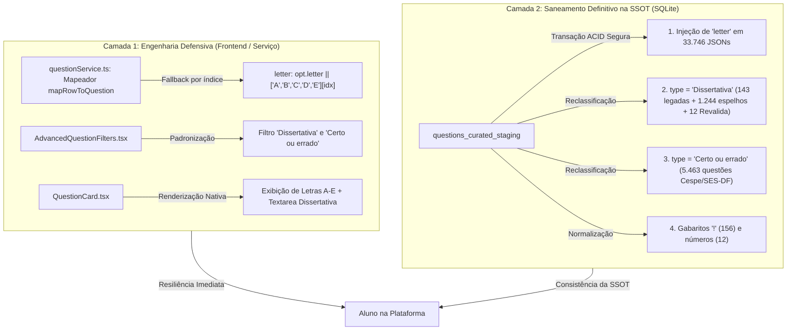

# Plano Estruturado: Solução Imediata no Frontend/Serviço & Saneamento Definitivo na SSOT

> **Documento de Engenharia & Governança de Dados**  
> **Base Alvo (SSOT):** [`data/supabase_tables/supabase_tables.db`](file:///d:/bancoresidencia/data/supabase_tables/supabase_tables.db) &rarr; Tabela `questions_curated_staging` (254.192 questões)  
> **Status:** Proposta de Execução Estruturada (Aguardando Aprovação do Usuário)  
> **Premissa Inegociável:** As colunas `especialidade`, `tema`, `foco` e `subfoco` **não serão modificadas**.

---

## 🎯 1. Objetivos do Plano

1. **Desbloqueio Imediato das 33.746 Questões com Alternativas sem Letras:**
   - Eliminar a falha visual das alternativas (círculos vazios/escuros) e restaurar instantaneamente a capacidade do aluno de clicar, selecionar ('A' a 'E') e submeter a resolução.
   - Saneamento definitivo no banco de dados injetando deterministicamente `"letter": "A"|"B"|"C"|"D"|"E"` em todas as 33.746 opções.
2. **Padronização Canônica do Formato `Dissertativa`:**
   - Unificar a terminologia entre Banco, Tipagem TypeScript e Filtros de Interface para **`Dissertativa`** (eliminando a discrepância que gerava 0 resultados ao filtrar por discursivas).
   - Reclassificar as **1.244 questões discursivas** que foram erroneamente inseridas como múltipla escolha com 1 única assertiva contendo o espelho de resposta.
   - Corrigir as questões dissertativas que continham número de caderno no gabarito (`37`, `38`, `39`).
3. **Reclassificação das 5.463 Questões de Certo/Errado:**
   - Reclassificar as questões de 2 alternativas (Cespe/Cebraspe, UnB, SES-DF) de `'Múltipla escolha'` para `'Certo ou errado'`, habilitando o filtro correspondente.
4. **Resolução de Anomalias Críticas de Gabarito:**
   - Normalizar os 156 gabaritos com caractere de sentinela `'!'`.

---

## 🗺️ 2. Arquitetura da Solução em 2 Camadas



---

## 📋 3. Fases Detalhadas de Execução

### 🔹 Fase 1: Solução Imediata de Engenharia no Frontend e Serviços

Esta etapa confere resiliência imediata à aplicação. Qualquer dado consumido pelo aluno passa a ter tratamento defensivo sem risco de regressão.

#### 1.1. Tratamento Defensivo no Mapeador de Questões ([`src/services/questionService.ts`](file:///d:/bancoresidencia/src/services/questionService.ts#L224-L226))
- **Problema:** O código atual faz `opt.letter`, que retorna `undefined` nas 33.746 questões.
- **Implementação:**
  ```typescript
  // Linhas 224-226:
  const LETTERS = ['A', 'B', 'C', 'D', 'E'] as const;
  const cleanOptions = Array.isArray(row.options)
    ? row.options.map((opt, idx) => ({
        letter: (opt.letter && typeof opt.letter === 'string' && opt.letter.trim().length === 1
          ? opt.letter.toUpperCase()
          : (LETTERS[idx] || 'A')) as 'A' | 'B' | 'C' | 'D' | 'E',
        text: opt.text || ''
      }))
    : [];
  ```
- **Resultado:** Desbloqueio imediato no frontend. Mesmo que uma questão no banco ainda não tenha a chave `letter`, ela recebe a letra correta baseada na posição ordinal ('A', 'B', 'C', 'D', 'E'), permitindo a renderização do badge e o clique de seleção.

#### 1.2. Alinhamento da Tipagem Canônica ([`src/types/index.ts`](file:///d:/bancoresidencia/src/types/index.ts#L23))
- **Ajuste de Tipos:**
  ```typescript
  // Linha 23:
  export type QuestionType = 'Todas' | 'Múltipla escolha' | 'Dissertativa' | 'Certo ou errado';
  ```
- Compatibilidade retroativa garantida com suporte a string `'Discursiva'` em rotas de busca legadas mapeando internamente para `'Dissertativa'`.

#### 1.3. Atualização dos Filtros de Formato ([`src/components/AdvancedQuestionFilters.tsx`](file:///d:/bancoresidencia/src/components/AdvancedQuestionFilters.tsx#L2050-L2055))
- **Ajuste da Interface:**
  Substituir a lista de botões de formato para:
  ```typescript
  [
    { label: 'Todas', val: 'Todas' },
    { label: 'Múltipla', val: 'Múltipla escolha' },
    { label: 'Dissertativa', val: 'Dissertativa' },
    { label: 'Certo/Errado', val: 'Certo ou errado' }
  ]
  ```
- Atualizar a montagem de queries em [`src/services/questionService.ts`](file:///d:/bancoresidencia/src/services/questionService.ts#L747) para que ao filtrar por `Dissertativa`, a query busque `type.in.('Dissertativa','Discursiva')`.

#### 1.4. Blindagem do Componente de Exibição ([`src/components/QuestionCard.tsx`](file:///d:/bancoresidencia/src/components/QuestionCard.tsx#L1718-L1762))
- Adicionar no render de cada opção um fallback local:
  ```typescript
  const safeLetter = option.letter || ['A', 'B', 'C', 'D', 'E'][idx] || 'A';
  ```
- Garantir que a renderização de `/* Questão Dissertativa */` seja ativada sempre que `activeQuestion.type === 'Dissertativa'` ou quando não houver alternativas de múltipla escolha.

---

### 🔹 Fase 2: Saneamento Definitivo na SSOT (`questions_curated_staging`)

Criação e execução de um script determinístico em Python ([`scripts/sanitize_ssot_options_and_types.py`](file:///d:/bancoresidencia/scripts/sanitize_ssot_options_and_types.py)) com transação ACID, backup automático prévio e log censitário item a item.

#### 2.1. Ação A: Injeção da Chave `"letter"` nas 33.746 Questões
- **Regra:** Para cada registro cujo JSON de `options` for uma lista de objetos sem o atributo `"letter"`, iterar pelos elementos mantendo todas as propriedades existentes (`id`, `text`, `index`) e injetando:
  - Elemento 0 &rarr; `"letter": "A"`
  - Elemento 1 &rarr; `"letter": "B"`
  - Elemento 2 &rarr; `"letter": "C"`
  - Elemento 3 &rarr; `"letter": "D"`
  - Elemento 4 &rarr; `"letter": "E"`
- **Verificação pós-execução:** Quantidade de `LIST_OF_DICTS_NO_LETTER` deve ser exatamente **0**.

#### 2.2. Ação B: Padronização Canônica de `type = 'Dissertativa'`
- **Grupo 1 (143 questões já com `Dissertativa`):** Preservadas como `'Dissertativa'`.
- **Grupo 2 (1.244 questões com 1 única alternativa contendo espelho):**
  - Mover o texto de `options[0].text` (ex: "GABARITO: O RN é prematuro...") para o campo `commentary` (caso não esteja duplicado).
  - Atualizar `options = '[]'`.
  - Atualizar `type = 'Dissertativa'`.
  - Atualizar `correct_answer = 'DISSERTATIVA'`.
- **Grupo 3 (12 questões do Revalida com número de questão no gabarito):**
  - Questões com enunciado começando com `QUESTÃO DISCURSIVA` e gabaritos numéricos (`'37'`, `'38'`, `'39'`, etc.).
  - Atualizar `type = 'Dissertativa'`, `options = '[]'` e `correct_answer = 'DISSERTATIVA'`.

#### 2.3. Ação C: Reclassificação das 5.463 Questões de Certo/Errado
- **Critério:** Questões com exatamente 2 alternativas cujos textos correspondam a `"Certo."` / `"Errado."` (ou equivalentes) das bancas CESPE/UnB, SES-DF, HFA, HSL.
- **Atualização:**
  - `type = 'Certo ou errado'`.
  - Garantir que a primeira alternativa tenha `letter: "A"` (Certo) e a segunda `letter: "B"` (Errado).

#### 2.4. Ação D: Normalização de Anomalias de Gabarito
- **156 questões com `correct_answer = '!'`**:
  - Analisar as 156 questões: 155 estão sem alternativas (`options = '[]'`).
  - Marcar como `is_anulada = 1` e `correct_answer = 'ANULADA'`, documentando em `curation_notes`.

#### 2.5. Cláusula de Preservação Taxonômica
- O script não conterá nenhuma cláusula `UPDATE` ou atribuição sobre as colunas:
  - `especialidade`
  - `tema`
  - `foco`
  - `subfoco`
- Uma checagem de integridade (checksum) dessas 4 colunas será executada antes e depois do script para comprovar que nenhuma vírgula foi alterada nelas.

---

## 🧪 4. Quality Gates & Critérios de Aceitação

Para considerar a execução homologada:

1. **Gate 1 — Integridade de Alternativas:**
   - Consulta `SELECT count(*) FROM questions_curated_staging WHERE options LIKE '%"index":%' AND options NOT LIKE '%"letter":%'` deve retornar **0**.
2. **Gate 2 — Integridade de Tipos:**
   - Nenhuma questão dissertativa com espelho discursivo classificada como `'Múltipla escolha'`.
   - Exatamente **5.463 questões** de Cespe/SES-DF classificadas como `'Certo ou errado'`.
   - Todas as discursivas/dissertativas com `type = 'Dissertativa'`.
3. **Gate 3 — Não-Regressão de Código:**
   - Execução bem-sucedida de `npm run test` e verificação estrita de TypeScript (`npx tsc --noEmit`).
4. **Gate 4 — Validação de Interface:**
   - Abertura de uma das questões anteriormente quebradas (ex: `EXP-DIR-197508`, a mesma do print do usuário) confirmando:
     - As letras A, B, C, D e E aparecem perfeitamente dentro dos badges circulares.
     - O clique de seleção funciona e destaca a alternativa com o acento cromático do aluno.
     - A submissão da resposta processa normalmente com feedback imediato.

---

## 🔒 5. Segurança e Rastreabilidade

- **Backup Pré-Execução:** Cópia de segurança física da tabela [`data/supabase_tables/supabase_tables.db`](file:///d:/bancoresidencia/data/supabase_tables/supabase_tables.db) para `data/supabase_tables/supabase_tables.backup_pre_filter_sanitization.db`.
- **Modo Transacional:** Todas as alterações na SSOT rodam sob `BEGIN TRANSACTION` e só executam `COMMIT` se 100% das asserções de qualidade passarem.
- **Rastreabilidade:** Gravação na coluna `curation_notes` das questões alteradas (ex: `"Saneamento: Injeção de letter em options e normalização de type"`).
